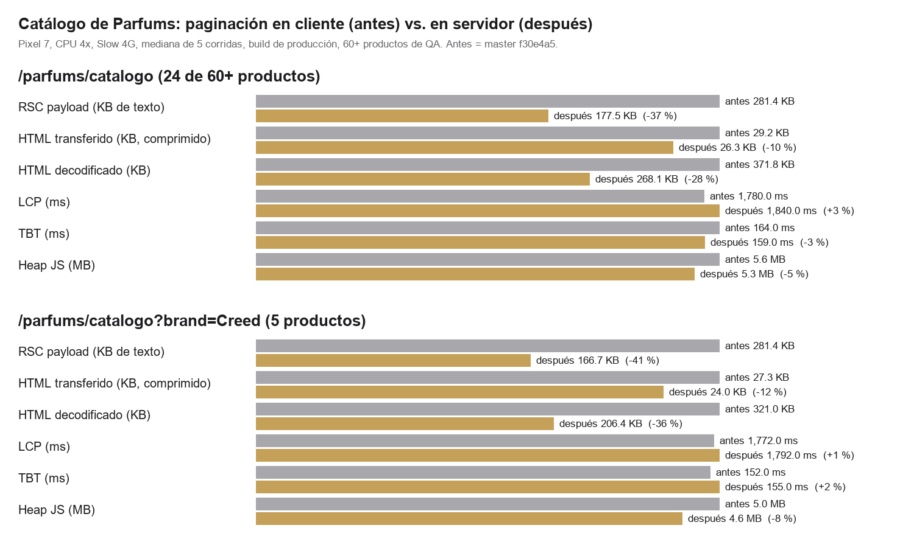

# Catálogo de Parfums con paginación en el servidor (T12, primera mitad) — 2026-10-14

Rama `perf/catalog-server-pagination` (con PR, sin merge). Reemplaza la paginación provisional del lote 3
(`docs/redesign-batch-3.md` §3), que dibujaba 24 tarjetas pero **enviaba todos los productos** al navegador.

## 1. Qué cambió

| Antes (lote 3) | Ahora |
|---|---|
| La página recibía **todos** los productos como prop del cliente; filtro, orden, búsqueda y paginación corrían en el navegador. | El **estado vive en la URL** (`searchParams`: `type`, `gender`, `family`, `brand`, `sort`, `search`, `vista`). El servidor lee la URL, filtra, ordena y pagina, y envía **solo la vista pedida**: 24 tarjetas más las facetas pequeñas (marcas y tamaño de cada tipo). |
| Controles con `useState` + `history.replaceState`. | Componente cliente con `useRouter().replace()` (sin `scroll`), dentro de `useTransition`; chips y categorías responden al instante (`useOptimistic`) mientras llega la vista nueva; el grid viejo queda atenuado (`aria-busy`) en vez de parpadear en blanco. |
| «Vista n» eran botones. | «Vista n» son **enlaces** (`<a href="?vista=2">`): funcionan sin JavaScript, se pueden abrir en otra pestaña y los rastrea un buscador. |
| Cada tarjeta recibía el producto completo (descripción, notas, todas las fotos, precios de frasco…). | Cada tarjeta recibe una **proyección** (`CatalogCardProduct`: lo que la tarjeta lee y nada más). |
| La recomendación del Finder se calculaba en el cliente con el catálogo completo. | Se calcula **en el servidor** con las mismas reglas (`findPerfumes`) y al navegador llegan solo los 4 productos que muestra. |

Piezas: `domains/catalog/catalog-query.ts` (`parseCatalogQuery`, `catalogQueryToParams`, `catalogFacets`, `paginateCatalog`, puras y
con pruebas), `domains/catalog/card-product.ts`, `lib/catalog/parfums-catalog-page.ts` (`loadCatalogPage`),
`app/parfums/catalogo/page.tsx` (Server Component) y `components/parfums/catalog/catalog-experience.tsx` (cliente).

**Compatibilidad:** un `?vista=` fuera de rango se recorta a la última vista; valores desconocidos (orden, página, textos largos)
vuelven al valor por defecto; los parámetros retirados `format` y `price` se ignoran; la entrega del Finder al catálogo conserva ahora
también el filtro de marca; el catálogo sin filtros mantiene la URL limpia `/parfums/catalogo`.

## 2. Decisión que se aparta del encargo: no usa `.range()` de Supabase

El encargo pedía «query paginada en Supabase (`.range()`)». **No se hizo así, a propósito**:

1. Con PostgREST **no se puede expresar** todo lo que el catálogo ya hacía: ordenar por precio (es el mínimo de las variantes, no una
   columna), la regla «solo decants», y buscar por notas y familia a la vez que por nombre y marca. Hacerlo con `.range()` obligaría a
   **quitar el orden por precio y recortar la búsqueda**, o a crear una **vista/RPC en la BD**.
2. Una vista/RPC es un **cambio de esquema** que hay que aplicar en Producción por el proceso con precheck del dueño; no se puede
   desplegar junto con este cambio sin que el sitio se rompa en el intervalo.

**Qué se hizo en su lugar:** el servidor filtra, ordena y pagina sobre las filas publicadas que **ya** cachea (`unstable_cache`, 60 s,
etiqueta `parfums-catalog`) con **las mismas reglas de dominio de siempre** (`filterCatalogProducts`, probadas, sin cambios de
comportamiento), y cachea **cada vista** por consulta bajo la misma etiqueta, de modo que una mutación del admin invalida las filas y
las vistas juntas. Cero migraciones.

**La costura para el siguiente paso** es `loadCatalogPage(query)`: cambiar su cuerpo por una RPC `public_list_parfums_catalog` (con
`p_page`/`p_page_size` como ya hace `public_list_import_catalog`) no cambia nada para la página ni para el cliente. Conviene hacerlo
cuando el catálogo crezca a miles de productos o junto con el catálogo de frascos enteros (`docs/fase-3-architecture.md` §4.3), que
comparte la misma capa de consulta.

## 3. Rendimiento, antes y después

Misma máquina y mismo script para ambos lados (`docs/perf/catalog-server-pagination/measure.mjs`): Pixel 7, CPU 4×, Slow 4G, mediana
de 5 corridas, **build de producción**, 60+ productos de QA locales (no versionados). «Antes» = `master` `f30e4a5`. Datos crudos:
`perf-before.json`, `perf-after.json`, `perf-layout.json`. Gráfico: `docs/perf/catalog-server-pagination/before-after.png`.

| `/parfums/catalogo` | Antes | Después | Cambio |
|---|---|---|---|
| Payload RSC (texto en el HTML) | 281.4 KB | **177.5 KB** | **−37 %** |
| HTML decodificado | 371.8 KB | 268.1 KB | −28 % |
| HTML transferido (comprimido) | 29.2 KB | 26.3 KB | −10 % |
| LCP | 1 780 ms | 1 840 ms | +3 % (ruido) |
| TBT | 164 ms | 159 ms | −3 % (ruido) |
| Heap JS | 5.6 MB | 5.3 MB | −5 % |
| `?brand=Creed` (5 productos): payload RSC | 281.4 KB | **166.7 KB** | **−41 %** |

**Lectura honesta:**

- **El payload bajó, LCP y TBT no se movieron** (dentro del ruido de las medianas). Con ~60 productos y una página con 24 tarjetas, lo
  que domina el LCP es la imagen y la hidratación del resto de la página, no la lista.
- **Casi todo el payload que queda NO es del catálogo.** Una página sin datos de catálogo (`/parfums/nosotros`) pesa **172.9 KB** de
  RSC: es el **layout** de `/parfums/**`, que serializa todos los productos (`cartProducts`, `searchProducts`) hacia el header en
  cada página. El catálogo ya solo aporta ≈ 4.6 KB (las 24 tarjetas): de ≈ 108 KB a ≈ 4.6 KB, **−96 %** en la parte que le
  correspondía. **T12 sigue abierto en su otra mitad:** sacar esas listas del layout (cargarlas al abrir el carrito o la búsqueda,
  o por una ruta de datos) es lo que moverá de verdad el payload, el TBT y el LCP de **todas** las páginas.
- Con los ~98 productos de Producción las cifras absolutas serán mayores; la proporción del catálogo que se ahorra, similar.

## 4. Pruebas

- **Unitarias nuevas** (`catalog-query.test.ts`, `card-product.test.ts`): lectura/escritura de la URL (valores por defecto, página
  inválida o enorme, parámetros retirados, ida y vuelta), clave de caché, que filtrar con la URL da **exactamente** los mismos
  resultados y orden que antes, facetas, y que la proyección de tarjeta quita lo que la tarjeta no lee.
- **E2E nuevas** (`e2e/redesign-batch-3.spec.ts`, «catalog with server-side pagination», en chromium, mobile y tablet): un cambio de
  filtro va a la URL y una recarga muestra la misma vista; la búsqueda llega a la URL **tras una pausa** (no por tecla) y borrarla
  vuelve a la URL limpia; **el catálogo funciona sin JavaScript** (la URL decide lo que el servidor dibuja, incluido el orden por
  precio); el HTML de una vista trae sus 24 tarjetas y los enlaces «Vista n» funcionan como enlaces, sin repetir productos entre
  vistas; `?vista=9999` y valores inválidos se recortan; una recomendación del Finder sobrevive a los cambios de filtro.
- **Ajustes a pruebas del propio lote 3** (no se tocó ninguna prueba anterior): «Vista n» pasa de `button` a `link`; el filtro de
  marca, el cambio de filtro y la búsqueda esperan la respuesta del servidor (viaje de ida y vuelta) en lugar de leer el grid viejo.
- **Verificación local:** `npm run check` EXIT 0 (lint, tipos, 1 267 pruebas unitarias, build) y suite pública e2e sobre el build de
  producción, 2 corridas: **374 y 373 pasan, 0 fallan** (63–64 omitidas). Las e2e de paginación necesitan más de 24 productos y se
  omiten solas en un stack con pocos datos (como el de CI); corrieron en local con el seed de QA (82 pasan en las 3 proyectos).

## 5. Límites y riesgos conocidos

- **`router.replace` no agrega entradas al historial** (era lo pedido): el botón «Atrás» sale del catálogo en vez de deshacer el último
  filtro. «Vista n» sí son enlaces normales y entran al historial.
- **Cada filtro es un viaje al servidor** (cacheado 60 s por consulta). A cambio de un payload menor, el cambio de filtro ya no es
  instantáneo; se compensa con la respuesta optimista de chips y categorías y con el grid atenuado mientras carga.
- La caché por consulta tiene cardinalidad acotada (tipo × género × familia × marca × orden × búsqueda × vista) pero la búsqueda libre
  la hace abierta: cada texto distinto genera una entrada de 60 s. Si preocupa, se puede dejar la búsqueda sin caché por consulta.
- Mientras exista la recomendación del Finder (`rw`, `rf`…) la página calcula `findPerfumes` en cada petición (no se cachea).
