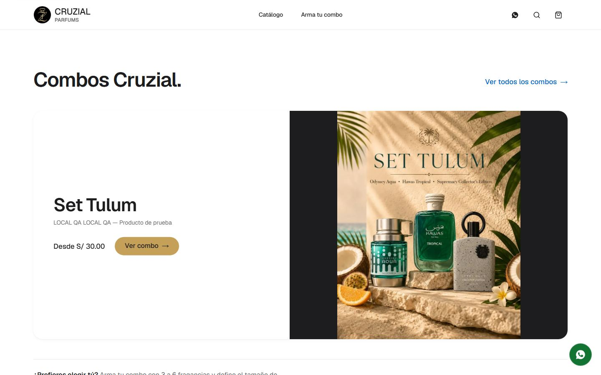
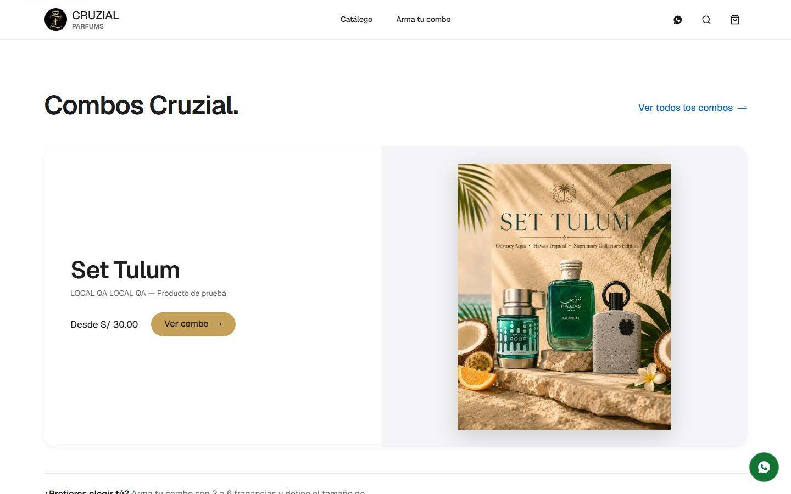
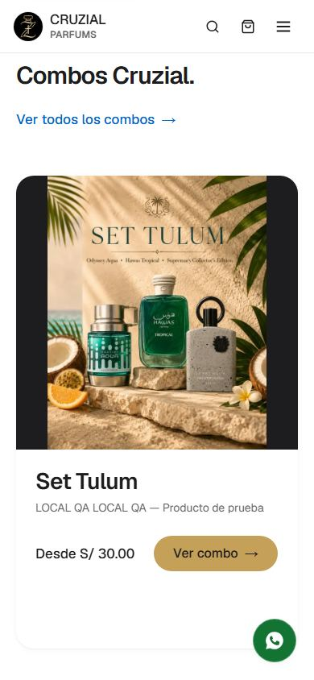
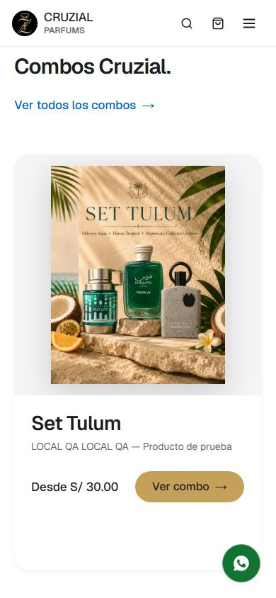

# Combos del home (`/parfums`): fuera el rectángulo negro

## Qué pasaba

El carrusel de combos (`combo-carousel.tsx` / `combo-carousel.module.css`) ponía el arte de cada set sobre un panel con
`background: var(--ds-ink)` (casi negro, a la derecha en escritorio y arriba en móvil). El arte de los sets
(`public/parfums/combos/set-*.webp`) es **4:5**, el panel es más ancho que alto, y la imagen va con `object-fit: contain`: quedaban
dos barras negras a los lados del arte. No era un contenedor para superponer texto (el texto vive en la mitad blanca de la tarjeta);
era el relleno del `contain`.

## Qué se hizo

- El panel pasa a `--ds-gray-50` (el gris claro del sistema; `DESIGN.md` no define un beige/crema: la paleta es blanco / `#F5F5F7` /
  tinta, y el dorado de marca sólo para acciones), con **un marco de aire** alrededor del arte (`padding: clamp(16px, 3vw, 32px)`)
  y una **sombra suave** que sigue a la imagen (`filter: drop-shadow`, no a la caja).
- Composición sin cambios: arte a la derecha y texto a la izquierda en escritorio; arte arriba y texto debajo en móvil (la columna
  apilada de #104).
- El texto ya estaba sobre blanco (tinta sobre blanco 16.8:1); el botón «Ver combo» es el dorado de marca con tinta (6.85:1).
- Los sets sin foto propia, que muestran las fotos de sus fragancias en tarjetas blancas, ya no flotan sobre negro sino sobre el
  mismo gris claro.

No se tocó la lógica del carrusel (autoplay, flechas, puntos, deslizar).

## Antes / después

| | Antes | Después |
|---|---|---|
| 1440 |  |  |
| 390 |  |  |

(Capturas con un set local renombrado a «Set Tulum» para que use su arte real; el dato local se restauró.)

## Límites

- Las esquinas del arte siguen rectas: el arte llena su caja con `contain`, y redondearlas exigiría un contenedor propio por
  imagen (cambio de marcado). El panel gris sí hereda el radio de la tarjeta.
- Si el cliente prefiere un beige cálido, habría que añadir un token nuevo a `DESIGN.md`; no se inventó uno aquí.
