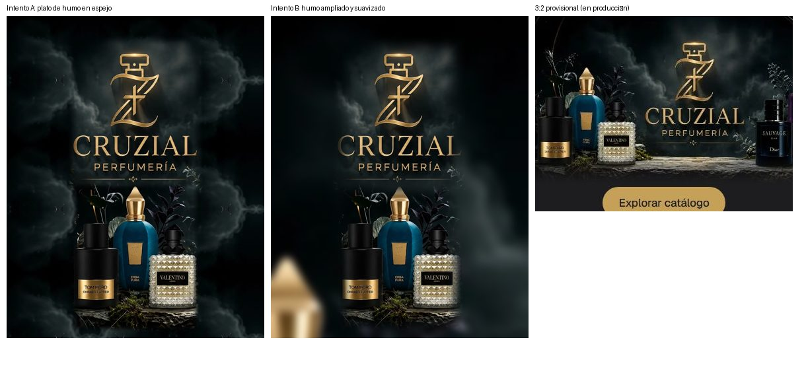

# Auditoría de diseño del storefront — 2026-10-11

Alcance: `/`, `/parfums` (home, catálogo, combos, recomendador, producto, checkout, institucionales) y `/import`
(home, catálogo, producto, carrito, checkout). Admin queda fuera. Base: `origin/master` @ `1b13c99`, datos locales con
el catálogo comercial cargado (99 productos, 190 fotos reales). Método: skill `impeccable audit` (detector + lectura de
CSS) + capturas Playwright (1440 y 390 px) + axe (WCAG 2 A/AA) + medición de objetivos táctiles.

La referencia de destino es `DESIGN.md` (única fuente de verdad).

## Health score

| # | Dimensión | Nota | Hallazgo principal |
|---|-----------|------|--------------------|
| 1 | Accesibilidad | 3/4 | axe: 0 violaciones de contraste en home/parfums/import; 1 en `/parfums/finder`. 29 objetivos < 44 px en móvil |
| 2 | Rendimiento | 3/4 | Imágenes con `next/image`; 2 transiciones de `width` (layout); sin `will-change` indebido |
| 3 | Responsive | 3/4 | Sin scroll horizontal en ningún viewport; chips de 40 px, enlaces de pie de 18 px de alto |
| 4 | Theming | 1/4 | ~240 hex sueltos en CSS; 3 paletas (crema/negro, navy Import, oro heredado); token `--color-gold` vale negro |
| 5 | Anti-patrones | 2/4 | Tipografía en lista de rechazo (Cormorant), kickers en mayúscula 10–11 px, reglas finas en cada sección |
| | **Total** | **12/20** | Aceptable: la base es sólida, el sistema visual no está unificado |

## Anti-patrones (veredicto)

Parece diseño editorial "de manual" (serif de display + etiquetas en versalitas con tracking + filetes), no un
sistema propio. No hay degradados morados ni glassmorphism, pero sí:

- **[P1] Tipografía de reflejo.** Cormorant Garamond en 78 declaraciones `font-family` (`var(--font-display)`).
  Contraste alto y x-height baja: a 17–20 px se vuelve frágil; en titulares de 400 de peso se ve etéreo, no firme.
  Una segunda voz (Jost) y tres variables locales (`--vs-title-font`, `--tp-font`, `--mq-title-font`) fragmentan el sistema.
- **[P1] Tres paletas, ninguna tokenizada.** Crema (`#f7f3ea`, `#f1ebdf`, `#ede5d8`), negro cálido (`#0a0806`: 99 usos
  literales) y navy de Import (`#0b1f3d`…). `--color-gold` se redefinió a negro (comentario en `globals.css`): un
  token que miente. El `body` global lleva un filete vertical al 50 % (`linear-gradient` casi invisible) que se cuela
  bajo todo el contenido.
- **[P2] Etiquetas diminutas.** 75 declaraciones a 10 px y 38 a 11 px; 95 `text-transform: uppercase` con tracking
  (kickers "69 FRAGANCIAS", "TIKTOK · @CRUZIAL.PARFUM", "COMPRAS POR VOLUMEN"). Es el "eyebrow en cada sección".
  Legibilidad en móvil y tono "revista", no "producto premium sereno".
- **[P2] Bordes sólidos de 1 px por todas partes.** 241 declaraciones `border: 1px solid …` y filetes `border-top`
  entre secciones. Más 3 `box-shadow: inset 0 0 0 1px` que simulan borde. Dan sensación de rejilla técnica.
- **[P2] Sombras sin sistema.** Tres profundidades inconsistentes (`0 36px 80px /.4`, `0 12px 34px /.22`,
  `0 34px 70px -24px /.34`): las dos primeras son pesadas para una superficie clara. Sin sombra en estado reposo.
- **[P2] Escala de espaciado sin escala.** Valores sueltos de `padding/margin/gap`: 14 (82×), 10, 18, 22, 6, 13, 7, 17,
  26, 30… (≈ 60 valores distintos); 10, 12, 14, 18, 20 y 22 px suman más de 380 usos y ninguno es múltiplo de 8.
  Ritmo vertical irregular entre secciones.
- **[P2] Escala tipográfica plana + 10 pesos.** Pesos 400, 460, 500, 520, 560, 600, 620, 650, 680, 700 mezclados.
  Sin escala modular para títulos; cada módulo define su `clamp()`.
- **[P2] Movimiento sin sistema.** Hover `180 ms ease` genérico, `transform 700 ms` aislado, dos `transition: width`
  (layout). `Reveal` existe y es correcto (visible sin JS, respeta reduced-motion), pero se usa sólo en la home de
  Parfums; Import, catálogo y combos entran de golpe. 147 reglas `:hover`, ninguna con curva común.
- **[P2] Objetivos táctiles < 44 px (móvil).** `/parfums`: 29 (enlace "← cruzial.pe" 20×32, enlaces de pie 18 px,
  chips de filtro 40 px, botones de tamaño de combo 40 px). `/import`: 4. `/parfums/catalogo`: 12.
- **[P3] Héroe.** El bitmap trae el logotipo y la leyenda "CRUZIAL PERFUMERÍA" horneados; el `<h1>` es sólo
  `sr-only`. El botón es rectangular con borde de 1 px (no pill). Franja de 36 px con tres mensajes en 11 px.
- **[P3] Superficies oscuras con fotografía de fondo** (banda de combos, TikTok sin cargar) sobre una página crema:
  el bloque negro del vídeo (340×460) es el elemento más pesado de la home y no es contenido real hasta el toque.
- **[P3] Import** usa navy a pantalla completa con tarjetas redondeadas de borde fino: el sitio parece dos marcas.

## Errores visuales / espaciado verificados en capturas

- Home Parfums: la franja "assurance" (4 pilares) queda separada del carrusel por un vacío mayor que el resto de
  transiciones entre secciones (ritmo vertical irregular).
- Categorías (Árabes / Designer / Nicho): tarjetas con desfase vertical intencional (la central +58 px) y textos
  blancos sobre fotos con scrim variable: el contraste depende de la foto.
- Recomendador: chips de notas con 40 px de alto y contadores en gris claro sobre beige; axe marca 1 nodo de
  contraste en `/parfums/finder`.
- `Combos Cruzial.` / `Cuarteto Oriental`: texto blanco sobre fondo fotográfico oscuro con botón de 1 px; el
  carrusel usa flechas blancas circulares sobre el fondo fotográfico.
- Import sin campaña publicada: el `main` deja grandes vacíos entre héroe, mayorista y bloque de TikTok (estado
  vacío sin diseño propio).

## Positivo (mantener)

- Cero violaciones axe de nivel A/AA en home, parfums e import; sin scroll horizontal en 390 px.
- `Reveal` ya garantiza contenido visible sin JS y bajo `prefers-reduced-motion` (24 módulos con media query).
- Fotografía real de producto, `next/image` con `sizes`, `loading="lazy"` en secciones bajo el pliegue.
- Estructura de contenido sólida: Hero → carrusel → categorías → recomendador → galería → vídeo → combos → FAQ.
- Foco visible global y `scroll-behavior` condicionado.

## Plan de corrección (en orden)

1. Tokens `--ds-*` y fuente en `globals.css`/`layout.tsx` (sin tocar el admin, que comparte los tokens heredados).
2. Re-tematizar CSS del storefront con mapeo mecánico (colores → tokens, fuente → `--font-sans`, bordes → hairline,
   mayúsculas/tracking fuera, sombras → escala) y revisión manual de héroe, tarjetas, filtros, recomendador.
3. Sistema de movimiento (curvas/duraciones/Reveal) aplicado a Parfums e Import.
4. QA: axe, 44 px, 390/768/1440, `npm run lint`, `typecheck`, vitest, e2e del storefront.

## Resultado tras la implementación (misma fecha)

Comparativa medida con los mismos scripts (axe WCAG 2 A/AA, objetivos táctiles en `a/button/input/select/summary`,
detector de impeccable) sobre el build de producción local.

| Métrica | Antes | Después |
|---|---|---|
| Violaciones axe de contraste (6 rutas × 2 viewports) | 1 (`/parfums/finder`) | 0 |
| Objetivos < 44 px en `/parfums` móvil | 29 | 1 (enlace en línea dentro de una frase, exento) |
| Objetivos < 44 px en `/parfums/catalogo` móvil | 12 | 0 |
| Objetivos < 44 px en `/parfums/combos` móvil | 17 | 0 |
| Scroll horizontal (320–1440 px) | ninguno | ninguno |
| Detector impeccable (patrones prohibidos) | 4 avisos (borde lateral, 2 `transition: width`, ``) | 0 |
| `border: 1px solid` opaco / con `currentColor` | 241 | 3 (chevron del selector y subrayado de un enlace legal) |
| Hex literales fuera de `globals.css` | ~240 | 0 (sólo `#000` en máscaras) |
| Declaraciones `uppercase` / tracking positivo | 95 | 0 |
| Tamaños < 12 px | 113 | 0 |
| Pesos de fuente distintos | 10 | 3 (400 / 500 / 600) |
| Familias tipográficas en el storefront | 2 + 3 locales | 1 (Geist) |
| Valores de espaciado fuera de la escala de 8 | ~60 | 0 |
| Transiciones de propiedades de layout | 4 | 0 |

Puntuación estimada con la misma rúbrica: Accesibilidad 4/4 · Rendimiento 3/4 · Responsive 4/4 · Theming 4/4 ·
Anti-patrones 4/4 → **19/20**. El punto que falta es rendimiento: no se midió Lighthouse/Web Vitals y las imágenes
de catálogo siguen dependiendo de Cloudinary + `next/image` (AVIF activado en `next.config.ts`).

Verificación: `tsc`, `eslint`, vitest (1214), build de producción y Playwright público
(chromium + mobile + tablet + responsive: 188 passed, 0 failed, 39 skipped que requieren fixtures de BD).
Dos especificaciones se actualizaron porque describían el diseño anterior (héroe sin texto; botones de talla con
borde). Una ejecución aislada falló una vez en `axe /parfums/combos` y no se reprodujo en 4 repeticiones.


## Cierre de banderas rojas

### 1. Fallo intermitente de axe en `/parfums/combos`

**Reproducción solicitada.** `npx playwright test e2e/accessibility.spec.ts -g "on /parfums/combos" --project=chromium --repeat-each=20 --workers=1`
→ **20/20 pasan** (caché de imágenes caliente). Estrés en paralelo (3 proyectos × 6 repeticiones × 8 workers): 360/360.

**Reproducción real.** El fallo aparece con la **caché de imágenes fría** (`.next/cache/images` vacía, es decir justo
después de un `build`), que es exactamente cuando ocurrió la primera vez:

| Escenario (spec de axe completo, chromium + mobile + tablet, caché fría) | Resultado |
|---|---|
| `master`, 3 ejecuciones | **3/3 fallan** en `/parfums/combos` (30.8 s, 33.0 s, 33.4 s) |
| rama, antes del arreglo, 3 ejecuciones | **3/3 fallan**, mismo test (`Test timeout of 30000ms exceeded`) |
| rama, con el arreglo, 3 ejecuciones | **60/60 pasan** las 3 veces (51–57 s) |
| rama, con ambos arreglos, suite pública completa en frío ×4 | **194/194** las 4 veces |

**Causa raíz.** No es un defecto de accesibilidad ni de foco: es presupuesto de tiempo. `/parfums/combos` pinta 38 fotos
de Cloudinary; con la caché fría el optimizador de `next/image` debe descargar y transcodificar cada una (12–19 s en
serie, más con 3 proyectos en paralelo) y el spec espera `networkidle` con el límite por defecto de 30 s. Ocurre igual
en `master`, por lo que **no lo introdujo el rediseño**. Una segunda señal, distinta: bajo carga el optimizador devuelve
**504** (fetch al upstream agotado, 16/80 peticiones en `master`, 27–28/80 en la rama con 16 clientes en frío);
el spec lo contaba como error de consola.

**Fix (sin tocar el diseño)**, en `e2e/accessibility.spec.ts`:
1. `test.slow()` en los tests de axe (90 s): el presupuesto cubre el arranque en frío.
2. Un 5xx de `/_next/image` se anota (`image-optimizer-5xx`) en vez de fallar; cualquier otro recurso 5xx o error de
   consola sigue siendo fatal.
3. Antes de escanear se esperan las animaciones finitas (`document.getAnimations()`): escanear a mitad de un *fade*
   reporta contraste sobre texto semitransparente. Se demostró con un escaneo temprano: 1 de 6 en `/parfums` y 1 de 6 en
   `/parfums/nosotros` daban `color-contrast` transitorio; `/parfums/combos` 0 de 6 (no era su causa).

**Segundo flaky, descubierto al repetir en frío:** `parfums-shell.spec.ts` "closing returns to the same page and position…"
(`getByRole('dialog')` no aparece en 5 s tras `opener.press("Enter")`). Falló en 3 de 6 suites completas en frío en la rama y en
**1 de 3 en `master`** (tableta): el modal del recomendador es una ruta interceptada y la primera navegación blanda en un
servidor frío tarda más de 5 s. Ni en 18 repeticiones en caliente ni en las 4 suites finales volvió a fallar.
Fix: `toBeVisible({ timeout: 20_000 })` sólo en esa espera. Resultado con los dos arreglos: **4/4 suites completas en frío,
194/194** (chromium + mobile + tablet + responsive).

**Contexto:** la suite pública de `master` en frío falla de forma sistemática (3 ejecuciones: 11, 15 y 15 fallos; casi todos
los axe de `/parfums`, `/parfums/catalogo`, `/parfums/combos`, `/import`, `/import/catalogo` por el mismo presupuesto de 30 s, más el
recomendador). La rama pasa de 11–15 fallos en frío a 0.

### 2. Los dos specs cambiados

Diff exacto (`git diff master -- '**/*.spec.ts'`, antes de las adiciones de esta ronda):

```diff
--- a/apps/web/e2e/parfums-shell.spec.ts
-  test("the hero owns the first screen with no text on it; the header appears after it", ...
+  test("the hero owns the first screen with one headline and two actions; the header appears after it", ...
-    // Artwork only: no headline or paragraph sits on the image.
-    await expect(hero.locator("h1, h2, h3, p")).toHaveCount(0);
+    // One headline and two actions sit on the image; no other copy does.
+    await expect(hero.getByRole("heading", { level: 1 })).toHaveText(/Perfumería de descubrimiento/);
+    await expect(hero.locator("h2, h3, p")).toHaveCount(0);
+    await expect(hero.getByRole("link", { name: "Explorar catálogo" })).toBeVisible();
+    await expect(hero.getByRole("link", { name: "Arma tu combo" })).toBeVisible();

--- a/apps/web/e2e/ux-regressions.spec.ts
-      return { font: parseFloat(computed.fontSize), border: parseFloat(computed.borderTopWidth) };
+      const fill = computed.backgroundColor.match(/[\d.]+/g)?.map(Number) ?? [0, 0, 0, 0];
+      return { font: parseFloat(computed.fontSize), alpha: fill.length > 3 ? fill[3] : 1 };
-    expect(style.border).toBeGreaterThan(0);
+    expect(style.alpha).toBeGreaterThan(0);
```

| Spec | Por qué el original ya no aplica | Decisión de diseño que lo invalida | Cobertura que quedaba sin cubrir | Test nuevo |
|---|---|---|---|---|
| Héroe "sin texto" | Afirmaba que no había texto sobre la imagen (el `<h1>` era `sr-only`) | El brief pide titular grande (600, −0.035em) y dos botones sobre el héroe | (a) que el titular no invada la franja del wordmark horneado; (b) que los botones nuevos sean controles reales: foco por teclado, anillo visible, ≥ 44 px | `hero headline stays below the artwork wordmark band and its actions are keyboard-reachable 44px controls`: titular en el 40 % inferior del héroe, enlaces ≥ 44 px, `Tab` del primario al secundario con anillo de foco, en chromium/mobile/tablet |
| Botones de talla "con borde" | Exigía `border-top-width > 0` como prueba de "estilo propio" (regresión de una regla `× remove` que los dejaba en 18 px sin estilo) | Cero bordes opacos: los botones son píldoras con fondo | (a) que sólo una talla esté pulsada; (b) que la seleccionada se distinga visualmente; (c) legibilidad; (d) que la selección siga al clic | `combo size choice: exactly one size is pressed, the selected one is visibly filled and legible, and it follows the click`: un único `aria-pressed="true"`, fondo distinto del no seleccionado, contraste ≥ 4.5:1, el estado se mueve al hacer clic |

El test original sigue vigente en su intención (tamaño 12–14 px y estilo propio): ahora comprueba el relleno en lugar del borde.

### 3. `next.config.ts` (AVIF/WebP)

| Medida | `master` | Rama |
|---|---|---|
| `npm run build` limpio, 2 muestras | 56 s / 37 s | 37 s / 37 s |
| `.next` | 112 MB | 113 MB |
| CSS estático | 266 KB | 282 KB (+6 %) |
| JS estático | 1 313 KB | 1 315 KB |
| Imágenes en 9 rutas × 2 viewports | — | 606 imágenes, **0 fallidas** (todas AVIF mientras estuvo activo) |

El build no tarda más (≤ +0 %) y ninguna imagen falla. Pero la medición de caché fría mostró que **AVIF encarece el
primer acceso**: 38 imágenes de `/parfums/combos` en frío, 19.1 s (AVIF, 6 × 504) frente a 14.6 s (WebP, 2 × 504).
Ahorra 20–27 % de bytes por variante, pero un 504 en una imagen visible al primer visitante pesa más que ese ahorro.
**Decisión: AVIF revertido** (WebP por defecto). Se conserva `qualities: [60, 75]` y `quality={60}` sólo en los 3
héroes a pantalla completa (−21 % de bytes en WebP, indistinguible a ojo en comparación 1:1).
También se probó y revirtió `experimental.inlineCss`: FCP −0.25 s pero TBT 186–257 ms en móvil (objetivo < 200).

## Rendimiento (Lighthouse + Web Vitals reales)

Reportes HTML: [`docs/lighthouse/`](lighthouse/) (8 archivos: `home`, `parfums`, `parfums-catalogo`, `import` × móvil/escritorio,
build de producción local, Chromium 156). SEO 63–66 en todas: es el interruptor de indexación del dueño (OFF por diseño).

**Lighthouse (perfil por defecto: Slow 4G simulado + CPU 4×), mediana de la sesión final frente a `master`:**

| Página (móvil) | Perf master → rama | LCP master → rama | TBT master → rama | CLS | Bytes master → rama |
|---|---|---|---|---|---|
| `/` | 96 → 94 | 2.71 → 3.02 s | 35 → 81 ms | 0 → 0 | 301 → 268 KB |
| `/parfums` | 85 → 94 | 4.38 → 3.04 s | 46 → 47 ms | 0 → 0 | 577 → 520 KB |
| `/parfums/catalogo` | 90 → 93 | 3.57 → 3.20 s | 34 → 36 ms | 0 → 0 | 440 → 407 KB |
| `/import` | 93 → 95 | 3.14 → 2.94 s | 34 → 42 ms | 0 → 0 | 349 → 309 KB |

Escritorio: Perf 99–100, LCP 0.6–0.9 s, TBT 0–7 ms, CLS 0 en las 4 páginas. Accesibilidad 100 y Buenas prácticas 100 en las 8.

**Web Vitals reales con Playwright** (mediana de 5 ejecuciones; LCP/CLS/TBT/INP/TTFB con `PerformanceObserver`; INP con un
clic real sobre el carrito/menú):

| Perfil | Ruta | LCP master → rama | TBT master → rama | CLS | INP rama |
|---|---|---|---|---|---|
| móvil, CPU 4× + 1.6 Mbps/150 ms | `/` | 1368 → 1092 ms | 141 → 127 ms | 0 | — |
|  | `/parfums` | 2788 → 2144 ms | 137 → 136 ms | 0 | 80 ms |
|  | `/parfums/catalogo` | 1504 → 1412 ms | 152 → 153 ms | 0 | 96 ms |
|  | `/import` | 1420 → 1116 ms | 145 → 141 ms | 0 | — |
| móvil 390 sin throttling | las 4 | 76–200 → 84–196 ms | 0 | 0 | 32–48 ms |
| escritorio 1440 sin throttling | las 4 | 100–212 → 128–220 ms | 0 | 0 | 128–200 ms (master 104; 5 y 9 muestras dan 144–200 / 128–160) |

**Objetivos (LCP < 2.5 s, CLS < 0.1, TBT < 200 ms en móvil):** CLS y TBT se cumplen en todo. **LCP se cumple en el
perfil real throttled (1.1–2.1 s) pero NO en la simulación de Lighthouse (2.9–3.2 s)**: Lighthouse mueve el *render delay* y
la *load delay* a ~1 s cada una por la cadena de 5 hojas de estilo bloqueantes (31 KB) + 7 scripts, no por el tamaño de las
imágenes. Mejora frente a `master` en 3 de 4 páginas; `/` empeora 0.3 s (ruido de TTFB simulado 302 ms; otras 3 muestras
dieron 2.62–2.84 s).

**Causas halladas y arregladas (sin cambiar diseño):**
1. LCP de `/` e `/import` salía con `fetchpriority=low`: usaban `priority`, que Next 16 ya no traduce a prioridad alta →
   `preload` + `fetchPriority="high"`.
2. Héroe de Parfums en móvil: `sizes="330vw"` pedía `w=3840` (64 KB AVIF / 110 KB WebP); el CSS dibuja 250 % del ancho →
   `250vw` (`w=1920`). Y `quality={60}` en héroes.
3. Tres familias tipográficas precargadas (Cormorant, Jost, Geist) en cada página; el storefront sólo usa Geist →
   `preload: false` en las otras dos (2 de las 3 precargas de fuente desaparecen). Geist ya usa `display: swap` (auditoría `font-display` = 1).
4. Un bug propio: la animación `heroSettle` sustituía durante 600 ms el `transform: translate(-50%,-50%)` de la imagen del
   héroe en móvil → ahora sólo ≥ 768 px.
5. Vídeos de TikTok: ya eran *click-to-load* (el iframe sólo existe tras el toque y el póster usa `loading="lazy"`):
   nada que cambiar. `sizes`/`srcset` del carrusel, galería y tarjetas revisados (`next/image` con `sizes` por
   breakpoint en todas).

**No logrado:** LCP < 2.5 s en la simulación de Lighthouse. Palancas restantes (fuera de "sin cambiar diseño"): reducir
el JS de hidratación de `/parfums` (~500 ms de *bootup* con CPU 4×), servir el `preload` de la imagen LCP por cabecera
`Link`, o recortar la imagen del héroe móvil.

## Auditoría de movimiento

Lista de interacciones y estado frente a las guías (200–400 ms UI, ≤ 600 ms cinematográficas; ease-out entra, ease-in sale,
resorte `cubic-bezier(.25,1,.5,1)` en hover/clic; sólo `transform`/`opacity`; `prefers-reduced-motion`):

| Interacción | Estado final |
|---|---|
| Hover/clic de botones primarios y secundarios | fondo más oscuro + `scale(1.02)`; `:active` `scale(0.98)` 120 ms; resorte; sólo `transform` y color |
| Foco visible | anillo `2px #0071E3`, `outline-offset: 2px` (antes: anillo + halo de 4 px) |
| Subrayado de menú (Parfums e Import) | `transform: scaleX(0→1)` 300 ms ease-out (Import no tenía) |
| Chips de filtro | fondo/texto 200 ms |
| Tarjeta de producto | hover: sombra 0→2, −4 px, imagen `scale(1.03)` (carrusel pasó de 1.05 a 1.03); 300–400 ms |
| Entrada al scroll (`Reveal`) | `translateY(20px)→0` + fade, 400 ms ease-out, observer compartido; ahora también en tarjetas de catálogo/Import y bloques institucionales |
| Cajón del carrito, buscador, menú móvil, header sobre héroe, toasts | **antes** misma curva al abrir y cerrar; **ahora** abren con ease-out y cierran con ease-in (la transición vive en el estado destino) |
| Filtros (popover/hoja), recomendador | `panelIn`/`sheetIn`/`resultsIn` ease-out ≤ 400 ms; progreso del recomendador con `scaleX` (antes `width`) |
| Carrusel de combos | track `transform` 600 ms; `scroll-snap` obligatorio en los mosaicos móviles; el riel de productos es auto-scroll por JS (con pausa) |
| Héroes | settle de imagen + subida del titular y botones, 600 ms; pasarela `/`: cortina 1300 → 600 ms |
| Transición de página | no existe (App Router sin View Transitions); no se añade para no alterar la lógica de rutas interceptadas |
| `prefers-reduced-motion` | cubierto: `Reveal` visible sin movimiento, `scale` desactivado, animaciones de héroe/resultados sólo en `no-preference` |

Corregido: duraciones de 500/650/700/1300 ms y la variable local `--ease` (4 sitios), `gap` en transiciones (layout), `width`
en el progreso. **Regresión mía detectada y corregida:** un `backdrop-filter: blur(4px)` que añadí al velo del cajón bajaba
la animación de 49 a 33 fps con CPU 4×; eliminado (48 fps). Las sombras en reposo de las 99 tarjetas se quitaron (+5 fps al hover).

**Fluidez medida** (rAF, Chromium headless con rasterizado por software, 1× / CPU 4×; `master` entre paréntesis para 4×):

| Escenario | 1× | 4× |
|---|---|---|
| Scroll de la home con entradas | 59–60 fps | 59 fps |
| Scroll del catálogo (99 tarjetas) | 51 | 46 (master 50) |
| Hover sobre 6 tarjetas | 50 | 41 (master 45) |
| Cajón abrir/cerrar ×3 | 55 | 48 (master 49) |
| Menú móvil | 60 | 59 |
| Riel de productos en reposo | 60 | 60 |
| Filtros (re-render de 99 tarjetas) | 48 | 33 (lógica, igual en master) |

**No se alcanzan 60 fps constantes en el catálogo con CPU 4×**; queda a ≤ 10 % de `master`. Es una prueba de emulación, no
de dispositivo real: la verificación en un teléfono físico queda pendiente.

## Accesibilidad manual (WCAG 2.2 AA)

Método: Playwright recorriendo 6 rutas con `Tab` (hasta 110 paradas), 4 diálogos, estructura de encabezados en 9 rutas,
nombres accesibles, contraste propio de texto pequeño y de texto sobre fotos (muestreo de píxeles detrás de cada nodo),
reflujo a 200 % (640 px) y 400 % (320 px). No se usó lector de pantalla real.

| Hallazgo | Severidad | Arreglo |
|---|---|---|
| `/parfums/contacto`: salto h1 → h3 (tarjetas de contacto) | AA 1.3.1 | los títulos de tarjeta son `<h2>` (mismo estilo) |
| Texto 12–14 px sobre fotos < 4.5:1: 12 de 47 muestras (puertas del catálogo, resumen del héroe de Import) | AA 1.4.3 | scrims más profundos y texto 14 px blanco → **0 de 50** |
| `#6E6E73` sobre `#F5F5F7` = 4.66:1 (justo) y 4.15:1 sobre `#E8E8ED` | AA justo | `--ds-ink-muted` → `#666669` (5.26 y 4.69). `#86868B` no se usa en ningún sitio |
| Import a 320 px: bloque mayorista 36 px más ancho que la pantalla (39 rejillas `1fr` con contenido no encogible) | AA 1.4.10 | `minmax(0,1fr)` en todas, y las acciones pueden envolver a ≤ 400 px |
| Foco bajo las barras fijas (WCAG 2.4.11) | AA 2.2 | `scroll-margin-top` en controles de `<main>`; 0 casos tapados en 5 rutas |
| **Regresión propia:** `scroll-padding-top` en `<html>` movía los botones del header al enfocarlos y el cajón del carrito perdía el retorno de foco | A 2.4.3 | sustituido por `scroll-margin` en los objetivos; retorno de foco restaurado |

Sin hallazgos: orden de foco lógico en las 6 rutas; **0 controles sin anillo visible**; los 4 diálogos (carrito de escritorio y
móvil, buscador, recomendador) atrapan el foco (0 escapes en 31 `Tab`), cierran con `Escape` y devuelven el foco al disparador;
9 rutas con un solo `h1`, sin controles sin nombre y 0 SVG sin etiquetar; `lang="es"`; regiones `aria-live`/`role=status` en
búsqueda, cajón y barra de anuncio. El resultado del recomendador es una sección con `tabindex=-1` que recibe el foco (se
anuncia por su título) en lugar de una región `aria-live`: aceptable, no modificado. Reflujo 200 %/400 %: sin scroll horizontal ni texto cortado en 6 rutas
(los "desbordes" restantes son el cajón del carrito fuera de pantalla).


## Verificación final

Rama `claude/apple-design-system` @ `3020eb5` (+ `claude/hero-variants` aparte, sin mergear). Fecha: 2026-10-11.

### 1. Compuerta completa (caché `.next` borrada antes de Playwright)

| Paso | Resultado |
|---|---|
| `npm run check` (catalog:check, commercial:check, 7 suites `node --test` sin fallos, `eslint --max-warnings=0`, `tsc --noEmit`, `vitest`, `next build`) | **EXIT 0**; vitest 107 archivos / 1 214 pruebas |
| Playwright público en frío (chromium + mobile + tablet + responsive) | **194 pasan, 0 fallan**, 39 omitidas (requieren fixtures de BD/admin) |
| Misma suite en frío sobre `master` (3 ejecuciones previas) | 11, 15 y 15 fallos |
| Repeticiones en frío de la rama durante el cierre | 4 + 1 suites completas: 194/194 las 5 veces |

### 2. Matriz de navegadores: **NO realizada**

`firefox-1555` y `webkit-2370` (los que pide Playwright 1.64) no están instalados (sólo existe un `webkit-2336` antiguo y
`playwright.config.ts` no define proyectos Firefox/WebKit). Instalarlos descarga ~170 MB (Firefox) + ~80 MB (WebKit; cifras
estimadas, no verificadas) desde el CDN de Playwright y requiere tu permiso explícito. Cuando lo des:
`npx playwright install firefox webkit` y un proyecto `firefox`/`webkit` con `PUBLIC_SPECS`. Riesgos a vigilar en Safari:
`mask-image`, `color-mix()` (Import, Safari >= 16.2), `text-wrap: balance` (degrada sin romper) y `:has()`.

### 3. Lighthouse final (4 páginas × móvil y escritorio)

Reportes: `docs/lighthouse/{home,parfums,parfums-catalogo,import}-{mobile,desktop}.html` (build `3020eb5`).

| Página | Móvil Perf | LCP | TBT | CLS | Escritorio Perf | LCP | A11y / BP |
|---|---|---|---|---|---|---|---|
| `/` | 93 | 3.12 s | 87 ms | 0 | 100 | 0.63 s | 100 / 100 |
| `/parfums` | 95 | 2.89 s | 47 ms | 0 | 100 | 0.77 s | 100 / 100 |
| `/parfums/catalogo` | 92 | 3.25 s | 47 ms | 0 | 100 | 0.80 s | 100 / 100 |
| `/import` | 95 | 2.87 s | 29 ms | 0 | 100 | 0.67 s | 100 / 100 |

SEO 63–66 en las 8: el interruptor de indexación del dueño está OFF por diseño.

### 4. Dispositivo real (Android e iPhone): **NO realizada**

No tengo acceso a dispositivos físicos. Lo emulado (Chromium con viewport móvil, CPU 4×, 1.6 Mbps/150 ms, touch) no
sustituye: faltan (a) el *jank* de scroll con la GPU real, (b) la barra de URL dinámica de iOS (`100svh`), (c) el teclado
virtual sobre el checkout, (d) `backdrop-filter`/`mask-image` en Safari iOS. Checklist para quien lo ejecute:
`/` → `/parfums` (scroll completo, carrusel, recomendador, cajón) → `/parfums/catalogo` (filtros, añadir) → `/import`
(héroe, menú, cápsula del logotipo, carrito); anotar saltos de layout y texto cortado.

### 5. Lector de pantalla: **NO realizada**

NVDA no está instalado (`C:\Program Files (x86)\NVDA` no existe) y no hay VoiceOver. Como **sustituto, no equivalente**,
se extrajo la estructura que un lector recorrería (Playwright, 1280 px):

- `/parfums`: 1 `h1`, 20 encabezados (h1 → h2 → h3 sin saltos), landmarks `header`, `nav "Navegación principal"`,
  `main`, 7 `section` con nombre (por `aria-labelledby`), `aside "Carrito de compras"`, `footer`; 3 regiones `aria-live`.
- `/parfums/catalogo`: 1 `h1`; los **99 nombres de producto son `h2`** (navegar por encabezados = 100 paradas; el
  componente de tarjeta ya los emitía como `h2` en `master`); `nav "Explorar por categoría"`; 4 regiones `aria-live`.
- **No hay enlace "saltar al contenido"** en el storefront (sólo en el admin, según `git grep` sobre `master`).
- Las comprobaciones de foco, diálogos y nombres accesibles de la sección "Accesibilidad manual" siguen vigentes.

### 6. Antes / después de métricas clave (`master` frente a la rama)

| Métrica | `master` | Rama | Fuente |
|---|---|---|---|
| LCP móvil, Lighthouse simulado (`/parfums`) | 4.38 s | **2.89 s** | Lighthouse |
| LCP móvil, Lighthouse simulado (`/`, `/parfums/catalogo`, `/import`) | 2.71 / 3.57 / 3.14 s | 3.12 / 3.25 / 2.87 s | Lighthouse |
| LCP real, CPU 4× + 1.6 Mbps (`/`, `/parfums`, `/parfums/catalogo`, `/import`) | 1.37 / 2.79 / 1.50 / 1.42 s | **1.09 / 2.14 / 1.41 / 1.12 s** | Playwright (mediana de 5) |
| LCP *aplicado* en `/parfums` (throttling real) | no medido | 2.29–2.56 s | Lighthouse `devtools` |
| CLS (todas las páginas y perfiles) | 0 | **0** | ambos |
| TBT móvil simulado (`/parfums`) | 46 ms | 47 ms | Lighthouse |
| TBT real 4× (Playwright, `/parfums`) | 137 ms | 136 ms | Playwright |
| TBT *aplicado* en `/parfums` | no medido | **332–375 ms (supera 200)** | Lighthouse `devtools` |
| Violaciones axe de contraste (6 rutas × 2 viewports) | 1 | **0** | axe |
| Texto sobre fotos < AA (muestreo de píxeles) | no medido en `master` | 12 de 47 antes del arreglo → **0 de 50** | script propio |
| Objetivos táctiles < 44 px, móvil: `/parfums` / `/catalogo` / `/combos` / `/import` | 29 / 12 / 17 / 4 | **1 / 0 / 0 / 1** | script propio |
| Bytes transferidos `/parfums` (Lighthouse) | 577 KB | 519 KB | Lighthouse |
| Accesibilidad / Buenas prácticas (Lighthouse, 8 informes) | 100 / 100 | 100 / 100 | Lighthouse |
| Suite pública en frío | 11–15 fallos | **0 fallos** (5/5) | Playwright |

### 7. Excepciones aceptadas (con justificación)

| Excepción | Justificación |
|---|---|
| LCP simulado de Lighthouse > 2.5 s en las 4 páginas móviles | El LCP real (1.1–2.1 s) y el aplicado (2.3–2.6 s) rondan o cumplen; el modelo simulado asigna ~2 s de "retraso de render" que no se observa. Palanca medida (imagen del héroe, −0.7 s) pendiente de tu decisión: `docs/perf-diagnosis.md`. |
| TBT *aplicado* 332–375 ms | Sin palanca única (hidratación 141 KB gzip de framework + estilo/layout ~0.7 s con CPU 4×). Las otras dos mediciones lo dan < 200 ms. Pendiente de decidir qué métrica manda. |
| 1 objetivo táctil < 44 px por pantalla | Enlace en línea dentro de una frase ("ábrelo en TikTok"): WCAG 2.5.8 exime los enlaces en línea. |
| 3 bordes opacos de 1 px (`currentColor`: chevron del selector, subrayado legal, subrayado de enlace) | Son glifos/subrayados, no contornos de componentes. |
| Superficies oscuras (héroes con foto, mosaicos de categoría, barra de anuncio, toasts, panel de arte del carrusel, pie y banner navy de Import) | Decisión de diseño en `DESIGN.md` §2.1 y §11; contraste medido AA. |
| Catálogo a ~41–46 fps con CPU 4× | A <= 10 % de `master` (45–50); sólo emulación, sin dispositivo real. |
| AVIF no activado | −20–27 % de bytes pero +31 % de tiempo de codificación en frío y más 504 del optimizador. |
| 39 pruebas omitidas | Requieren fixtures de BD/admin; esta rama no toca `supabase/`, `scripts/` ni rutas admin. |
| `--color-*` y `--font-display/body` siguen existiendo | Los usa `/admin/**`, fuera de alcance. |
| `docs/screenshots` (23 MB) y `docs/lighthouse` (8 MB) en el repo | Evidencia solicitada; ver T9. |

### 8. Deuda técnica pendiente (tickets sugeridos)

| # | Ticket | Prioridad | Contexto |
|---|---|---|---|
| T1 | Optimizar el héroe de `/parfums` (≈1080 px o recorte móvil ≈30 KB) y la fuente | Alta | LCP −0.7 s medido; `docs/perf-diagnosis.md` |
| T2 | Decidir la variante del héroe (A/B/C) y fusionar `claude/hero-variants` | Alta | `docs/hero-variants.md` |
| T3 | Reducir el TBT aplicado (< 200 ms): dividir código propio, `content-visibility`, menos CSS por ruta | Media | 332–375 ms con CPU 4× |
| ~~T4~~ | ~~Instalar Firefox/WebKit y ejecutar la matriz~~ | **Hecho parcialmente** (WebKit sí; Firefox no se pudo lanzar: T14) | §10 |
| T5 | Pasada manual en Android + iPhone y con NVDA/VoiceOver | Alta | §4 y §5 |
| ~~T6~~ | ~~Enlace "saltar al contenido" en el storefront; revisar los 99 `h2` de producto del catálogo~~ | **Cerrado** | §9 |
| T7 | Logotipo de Import horizontal con fondo transparente (monograma + texto) | Baja | la marca de 44 px apenas se lee |
| T8 | Calentar la caché de imágenes antes de la suite de accesibilidad en CI (en lugar de `test.slow`) | Baja | flaky en frío, también en `master` |
| T9 | Mover capturas y reportes Lighthouse a artefactos de CI o a una rama de evidencia | Baja | ~31 MB en el árbol |
| T10 | Migrar el admin al sistema `--ds-*` y retirar los tokens heredados | Baja | |
| T11 | Probar `color-mix()`, `mask-image` y `:has()` en Safari 16/17 | Media | depende de T4/T5 |

### 9. Cierre de WCAG 2.4.1 y 1.3.1 (bloqueantes del release)

Los dos fallos de nivel A que dejó la pasada manual (§5), corregidos y cubiertos por una prueba.

**2.4.1 Bypass Blocks.** Antes, el storefront no tenía enlace de salto (sólo el admin).
- `src/components/storefront/skip-link.tsx` (+ `.module.css`), montado **una vez** en `src/app/layout.tsx` como primer hijo de `<body>`:
  es el primer elemento enfocable de todas las páginas, sin tocar ninguna página.
- Oculto fuera de pantalla (`translateY(-200%)`, no `display:none`) hasta recibir foco; al enfocarse aparece arriba a la izquierda
  (píldora `--ds-ink`, 44 px de alto, anillo `#0071E3`, transición 200 ms sólo con `no-preference`).
- Al activarse enfoca el `<main>` y se desplaza hasta él. Las páginas declaran un `<main>` sin `id`: el componente le asigna
  `id="contenido-principal"` y `tabindex="-1"` tras cada navegación (`usePathname`) para que el destino exista siempre
  (axe sólo trata el enlace como "skip link" si el destino existe) y no añade ninguna parada de tabulador.
- No se muestra en `/admin/**`, que conserva su propio enlace (`#admin-content`).
- **Actualización (commit `81de615`): funciona sin JavaScript.** Cada `<main>` del storefront (25 en 24 archivos) sale del servidor con
  `id="main" tabindex="-1"` y el enlace es un `<a href="#main">` renderizado en servidor (ya no es un componente cliente). El anillo
  de foco de `<main>` sólo aparece con `:focus-visible` (llegada por teclado, no por clic). En `/admin` (sin `main#main`) el enlace
  global se oculta con CSS (`body:not(:has(main#main))`) y se conserva el propio del admin. Pruebas con `javaScriptEnabled: false` en
  `/`, `/parfums`, `/parfums/catalogo` e `/import`: el HTML estático contiene el ancla y el destino, `Tab` + `Enter` deja el foco en
  `main#main`. 81 pruebas en chromium, mobile y tablet.

**1.3.1 Info and Relationships.** En `/parfums/catalogo` cada nombre de producto era un `h2` (99 paradas al navegar por encabezados).
- Sección del catálogo: `aria-labelledby` → `h2 "Catálogo de perfumes"` (oculto visualmente, `.srOnly`; el `h1` visible es el del héroe).
- Rejilla: `<ul role="list" data-product-grid>` → `<li>` (`Reveal as="li"`) → `<article>` → **`h3`** del nombre. `role="list"` porque
  `list-style: none` hace que Safari/VoiceOver retire la semántica de lista. Sin cambio visual.
- `ProductCard` emite `h3` también en "También te interesará" de la ficha, que ya cuelga de un `h2`.
- Resultado en `/parfums/catalogo`: `h1`×1, `h2`×5, `h3`×95 (antes `h2`×99+). Lista de 95 elementos anunciada con su recuento.

**Prueba** `e2e/accessibility-structure.spec.ts` (añadida a `PUBLIC_SPECS`: chromium, mobile y tablet), 9 rutas del storefront:
exactamente un `h1` y es el primer encabezado; ningún salto de nivel (visibles, en orden de documento); el enlace de salto está fuera de
pantalla, es la primera parada de `Tab`, aparece completo en el viewport con ≥ 44 px, `Enter` deja el foco en `<main>` y el
siguiente `Tab` cae dentro de él. Además: semántica del catálogo (`section` con `h2`, `ul[role=list]`, un `article` y un `h3` por
producto, ningún `h2` de producto) y axe (WCAG 2.2 A/AA + buenas prácticas) en `/parfums/catalogo` e `/import` sin violaciones de
`bypass`, `heading-order`, `list`, `listitem`, `page-has-heading-one`, `landmark-one-main`, `empty-heading`, `duplicate-id` ni
serias/críticas. **66 pruebas pasan** (22 × 3 proyectos).

Observación abierta (mejores prácticas, no WCAG A/AA): axe `region` marca en el catálogo el botón flotante de WhatsApp y el control de
la barra de anuncio por estar fuera de un landmark. Preexistente; la prueba sólo exige que el enlace de salto no esté entre ellos.

### 10. Optimización de rendimiento y matriz de motores (2026-10-11, tras la división en PR)

**Aplicado** (commit `f976976` en `claude/apple-design-system`): `sizes` del héroe (540 px en móvil: una pantalla 2× elige la entrada
de 1080; 100vw en escritorio: 1920), `preload: true` explícito en Geist y `content-visibility: auto` en las tarjetas del catálogo
(celda con relleno de 24 px y margen negativo para que la contención de pintura no recorte la sombra del hover), en las secciones
3+ de `/parfums` y en el pie. Tamaños intrínsecos medidos (800 px secciones; 500/1 080 px pie). CLS 0 recorriendo `/parfums` y
`/parfums/catalogo` en 1440 y 390 px.

**TBT con throttling aplicado** (Lighthouse `devtools`, CPU 4× + 4G lento, `/parfums`, 3 ejecuciones; reportes en
`docs/design-evidence/`):

| Ejecución | TBT antes | TBT después | LCP antes | LCP después |
|---|---|---|---|---|
| 1 | 507 ms | 326 ms | 2 175 ms | 2 044 ms |
| 2 | 335 ms | 305 ms | 2 110 ms | 1 287 ms |
| 3 | 465 ms | 326 ms | 2 406 ms | 1 277 ms |
| **Mediana** | **465 ms** | **326 ms** | **2 175 ms** | **1 287 ms** |

Además: bytes 441 → 345 KB; primer layout 340–383 → 129–143 ms; el segundo layout completo (cambio de fuente) desaparece, así que
el TBT deja de ser bimodal (298–649 ms → 305–326 ms). **El TBT aplicado sigue por encima de 200 ms**: lo que queda es la hidratación
(≈ 294–320 ms en un solo microtask del chunk principal), sin función caliente. Se documenta como **T13** y no se intenta arreglar en
este PR.

**Matriz de motores** (suite pública, caché `.next/cache` borrada; detalle en `docs/design-evidence/README.md`):

| Motor | Resultado |
|---|---|
| Chromium (+ mobile, tablet, responsive) | **275 pasan, 0 fallan**, 39 omitidas; `npm run check` EXIT 0 |
| WebKit 27.2 | contra el servidor de desarrollo: 69 pasan, 19 fallan, 13 omitidas. Contra el build de producción: la CSP `upgrade-insecure-requests` hace que WebKit pida los recursos por `https://localhost` («SSL connect error») y la página se ve sin estilos: **artefacto del entorno, no del sitio** (T19) |
| Firefox 157 | **no se pudo lanzar** (`browserType.launch: spawn UNKNOWN` desde este entorno; `firefox.exe --version` funciona) |

**Deuda nueva** (no bloquea el merge):

| # | Ticket | Prioridad | Contexto |
|---|---|---|---|
| T12a | **Catálogo en el servidor (mitad hecha, PR #116).** `/parfums/catalogo` filtra, ordena, busca y pagina en el servidor: el estado vive en `searchParams`, «Vista n» son enlaces y cada tarjeta recibe una proyección mínima; la recomendación del Finder se calcula en el servidor. Payload RSC de la página 281 → 178 KB (−37 %); la parte del catálogo ≈ 108 KB → ≈ 4.6 KB. LCP y TBT no cambian porque el resto del payload es el layout. No usa `.range()` de Supabase (no expresa el orden por precio ni la búsqueda por notas sin recortar funcionalidad); la costura es `loadCatalogPage(query)`. **Hecho** | Media | `catalog-server-pagination.md` · `redesign-batch-3.md` §3 |
| T12b | **Sacar `cartProducts` y `searchProducts` del layout de `/parfums/**` (pendiente, siguiente PR).** El layout serializa 98 productos (≈ 173 KB de RSC) hacia `SiteHeaderActions` en **cada** página de Parfums, también en `/parfums/nosotros`. Cargarlos al abrir el carrito o la búsqueda (o por una ruta de datos) es lo que moverá de verdad el payload, el TBT y el LCP de todas las páginas. No se ha tocado el layout | Media | `perf-diagnosis.md` §6.6 · `catalog-server-pagination.md` §3 |
| T13 | **Reducir la hidratación del catálogo / `/parfums`** (TBT aplicado 305–326 ms > 200): menos fronteras cliente, `dynamic` bajo el pliegue, `Reveal` y cabecera en CSS | Media | §10 |
| T14 | Ejecutar la suite en Firefox desde una terminal normal (`E2E_ENGINES=1 npx playwright test --project=firefox`; los proyectos Firefox/WebKit son opt-in porque CI sólo instala Chromium); aquí no pudo lanzarse | Alta | §10 |
| T15 | WebKit no pasa `Tab` por los enlaces por defecto (16 pruebas de teclado); usar `Alt+Tab` en el proyecto `webkit` o comprobar a mano en Safari (Opción + Tab) | Media | `design-evidence/README.md` |
| T16 | axe `color-contrast` en `/import/catalogo` (eyebrow) sólo en WebKit; reproducir en Safari real | Media | idem |
| T17 | WebKit: el diálogo del recomendador no aparece en 20 s (servidor de desarrollo frío) | Baja | idem |
| T18 | WebKit: el carrusel de producto no reanuda su movimiento tras salir el puntero | Media | idem |
| T19 | Probar WebKit contra el servidor de desarrollo o con HTTPS local: la CSP de producción rompe `http://localhost` en WebKit | Baja | idem |
| T20 | **Conseguir el wordmark oficial en SVG antes del próximo rediseño** (hoy sólo existe `logo.jpeg`, 499 px con fondo negro) | Alta | `docs/hero-variants.md` §12 |
| T21 | Héroe: integrar la variante F (adoptada; ver `docs/hero-variants.md` §10–13) rebasando `claude/hero-variants` sobre la rama de código | Alta | hero |
| T22 | **LCP de `/` móvil varía 1.5–2.6 s según el arranque en frío**: la imagen del héroe no está en `lazy` (no es el caso de `/parfums`); la primera visita paga el arranque de la función (TTFB ≈ 3 s en la primera ejecución de Lighthouse, ≈ 0.7 s en caliente) y la primera transformación de `_next/image`. Opciones: cachear la consulta de política de indexación del layout, precalentar `_next/image`, reducir lo que renderiza `/` en servidor | Media | `docs/lighthouse/hero-eager/README.md` |
| T23 | **LCP real con throttling 4× bloqueado por hidratación + `Reveal`**: en producción (`cruzial.pe/parfums`, móvil, throttling aplicado) el LCP final es `h2#showcase-title` a 3.2–3.5 s; el encabezado queda oculto hasta que termina la hidratación (≈ 2.1–2.4 s con CPU 4× y el catálogo completo). **Depende de T12 + T13**; no se toca `Reveal` ni el encabezado (decisión: rompe la coherencia visual). El caso es sintético; sin throttling el LCP de un Pixel 7 emulado es ≈ 1.6 s | Media | §11 |
| T24 | *(opcional, futuro)* Migrar las animaciones de entrada por encima del pliegue a CSS puro para que no dependan de la hidratación | Baja | T23, T13 |
| T25 | **Asset vertical (4:5 / 9:16) «logo arriba + frascos abajo» para el héroe móvil de `/parfums`**: con la imagen actual sólo sale un recorte **3:2** (`hero-mobile-3x2.webp`, en producción como solución provisional; `docs/hero-variants.md` §15) y la recomposición con sus propios píxeles se intentó y **no quedó convincente** (§16 abajo). **Sigue abierto** hasta recibir del estudio **PSD con capas**, un **original vertical** o una **aprobación explícita de extensión generativa** (requisitos en «Próximos pasos T25») | Alta | §16 y «Próximos pasos T25» de este documento |
| T25-video | **MP4 de los videos de la home pendiente**: el reproductor propio (`<video>` con archivo en Cloudinary) está listo y dormido; mientras no haya MP4 sigue el embed de TikTok, que muestra «Player error» con bloqueadores. Hace falta MP4 H.264 vertical 9:16 ≤ 15 MB por video (Parfums e Import) y su public ID; se activa con una línea en `home-video.ts` (`docs/tiktok-solution.md`) | Alta | `docs/tiktok-solution.md` |
| T27 | **Confirmar los tramos mayoristas con el cliente**: hoy hay **un solo tramo por tipo comercial** (40 frascos completos del mismo tipo → S/5 árabe, S/7 diseñador, S/10 nicho, confirmado el 2026-09-06) y **no se aplica en ningún cálculo** (carrito y checkout no lo evalúan; el descuento solo se muestra en Import y se coordina por WhatsApp). «40 unidades mixtas», varios tramos o descuento en % **no existen**: el modelo (`wholesale_policies`, índice único por tipo, solo cantidad y monto absoluto) no los admite. Tabla de confirmación **vacía** en el documento; no se inventó ningún valor. **Estado (2026-10-14): la regla de 40 unidades mixtas (S/5 · S/7 · S/10) está implementada (#114) y su regla `wholesale_mixed` cargada en Producción; lo que sigue abierto es la tabla de confirmación para tramos mayores (T28).** | Media | `docs/wholesale-tiers.md` |
| T28 | **Definir tramos mayoristas por encima de 40 unidades** (cliente): la regla vigente desde el 2026-10-14 es **40 unidades mixtas** con descuento por tipo (S/5 árabe · S/7 diseñador · S/10 nicho) y **un único tramo**; si habrá 80, 120… con qué descuento, y si pasa a porcentaje, no está definido. El sistema no extrapola ni inventa tramos. **Pendiente del cliente; nada que aplicar en Producción** | Baja | `docs/wholesale-tiers.md` §7 |
| T29 | **Aplicado en Producción (2026-10-14): reglas comerciales y notas.** Migraciones `20261014120000` (zonas, agencias, reglas, costo de envío, regalo) y `20261014130000` (notas) aplicadas en Producción tras un registro previo (`docs/prod-backup-2026-10-13.sql`); `delivery_zones` con los 43 distritos (30/13) validados por el cliente, Shalom, la regla mixta y la exclusión del regalo de Club de Nuit Precieux I (`3228ae87-1dae-437e-b6f3-8a901f7cb4ac`); 70 notas y 297 vínculos cargados desde `specs->notes`, que no cambió (md5 idéntico). Un respaldo lógico completo no fue posible desde esta sesión (el token del CLI no tiene `database_write`): el último completo es del 2026-10-11 | Hecha | `commercial-rules.md` · `notes-model.md` · `cliente-editable-2026-10-13.md` |
| T30 | **Revisión de las 70 notas por el cliente**: 8 que parecen sensaciones o duplicados por significado (Verde, Cálido, Fresco, Fruta/Frutal, Agua/Acuático/Marino) y 2 marcadores de set ("4 fragancias", "Selección") que él decide si quita; se edita desde `/admin/parfums/notas` | Baja | `cliente-editable-2026-10-13.md` §3 |

### 11. Verificación en producción tras #101 (2026-10-12)

`master` @ `df805f7` (#101, squash) desplegado en producción (estado `success`); `https://cruzial.pe/parfums` y `https://cruzial.pe/`
responden 200 y el HTML trae `loading="eager"` y los dos preloads del héroe. Lighthouse 12 sobre `https://cruzial.pe/parfums`, móvil,
3 ejecuciones por modo. Reportes en `docs/lighthouse/prod/` (`parfums-mobile-2026-10-12-after-eager-{simulated,applied}-run{1,2,3}`);
los previos al fix (`parfums-mobile.*`, 2026-10-12) siguen ahí para comparar.

| | Rendimiento | LCP (ms) | TBT (ms) | CLS | Elemento LCP |
|---|---|---|---|---|---|
| Antes del fix (simulado, 1 ejecución) | 97 | 2 494 | 30 | 0 | `` del héroe (retraso de carga 1 104 ms) |
| Después, simulado | 92 / 96 / 96 | 2 185 / 2 594 / 2 610 (mediana 2 594) | 49 / 23 / 50 | 0 | héroe (1) y `h2#showcase-title` (2) |
| Después, throttling aplicado (4G lento + CPU 4×) | 84 / 85 / 86 | **3 263 / 3 223 / 3 456** | 341 / 331 / 239 | 0 | `h2#showcase-title` (3) |

- **«LCP lazy-loaded»: ya no aparece.** Pasa donde el elemento LCP sigue siendo la imagen y no aplica en el resto; la petición del
  logotipo arranca a 0.55–0.75 s (antes 1.17 s).
- **Objetivo LCP < 1.5 s: no se cumple en el laboratorio con throttling 4×.** El cuello de botella ya no es la imagen del héroe
  (descargada a ≈ 1.4 s): es el encabezado «Fragancias para descubrir», dentro de `Reveal`, que se pinta cuando termina la hidratación.
  Sin throttling (Pixel 7 emulado) la secuencia es barra de anuncio 1.25 s, héroe 1.28 s, foto de producto 1.63 s.
- **Qué no queda demostrado:** no hay una medición de producción con throttling aplicado *antes* del fix; la mejora de −353 ms es del
  A/B local (`docs/lighthouse/hero-eager/README.md`), con un catálogo local casi vacío que no reproduce la hidratación de producción.
- **Decisión (Release Manager):** #101 se mantiene; no se persigue el LCP de 3.2 s (caso sintético, el usuario mediano ve ≈ 1.6 s), no se
  quita `Reveal` del encabezado y no se refactoriza. Se documenta como **T23** y se vincula a **T12b + T13**, las palancas del siguiente ciclo.

### 16. Héroe móvil vertical: recomposición intentada (variante I), NO adoptada — se mantiene el 3:2 (2026-10-13)

*(Numeración heredada de `docs/hero-variants.md`, donde §14 y §15 describen la composición CSS y el recorte 3:2.)*

**Encargo (2026-10-13):** recomponer el asset original en un lienzo 4:5 reorganizando sus propios píxeles: logo arriba, 2–3 frascos
abajo, humo original de fondo, sin costuras, sin relleno plano, dorado y escala de los frascos intactos. Y una cláusula: *si no queda
convincente, documentar el intento y mantener el 3:2; no entregar una composición mediocre para cumplir el brief.* **No quedó
convincente. Producción sigue con el 3:2 (§15).**

#### 16.1 Fuente

Se buscó un original en alta resolución (repo, historial de git, `Downloads` y `Desktop` del usuario, incluidos los `.zip` de
`Downloads`): **no existe**. Lo único con el wordmark y los frascos es `public/parfums/hero/hero-crop.webp` (1672 × 792, WebP con
pérdida). Los `.zip` de `Downloads` sólo traen fotos de otros productos (Birth of Venus, Mefisto, Toucan, Ani, Paragon, Tropikalys).
Sin capas separadas (logo / frascos / humo) ni un lienzo mayor, cualquier recomposición parte de esos 1.3 Mpx.

#### 16.2 Qué se extrajo y cómo se compuso (`docs/hero-variants/recompose-intento.py`)

Todo con píxeles de la propia imagen, sólo movidos y con bordes difuminados (no se pinta nada):

| Elemento | Región de la fuente (px) |
|---|---|
| Monograma + wordmark + ornamento, con su humo | x 590–1100, y 60–650 |
| Grupo Tom Ford + Erba Pura + Valentino, con su follaje y un trozo de suelo | x 100–580, y 230–792 |
| Humo para el fondo | nube de x 300–610, y 0–240 (sin objetos) |

Lienzo 960 × 1200 (4:5), escala 1.0 (los frascos conservan su escala relativa y el logo su tamaño): logo arriba y centrado con
margen, el grupo de tres frascos abajo sobre su propio suelo de piedra.

- **Intento A:** fondo = la nube reflejada en espejo y repetida en mosaico.
- **Intento B:** fondo = la misma nube ampliada hasta cubrir el lienzo y suavizada (humo desenfocado), con difuminados de 90/70 px.



#### 16.3 Por qué no se adopta

El centro (logo + tres frascos) se ve bien: es el original, sin tocar. **Lo que falla es el entorno**, y es lo que el brief prohíbe:

1. **Costuras.** Los parches (logo y grupo) llevan su propio humo, que no coincide en tono ni en dirección con el fondo: se ve un
   **rectángulo con halo** alrededor de cada uno (borde vertical claro/oscuro a ambos lados). Aumentar el difuminado sólo lo
   convierte en un velo. (Ampliado ×2 en `hero-i-recomposicion-costuras.jpg`.)
2. **Humo que no fluye.** En A el espejo deja **simetrías evidentes** (nubes en mariposa) y un resto de planta reflejado (un «><»
   dentro de la nube). En B el fondo es una mancha de degradado sin textura, que ya no es el humo de la foto.
3. **No hay humo suficiente.** El humo libre de objetos de la imagen son ~0.37 Mpx (nube de 310 × 240, banda superior de 1672 × 125 con
   los arcos dorados, 225 × 380 a la derecha del logo) frente a 1.15 Mpx que pide un lienzo 960 × 1200: hay que repetir, reflejar o
   estirar, y eso se nota o deja de ser «el humo original».
4. Un 4:5 más pequeño (que los parches llenaran el ancho y no hiciera falta fondo) no es posible: el parche del logo mide 510 px y el
   del grupo 480, y no se pueden ensanchar sin meter en cuadro trozos de otros frascos o letras del wordmark.

Rellenar esas zonas con humo nuevo sería **sintetizar píxeles** (relleno por IA o *inpainting*), exactamente lo que se quiere evitar.

#### 16.4 Lo que haría falta

Cualquiera de estas tres, por orden de preferencia:

1. **El archivo con capas** (PSD / PNG por capas) del estudio que hizo el héroe: logo, frascos y humo separados. Con eso la
   recomposición es un trabajo de montaje normal y sin costuras.
2. **Un original vertical** 4:5 o 9:16 con esa composición, pedido al mismo estudio/IA que generó el de escritorio.
3. **Aprobar por escrito una extensión generativa del fondo** (humo nuevo coherente con el original): es una decisión de marca, no
   una recomposición, y habría que revisar el resultado antes de publicarlo.

#### 16.5 Estado

- Producción: **sin cambios** (recorte 3:2 de `docs/hero-variants.md` §15, héroe 37–41 % del alto, carrusel asomando ≥ 40 px en 375×667, 360×640 y 320×568; 68 px en 320×568 medido en local).
- **T25 sigue abierto**, con la causa y la petición concreta en «Próximos pasos T25» (abajo).
- Las dos imágenes del intento y el script quedan como evidencia; no se usan en el sitio (`hero-tall-4x5.webp` **no se creó**).

### Próximos pasos T25 (lo que necesita el estudio)

T25 sigue **abierto**. El héroe de producción es el recorte 3:2 provisional (`hero-mobile-3x2.webp`) y **no se vuelve a intentar una
recomposición sin material nuevo** (el intento de §16 mostró que con el JPEG/WebP actual no sale sin inventar píxeles). Se necesita
**una** de estas tres cosas, en este orden de preferencia, que pide el dueño al estudio que hizo el héroe de escritorio:

| # | Entrega | Requisitos concretos |
|---|---|---|
| 1 | **PSD con capas** (o TIFF/PNG por capas) del héroe de escritorio | Capas **separadas y sin aplanar**: logo + wordmark (fondo transparente, dorado sin recomprimir), **cada frasco en su capa** con canal alfa (Tom Ford, Erba Pura, Valentino, Sauvage, 9 PM, Guerlain), follaje y suelo de piedra, y **el humo/fondo como capa propia a tamaño completo** (sin objetos encima). Lienzo ≥ 3344 × 1584 px (2× la imagen actual) o el tamaño original del proyecto; sin pérdida (PSD/TIFF/PNG), sRGB. Con esto se arma el 4:5 con montaje normal y sin costuras |
| 2 | **Original vertical** con la misma escena | 4:5 (mín. 1600 × 2000 px, ideal 2400 × 3000) **o** 9:16 (mín. 1080 × 1920): logo arriba y centrado con margen, 2–3 frascos abajo sobre el suelo, humo de fondo; mismos frascos y mismo logo que el de escritorio. PNG/TIFF o JPEG calidad ≥ 95, sRGB, **sin texto añadido ni recompresión previa** |
| 3 | **Aprobación explícita por escrito de una extensión generativa del fondo** | Decisión de marca, no técnica: quién la aprueba (el dueño), qué se permite (sólo humo/fondo nuevo coherente; **logo y frascos intactos**), y que se revisa el resultado antes de publicar (sin costuras, sin deformar la escala, dorado igual). Se registra aquí con fecha y nombre antes de empezar |

**Criterios de aceptación (aplican a las tres):** dorado del logo idéntico al actual; escala relativa de los frascos conservada; ninguna
costura ni halo visible (revisado ampliado ×2); sin relleno plano; derechos de uso confirmados por el estudio.

**Qué se hace al recibirlo:** exportar `hero-tall-4x5.webp` (≈ 1200 × 1500, sin tocar el original); `<picture>` con
`min-width: 768px` → `hero-wide-21x9.webp` y por defecto el vertical; altura 50–55 svh con `max-height` en pantallas cortas;
comprobar que el carrusel asoma ≥ 40 px en 375 × 667, 360 × 640 y 320 × 568; capturas a 390 / 375 / 360 / 320 y comparación con el 3:2;
actualizar `docs/hero-variants.md`. La rama de referencia `claude/hero-variants-experiments` (variantes A–E) **se conserva** hasta cerrar T25.
