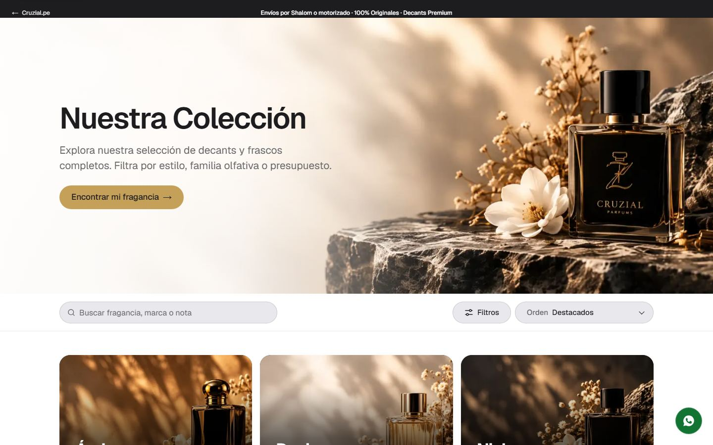
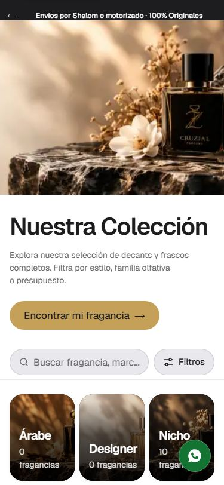
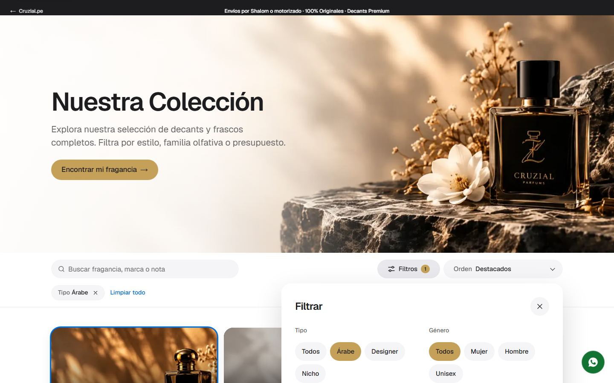
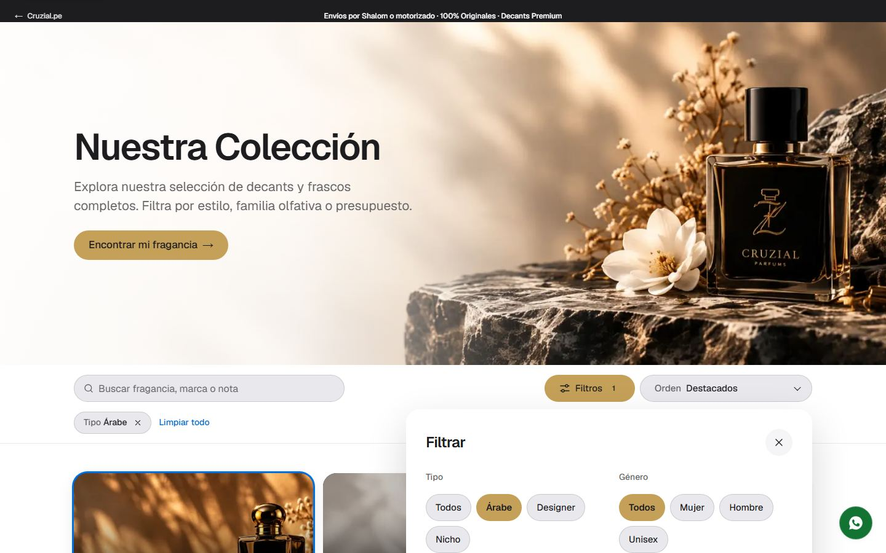
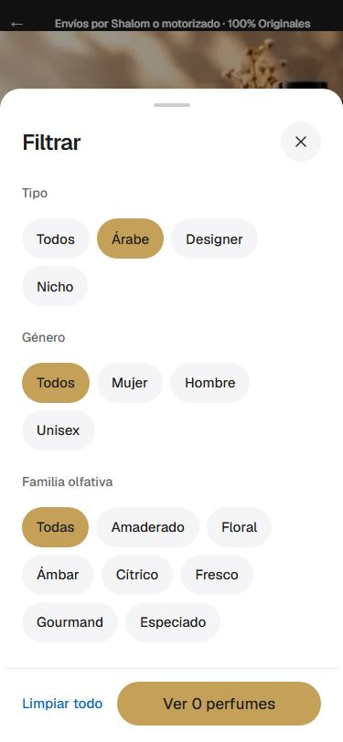
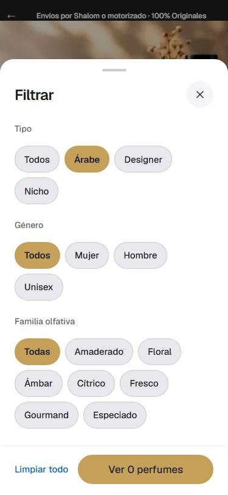

# Filtros del catálogo (`/parfums/catalogo`)

## Cambios

1. **Se elimina el conteo visible «N perfumes»** encima de la lista (`catalog-experience.tsx`). Para lectores de pantalla queda un
   `role="status"` oculto visualmente con el mismo texto, de modo que al filtrar se sigue anunciando cuántos resultados hay.
   *No se tocó:* el botón del panel «Ver N perfumes» (es la acción de cerrar con el número de resultados) ni los «N fragancias» de las
   tres puertas de categoría; si también sobran, es un cambio de una línea.
2. **Contraste de los controles** (`catalog-toolbar.module.css`): el buscador, «Filtros», «Orden», los chips del panel y los filtros
   activos eran píldoras `#F5F5F7` sobre blanco sin borde (frontera de 1.08:1), casi invisibles. Ahora:
   - Inactivo: gris `--ds-gray-100` (`#E8E8ED`) con un hilo de tinta de 1 px (`rgba(29,29,31,.14)`; `.32` al pasar el puntero). Texto en
     tinta (≈ 14:1).
   - **Activo: dorado `#C5A059` con texto tinta** (6.85:1) y peso 600; sin hilo.
   - «Filtros» con el panel abierto toma el dorado, como un chip seleccionado.
   - Íconos en `currentColor` tinta (visibles; el SVG de «Filtros» no se encogía y ahora tiene `flex: none`).
3. En móvil (375 px) el botón «Filtros» sigue completo dentro de la pantalla; el buscador recorta su texto con puntos suspensivos.

## Antes / después

| | Antes | Después |
|---|---|---|
| Barra, 1440 |  |  |
| Barra, 375 |  |  |
| Panel abierto, 1440 |  |  |
| Panel abierto, 375 |  |  |

(La captura «antes» ya incluye el dorado de #105 en el estado activo; lo nuevo es el contraste del estado inactivo.)

## Límites

- La frontera inactiva sigue siendo suave (≈ 1.4:1 con el hilo): el texto es lo que identifica el control (WCAG 1.4.11 se cumple por
  la etiqueta). Si se quiere más presencia, subir `--ds-control-ring`.
