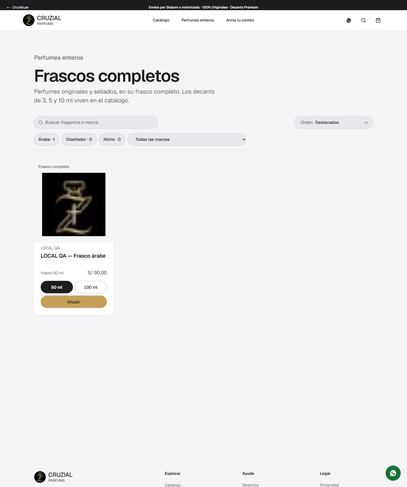
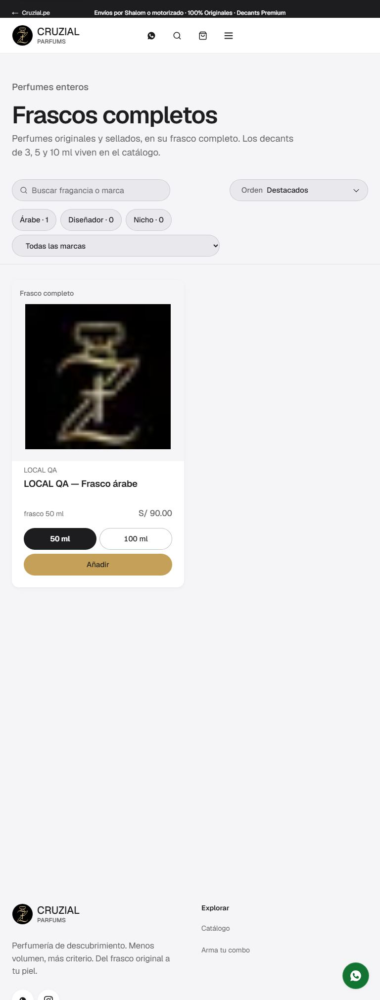
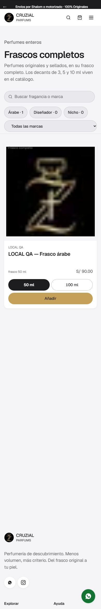
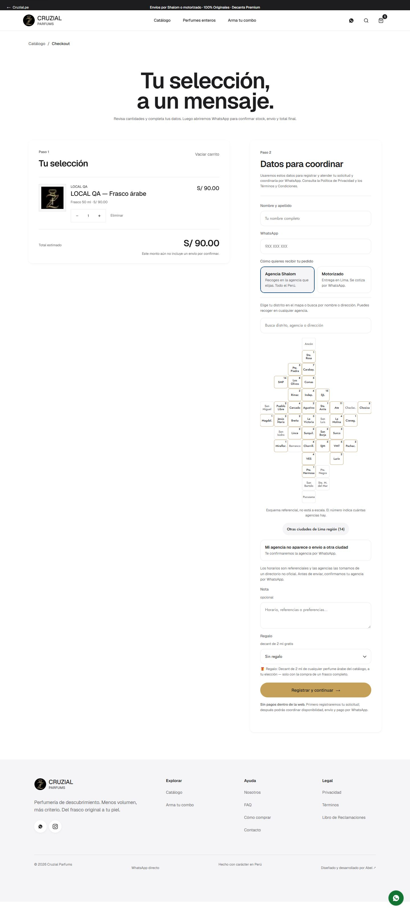
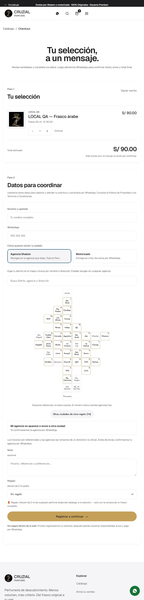
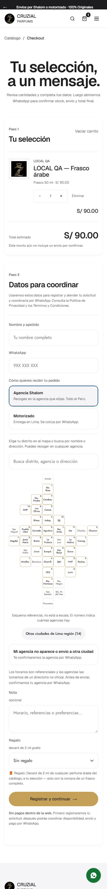

# Perfumes enteros (`/parfums/frascos`) y regalo de 2 ml en el checkout

Cierra la primera viñeta de «Qué NO incluye» de `docs/commercial-rules.md` §7: el selector de regalo
que el servidor y la base ya soportaban, más un catálogo que solo muestra frascos completos.
Sin migraciones: reusa `promotion_rules` (`gift_exclusion`), `attach_parfums_order_gift` y
`validateAndResolveParfumsOrder`.

## 1. Qué se agregó

1. **Ruta `/parfums/frascos`** (`app/parfums/frascos/page.tsx`), el catálogo de perfumes enteros.
   Mismo contrato de URL que `/parfums/catalogo` (`search`, `brand`, `type`, `gender`, `family`, `sort`, `vista`),
   pero el servidor solo envía productos con oferta de frasco.
2. **Enlace «Perfumes enteros»** en el header, entre «Catálogo» y «Arma tu combo» (`site-header.tsx`).
3. **Selector de regalo en el checkout** (`checkout-experience.tsx`): un `select` «Perfume de regalo (2 ml)»
   que aparece solo cuando el pedido lleva un frasco completo, con los árabes regalables y nunca el excluido.

## 2. La ruta de frascos

- **Datos** (`lib/catalog/parfums-frascos-page.ts`): parte del `loadParfumsStorefront()` ya cacheado, conserva
  los productos con `hasBottleVariant` (frasco publicado y disponible), aplica los filtros compartidos
  (`filterCatalogProducts`), **reordena por el precio del frasco** cuando el orden es por precio (el filtro
  compartido ordena por decant, el eje equivocado aquí) y pagina de 24 en 24. Se cachea por consulta bajo la
  etiqueta `parfums-catalog` (TTL 60 s), así que una mutación del admin invalida ruta y filas juntas.
- **Proyección** (`domains/catalog/bottle-card-product.ts`): `toBottleCardProduct` + `bottleSizeOptions`
  (tamaños ordenados, cada uno marcado disponible/agotado) y `defaultBottleSize` (el disponible más pequeño).
- **UI** (`components/parfums/frascos/*`): `bottle-card.tsx` con selector de tamaño por radio que añade la
  variante `bottle-{n}ml`; grilla 4/3/2/1 columnas. Los decants de 3/5/10 ml no aparecen: viven en el catálogo.
- **Lista de respaldo**: el catálogo de decants y el enlace `/perfumes-enteros.html` (que redirige a
  `/parfums/catalogo?format=bottle`) quedan intactos.

## 3. Regalo de 2 ml en el checkout

| Paso | Regla | Dónde |
|---|---|---|
| Elegibilidad | hay ≥ 1 línea con variante `group === "bottle"` y producto ≠ combo | `hasFullBottle` (`domains/commercial/gift.ts`) |
| Candidatos | árabes (`type === "arab"`), comprables, con id de base de datos y no excluidos; orden alfabético | `listGiftCandidates` |
| Exclusión por id | ids activos de la regla `gift_exclusion` de la unidad | `loadActiveGiftExclusions` (`lib/commercial/order-rules.ts`) |
| Validación del servidor | frasco entero + árabe + no excluido + comprable + con id | `checkGiftSelection`, reusado por `validateAndResolveParfumsOrder` |
| Persistencia | `attach_parfums_order_gift` → `orders.gift_product_id` | `app/parfums/checkout/actions.ts` |

`listGiftCandidates` se construye del mismo catálogo contra el que valida el servidor, así que el desplegable
solo puede ofrecer perfumes que `checkGiftSelection` aceptaría. El regalo se guarda **después** de crear el
pedido (igual que en `commercial-rules.md` §3): si la base lo rechazara, el pedido se conserva.
La exclusión (hoy «Club de Nuit Precieux I») la mantiene el dueño desde `/admin/parfums/reglas`.

## 4. Capturas

Datos de la pila local (`scripts/local-browser-fixtures.sql`): un frasco árabe con botella de 50 y 100 ml, un
árabe solo-decant como candidato y uno excluido. JPEG calidad 78, primeros 3200 px tras recorrer la página.

| Página | 1440 | 768 | 390 |
|---|---|---|---|
| Frascos |  |  |  |
| Checkout con regalo |  |  |  |

## 5. Pruebas

| Capa | Archivo | Qué cubre |
|---|---|---|
| Unitarias | `domains/catalog/catalog-query.test.ts` | `hasBottleVariant` (paridad con el filtro `format=bottle`; precio sin frasco disponible → falso) |
| Unitarias | `domains/catalog/bottle-card-product.test.ts` | tamaños ordenados y disponibilidad, tamaño por defecto, proyección de la tarjeta |
| Unitarias | `domains/commercial/gift.test.ts` | `listGiftCandidates` (árabes, comprables, con id, sin excluidos, orden) y `checkGiftSelection` |
| E2E | `e2e/full-bottles.spec.ts` | enlace del header y ruta solo-frascos; frasco → carrito/checkout «Frasco N ml»; el selector aparece solo con frasco y no ofrece el excluido; al elegir el regalo y enviar, `orders.gift_product_id` queda registrado |
| E2E | `e2e/accessibility.spec.ts` | axe sin violaciones serias/críticas en `/parfums/frascos` (los tres anchos) |

Los e2e corren en la pila local (`node scripts/local-admin-browser.mjs --seed e2e/full-bottles.spec.ts`); el
`--seed` ahora borra `.next/cache/fetch-cache` para que un servidor recién arrancado nunca sirva el catálogo
anterior a los fixtures.

## 6. Límites

- El selector exige un **frasco** en el carrito; no hay regalo para pedidos solo de decants (decisión del dueño).
- El catálogo de frascos no tiene editor de contenido propio: la publicación y los precios se administran como
  el resto del catálogo (`/admin/parfums/productos`).
- La lista de candidatos cabe entera en un `select`; si creciera mucho, valdría un buscador, no es el caso hoy.
