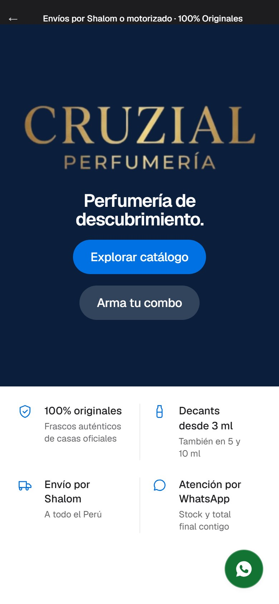
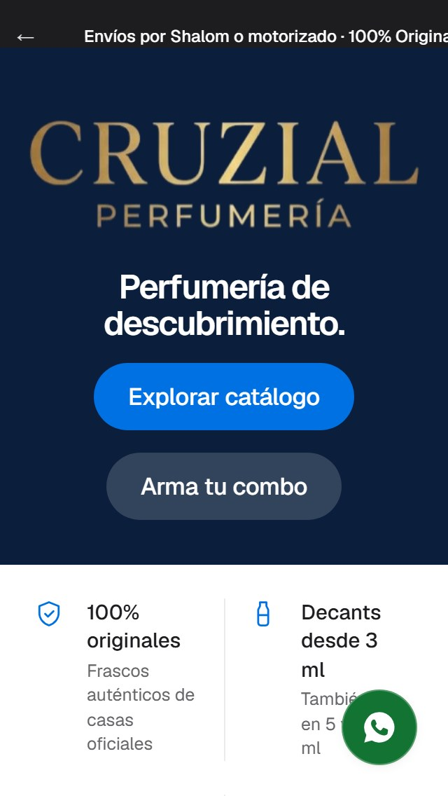

# Héroe de Parfums: seis variantes para recuperar el impacto de la imagen

**Rama:** `claude/hero-variants` (parte de `claude/apple-design-system` @ `3020eb5`). **Nada se mergea.**
Las variantes viven detrás de `?hero=a|b|c|d|e|ec|eb|f` en `/parfums` (sin parámetro = el héroe actual). Evidencia en
`docs/hero-variants/` (`hero-<variante>-<ancho>.jpg`: A, B, C y actual a 1440 y 390 px; D a 1440, 1024 y 390 px, más los dos assets nuevos). **La recomendación vigente es la de la sección 12** (F; D, E y EB están descartadas: D sintetiza píxeles, E y EB cambian de producto entre breakpoints).

## 1. Análisis de la imagen

`public/parfums/hero/hero-crop.webp` — 1672 × 792 px (2.11 : 1), dos grupos de frascos a los lados y el logotipo
"CRUZIAL PERFUMERÍA" **horneado** en el centro. Medido sobre el archivo (coordenadas de la imagen):

| Zona | Rectángulo (x0, y0, x1, y1) | Estado |
|---|---|---|
| **Wordmark** (monograma + CRUZIAL + PERFUMERÍA + filete) | 615, 130 → 1075, 600 | **Sagrada** |
| **Frascos izquierda** (Tom Ford, Erba Pura, Valentino) | 110, 245 → 570, 700 | **Sagrada** |
| **Frascos derecha** (Sauvage, 9pm, Guerlain) | 1125, 190 → 1670, 735 | **Sagrada** (el frasco de cristal llega a x = 1670, el borde) |
| **Humo superior** | 0, 0 → 1672, ~125 | **Prescindible**: oscuro y sin detalle; 16 % de la altura |
| **Repisa entre grupos** | 575, 640 → 1125, 792 | **Prescindible** (piedra): 550 × 150 px de espacio libre entre los dos grupos |
| Follaje lateral | x < 100 y la repisa de abajo | Prescindible |

**Por qué "se perdió el 20 %".** No es que el héroe actual tenga menos imagen: es que **a 1440 × 864 la versión anterior hacía
`cover` por altura** (escala 1.09, recortando 190 px por lado: ya cortaba el frasco de cristal de la derecha) y la actual
muestra la imagen **entera** a escala 0.86 (−21 %) para dejar una franja inferior de 190 px al titular. Los datos:

| Escala de la imagen a 1440 px | Qué se ve |
|---|---|
| 1.09 (master) | wordmark entero, frascos izquierdos 86 %, derechos 68 % |
| 0.86 (héroe actual) | todo, el 74 % del primer viewport es arte |
| **0.92 (máximo sin cortar un solo frasco)** | todo; recorta sólo 90 px de follaje a la izquierda |

## 2. Las tres variantes

Métricas (script, 1440 × 900 salvo indicación; "arte en el viewport" = % de la primera pantalla ocupada por la imagen;
visibilidad = % de cada zona sagrada que queda en pantalla; contraste = texto blanco del `h1` contra el 95.º percentil de
luminosidad del píxel de detrás, medido sin texto):

| | Actual | **A · Velo** | **B · Zonas libres** | **C · Recorte sagrado** |
|---|---|---|---|---|
| Escala de la imagen (1440) | 0.86 | **1.09** | **1.09** | 0.92 |
| Arte en el viewport 1440 | 74 % | **96 %** | **96 %** | 81 % |
| Arte en el viewport 390 | 55 % | 55 % | 55 % | **68 %** |
| Wordmark visible | 100 % | 100 % | 100 % | 100 % |
| Frascos izq. / der. visibles (1440) | 100 / 100 | 86 / 68 | 86 / 68 | **100 / 100** |
| Frascos izq. / der. visibles (1920) | 100 / 100 | 100 / 81 | 100 / 81 | 100 / 100 |
| Texto sobre zona sagrada | 0 % | **5 %** (1440), 9 % (1024) | **0 %** | 0 % |
| Contraste del titular (1440 / 390) | 19.7 / 19.4 | 7.2 / 18.7 | 17.4 / 18.2 | 16.8 / 9.1 |
| Alto de los CTA | 48 px | 48 px | 48 px | 48 px |

Todos los CTA miden 48 px, el `h1` sigue siendo el primer encabezado y visible, y el contraste del titular es ≥ 7:1 en
todos los casos medidos (AA exige 3:1 para texto grande).

### A · "Velo" — la imagen a pantalla completa, titular sobre un degradado

- **Idea:** como en master (`cover`, 100 svh) y el titular encima, sobre un degradado negro que sube desde el borde
  inferior (0.78 → 0 en el 46 % inferior). El texto se limita a 3 rem para caber en la repisa central.
- **Pros:** máximo impacto (arte 96 % del primer viewport), es la solución más reconocible de "héroe de lujo", sin franja
  vacía; contraste 7.2:1.
- **Contras:** el degradado **oscurece la base de los frascos** y la repisa (la parte más cálida de la foto); el titular
  roza la base de Valentino (5 % del texto sobre zona sagrada, 9 % en 1024); recorta el frasco de cristal derecho (32 %)
  y parte de Tom Ford, igual que master; en móvil no cambia nada.
- **Coste:** bajo (sólo CSS).

### B · "Zonas libres" — el titular integrado en el arte, sin tocar nada sagrado

- **Idea:** misma imagen a pantalla completa, pero el titular va en el **humo superior** (por encima del monograma) y los
  CTA en la **repisa central** entre los dos grupos de frascos: justo las dos zonas prescindibles que midió el análisis.
  Sólo hay dos velos suaves arriba y abajo (0.55 → 0 en el 22–24 %), ninguno sobre un frasco.
- **Pros:** **0 % del texto sobre zonas sagradas en los 4 anchos medidos**; el mismo arte a escala 1.09 y 96 % del viewport;
  la estructura "titular → imagen → acciones" se lee como un cartel; contraste 17:1.
- **Contras:** titular más pequeño (2.5 rem frente a 3.5) porque el humo sólo da ~140 px; separa titular y CTA (~650 px) en
  desktop, lo que cuesta algo de "un solo golpe de vista"; también recorta frascos laterales como master (86 % / 68 %);
  en móvil el titular queda arriba y los CTA abajo, con la imagen en medio (más "editorial", menos directo).
- **Coste:** bajo (CSS + el orden del DOM ya es el correcto).

### C · "Recorte sagrado" — la mayor escala que no corta ningún frasco

- **Idea:** el techo físico de escala sin perder un solo frasco es 0.92 (recortando sólo los 100 px de follaje izquierdo con
  `object-position: 100%`). Se reduce la franja a 128–160 px (frente a 152–200) y titular + CTA van **en una sola fila**; un
  fundido suave une la repisa con la franja. En móvil la imagen sube a 310 % del ancho.
- **Pros:** **ningún frasco recortado** (100 / 100 en 1440 y 1920); el wordmark nunca se toca; +7 puntos de arte en el
  viewport (74 → 81 %) y en móvil +13 (55 → 68 %); es la opción más fiel a "la imagen es el activo".
- **Contras:** **no recupera el impacto de master** (0.92 frente a 1.09: −16 %): el cliente que vio la versión anterior seguirá
  notando la imagen más pequeña; a 1024 px la ventana es estrecha y recorta frascos (88 % / 70 %); la fila titular + CTA es
  ancha (~900 px) y en pantallas < 1100 envuelve; en móvil la imagen ocupa más pero los frascos desaparecen (1 % / 0 %)
  porque se ve sólo el wordmark.
- **Coste:** bajo (sólo CSS).

## 3. Recomendación

**B ("Zonas libres").** Razones:

1. Es la única variante que **recupera la escala de master (1.09, 96 % del viewport) sin poner texto sobre ninguna zona
   sagrada** (0 % de solape): el título y los botones viven en los dos espacios que la imagen ya traía vacíos.
2. No oscurece la foto (A sí) ni hace pasar la imagen por un recorte menor (C).
3. Cumple lo exigido: `h1` visible y primero en el DOM, contraste ≥ 17:1 (AA ≥ 3:1), CTA de 48 px.

**Reservas honestas.** (a) Recorta lo mismo que master en los extremos (frasco de cristal derecho 32 %): si el dueño no
acepta ese recorte, la respuesta es **C**, que es la única que no corta un frasco; (b) el titular es más pequeño y está
separado de los botones: conviene mirarlo en el teléfono de la clienta antes de decidir; (c) A es la alternativa más
"estándar" si se prefiere el texto agrupado abajo y se acepta el degradado.

**Decisión que necesito:** A, B o C (o una combinación, p. ej. B con la escala de C). Hasta entonces no se toca master ni
`claude/apple-design-system`; si eliges, la implementación definitiva sustituye el parámetro `?hero=` por el diseño elegido.

## 4. Variante D · "Reencuadre": se edita el asset, no el CSS

Las tres variantes anteriores operan con CSS sobre una imagen 1672 × 792 que no se puede acomodar a todos los formatos. D
parte de otra hipótesis: **entregar el arte ya encuadrado para cada formato** y mostrarlo a escala 1.0 (la imagen nunca se amplía
ni se recorta con `object-fit`), con el titular en la franja de tinta que queda debajo. Viva en `?hero=d`.

### 4.1 Qué se puede recortar (y qué no) del original

| Zona | Rectángulo (imagen original) | Veredicto |
|---|---|---|
| Humo superior | y 0 → 88 | **Muerto** (oscuro, sin detalle; el logotipo empieza en y = 130) |
| Follaje izquierdo | x 0 → 95 | **Muerto** (hojas; el primer frasco empieza en x = 110) |
| Borde derecho | x > 1670 | **No se toca**: el frasco de cristal de Guerlain llega a x = 1670 |
| Repisa inferior | y 764 → 792 | **Muerto** (28 px de piedra bajo los frascos, que acaban en y = 735) |
| Wordmark, 6 frascos | ver sección 1 | **Intactos** |

### 4.2 Los dos assets (originales sin tocar; archivos nuevos)

| Asset | Archivo | Píxeles | Proporción | Cómo se obtiene |
|---|---|---|---|---|
| Desktop y tablet apaisada | `public/parfums/hero/hero-d-wide.webp` | 1577 × 676 (109 KB) | **21:9** exacta | **Recorte puro** del original: x 95 → 1672, y 88 → 764. Ni un píxel inventado. |
| Móvil y tableta vertical | `public/parfums/hero/hero-d-portrait.webp` | 1100 × 1375 (102 KB) | **4:5** exacta | **Recomposición** con los píxeles del original: bloque del wordmark arriba y los dos grupos de frascos lado a lado debajo, con fundidos en las uniones. **El humo de fondo que une las piezas está sintetizado** (degradado con ruido derivado de los bordes del propio humo): es edición de arte, no un recorte. |

Un recorte 4:5 del original no puede contener los dos grupos de frascos (mueven 1 560 px de ancho en 792 de alto), por eso en
móvil hace falta recomponer. `hero-d-portrait.webp` es la pieza que necesita visto bueno de quien lleve la marca.

### 4.3 Implementación (sólo en `claude/hero-variants`)

- `HeroArtworkD` en `hero-carousel.tsx`: `<picture>` con `getImageProps` de `next/image` (arte dirigido); el `<source>` vertical
  se usa con `(max-width: 767px), (max-width: 1100px) and (orientation: portrait)`; `fetchPriority="high"`, `quality` 60. Mismo `h1`
  y mismos enlaces que el héroe actual.
- CSS: el héroe pasa a altura automática = arte + franja. Sin velo sobre el arte. Un fundido de 16 % funde la repisa en la
  tinta. En pantallas bajas el arte vertical pierde como máximo el humo superior (17 % del cuadro) con `object-position: 50% 100%`;
  nunca un frasco.
- Peso servido (optimizador de Next, `q=60`): desktop 83 KB a 1577 px (el héroe actual: 87 KB); **móvil 29 KB a 640 px / 41 KB
  a 828 px** (el héroe actual en móvil descarga la imagen a 250 % del ancho: 44–87 KB).

### 4.4 Medidas (misma metodología que la sección 2, 5 anchos)

| | Actual | A | B | C | **D** |
|---|---|---|---|---|---|
| Escala de la imagen 1440 / 390 / 1024 | 0.86 / 0.58 / 0.71 | 1.09 / 0.58 / 0.92 | 1.09 / 0.58 / 0.92 | 0.92 / 0.72 / 0.76 | **0.91 / 0.36 / 0.65** |
| Anchura del wordmark en px (1440 / 390) | 396 / 268 | 502 / 268 | 502 / 268 | 423 / 333 | **420 / 163** |
| Arte en el viewport 1440 / 1024 / 390 | 74 / 73 / 55 % | 96 / 95 / 55 % | 96 / 95 / 55 % | 81 / 79 / 68 % | **69 / 57 / 58 %** |
| Frascos izq. / der. visibles, **1440** | 100 / 100 | 86 / 68 | 86 / 68 | 100 / 100 | **100 / 100** |
| Frascos izq. / der. visibles, **1024** | 99 / 79 | 63 / 49 | 63 / 49 | 88 / 70 | **100 / 100** |
| Frascos izq. / der. visibles, **820 (vertical)** | 17 / 10 | 4 / 0 | 4 / 0 | 14 / 8 | **100 / 100** |
| Frascos izq. / der. visibles, **390** | 15 / 8 | 15 / 8 | 15 / 8 | 1 / 0 | **100 / 100** |
| Wordmark visible (todos los anchos) | 100 % | 100 % | 100 % | 100 % | **100 %** |
| Texto sobre zona sagrada (peor ancho) | 3 % | 9 % | 0 % | 0 % | **0 %** |
| Contraste del `h1` (peor ancho) | 14.2 | 7.2 | 16.7 | 9.1 | **16.8** |
| Alto de los CTA | 48 px | 48 | 48 | 48 | **48** |
| `h1` presente y primer encabezado | sí | sí | sí | sí | **sí** |
| axe (WCAG 2.2 A/AA) sobre el héroe, 3 anchos | — | — | — | — | **0 violaciones** |

Capturas: `docs/hero-variants/hero-d-reencuadre-1440.jpg`, `…-1024.jpg`, `…-390.jpg`.

### 4.5 Lectura honesta

**Lo que gana D**
- Es la única variante con **los seis frascos y el wordmark completos en todos los anchos**, incluidos 1024 (88/70 en C), la
  tableta vertical (17/10 en el actual) y el móvil (15/8 en el actual, 1/0 en C). Hoy, en móvil, el visitante ve el logotipo y
  casi nada del producto.
- 0 % de texto sobre arte, contraste 16.8:1, sin velo sobre la foto (A) ni degradado que oscurezca la base de los frascos.
- Mismo tamaño de frasco que C en 1440 (0.91 frente a 0.92) y +6 % respecto al actual, sin la máscara ni el desplazamiento.
- Más ligera en móvil (29–41 KB frente a 44–87 KB).

**Lo que cuesta D**
- **Menos superficie de arte en pantalla en escritorio**: 69 % del primer viewport a 1440 (74 % el actual, 81 % C, 96 % A/B) y
  57 % a 1024. Se debe a que recortar el humo muerto acorta el cuadro: a un ancho dado, un 21:9 es más bajo que un 2.1:1. **No
  recupera el "impacto" medido en píxeles de A/B**; sólo iguala el tamaño del producto de C.
- **El wordmark se hace pequeño en móvil**: 163 px de ancho frente a 268 px actuales (−39 %): es el precio de mostrar todos los
  frascos. En 390 px el nombre sigue legible pero ya no domina.
- El asset vertical es una **recomposición con fondo sintetizado**: hay que aprobarla y, si se adopta, que diseño la rehaga con
  el archivo original en alta resolución (el actual es 1672 px).
- A diferencia de A/B, el héroe ya no ocupa el 100 % de la pantalla (813 px a 1440 × 900; 757 px a 390 × 844): asoma una franja de unos 45–55 px de la
  sección siguiente, algo que puede verse como pista de scroll o como pérdida de inmersión.

## 5. Comparación A · B · C · D

| Criterio | A · Velo | B · Zonas libres | C · Recorte sagrado | D · Reencuadre |
|---|---|---|---|---|
| Cambia | CSS | CSS | CSS | **asset** + CSS |
| Frascos cortados en 1440 | sí (32 % der.) | sí (32 % der.) | **no** | **no** |
| Frascos cortados en móvil | sí | sí | sí (casi todos) | **no** |
| Tamaño del producto en 1440 | 1.09 | 1.09 | 0.92 | 0.91 |
| Superficie de arte en 1440 | **96 %** | **96 %** | 81 % | 69 % |
| Texto sobre zona sagrada | hasta 9 % | **0 %** | **0 %** | **0 %** |
| Titular | sobre degradado | en el humo, lejos de los CTA | en una franja fina | **en franja natural propia** |
| Riesgo | oscurece la foto | titular pequeño y separado | pierde impacto | **asset recompuesto; héroe más bajo; wordmark pequeño en móvil** |
| Esfuerzo si se elige | bajo | bajo | bajo | **medio (diseño del asset 4:5)** |

## 6. Recomendación final

**D, condicionada a aprobar el asset vertical.** Es la única que resuelve las dos objeciones al mismo tiempo (nada de producto
cortado y titular en una franja que respeta el arte) y la única que arregla el móvil, donde hoy casi no se ve producto. Lo que no
hace es "recuperar el impacto" en el sentido de superficie de arte en escritorio: eso sólo lo da **B** (96 %), a costa de cortar el
frasco de cristal derecho (32 %).

Regla para decidir:
- **Prima no cortar producto y que el móvil enseñe el catálogo → D** (con el asset 4:5 rehecho por diseño a partir del original).
- **Prima la máxima presencia de la foto en escritorio y se acepta el recorte → B.**
- **No se quiere tocar el arte → C** (tamaño idéntico a D en escritorio, sin cambios de asset, pero en móvil no se ve producto).

No se ha mergeado nada; `claude/hero-variants` queda como rama de evidencia.

## 7. Variante E · "Sin síntesis": sólo píxeles que ya existen

**Restricción:** una marca de lujo no inventa arte. D sintetiza humo en el asset móvil y queda descartada por esa regla. E usa
**únicamente recortes de originales**; si no hay original, se renuncia a mostrar el frasco antes que fabricarlo.

### 7.1 Búsqueda de un original 4:5 con wordmark + frascos completos

| Dónde se buscó | Qué se revisó | Resultado |
|---|---|---|
| Árbol del repo | 288 imágenes versionadas, hoja de contactos de las 46 con pinta de héroe/banner (1672×941, 2172×724, 1122×1402…) | Sólo `hero-crop.webp/.jpg` (1672×792) combina wordmark horneado y la línea de frascos; es apaisada (2.11:1). Los 1122×1402 (4:5) son un único frasco Cruzial sobre negro (`PERFUME NEGRO`, `PERFUME DORADO`, `parfums-authenticity`…): llevan el logotipo en la etiqueta, no la composición. |
| Manifiesto de Cloudinary | `supabase/staging/client-media-cloudinary.json`: 190 URLs | Todas son fotos de producto; ninguna de héroe/marca. |
| Historial de git (`--all`) | `img/hero/*`, `hero.png` (raíz), versiones previas de `hero-crop` | **`hero2.png` (1376×768, commit `0c3752b`, 30-ago-2026)**: otro héroe, ya retirado del árbol en `14e9323`. Una ventana 4:5 de 614×768 contiene **wordmark + 4 frascos completos**. También `hero.png` (1024×572, `d3cc623`) y un `hero-crop` anterior (1024×417): apaisados y de menor resolución. |
| Perfil del usuario (Escritorio / OneDrive) | proyectos hermanos (Fragance Obsession, JNAFRAGANCE…) | Sólo fotos de producto; ningún héroe de Cruzial. |

**Conclusión:** sí existe un original utilizable, pero **no es el de escritorio**: es el héroe anterior. Se recupera con
`git show 0c3752b:img/hero/hero2.png`.

### 7.2 Los assets de E (todos recortes puros, ninguno sintetizado)

| Formato | Archivo | Origen | Píxeles |
|---|---|---|---|
| Escritorio y tableta apaisada | `hero-d-wide.webp` (el de D) | `hero-crop.webp`, x 95–1672, y 88–764 | 1577 × 676 (21:9) |
| **Móvil y tableta vertical (E)** | `hero-e-hero2-4x5.webp` | `hero2.png`, x 706–1320, y 0–768 | 614 × 768 (4:5), 38 KB servidos |
| Móvil, plan B sin original 4:5 (EC) | `hero-e-center.webp` | `hero-crop.webp`, x 575–1125, y 70–660 (la columna del wordmark, entre los dos grupos de frascos) | 550 × 590, 15 KB servidos |

Variantes en el sitio (`/parfums?hero=…`):
- **`e`**: escritorio D + móvil con el recorte de `hero2` (el que cumple el punto 2 del encargo).
- **`ec`** (plan B del punto 4, ya construido y medido): escritorio D + móvil con la columna del wordmark al 78 % del ancho,
  bordes difuminados, suelo del héroe del color del humo. **Ningún frasco se ve y ninguno se corta**; el wordmark queda más pequeño
  que en C (254 px frente a 333 px) y el héroe mide 596 px de alto en 390 × 844 (el actual, 810).
- **`eb`** (alternativa pura extra): la banda 21:9 completa también en móvil. Todos los frascos, wordmark de 114 px.

Capturas de E a 1440, 1024, 768, 390 y 375 px: `docs/hero-variants/hero-e-sin-sintesis-<ancho>.jpg`. Del plan B:
`hero-ec-columna-movil-{768,390,375}.jpg`; de la banda: `hero-eb-banda-movil-{390,375}.jpg`.

### 7.3 Implementación

`HeroArtworkD` (comparte estructura con D): `<picture>` con `getImageProps`, origen vertical bajo
`(max-width: 767px), (max-width: 1100px) and (orientation: portrait)`. Para `e` el arte **nunca se recorta con CSS**: en pantallas
bajas (iPhone SE, 375 × 667) se reduce su anchura (`min(100%, (100svh − 256px) × 0.8)`), no se corta el monograma.

### 7.4 Medidas (misma metodología; 5 anchos)

| | 1440 | 1024 | 768 (vertical) | 390 | 375 |
|---|---|---|---|---|---|
| **E** · escala de la imagen | 0.91 | 0.65 | 1.00 | 0.64 | 0.54 |
| **E** · wordmark (px de ancho) | 420 | 299 | 275 | 175 | 147 |
| **E** · frascos visibles izq. / der. | 100 / 100 | 100 / 100 | 100 / 100 | 100 / 100 | 100 / 100 |
| **E** · wordmark visible | 100 % | 100 % | 100 % | 100 % | 100 % |
| **E** · arte en el viewport | 69 % | 57 % | 60 % | 58 % | 54 % |
| **E** · texto sobre zona sagrada | 0 % | 0 % | 0 % | 0 % | 0 % |
| **E** · contraste del `h1` | 16.8 | 16.8 | 16.8 | 16.8 | 16.8 |
| **E** · CTA | 48 px | 48 | 48 | 48 | 48 |
| EC · frascos visibles / wordmark px | 100 / 420 | 100 / 299 | 0 (ninguno) / 401 | 0 (ninguno) / 254 | 0 (ninguno) / 245 |
| EB · frascos visibles / wordmark px | 100 / 420 | 100 / 299 | 100 / 224 | 100 / 114 | 100 / 109 |

axe (WCAG 2.2 A/AA) sobre el héroe: **0 violaciones** en E, EC y EB a 1440, 768, 390 y 375 px. (En EC la métrica «texto sobre zona
sagrada» da 1–8 % porque el rectángulo del frasco izquierdo, que **no se dibuja**, se extiende bajo el titular: es un artefacto del
cálculo, no texto sobre arte.)

### 7.5 Por qué no hay una opción mejor sin síntesis

1. La composición actual mide 1 560 px de producto en 1 672 de ancho y 792 de alto. **Cualquier ventana 4:5 de esa imagen contiene
   o el wordmark o un grupo de frascos, nunca todo**: para tener todo hay que recomponer (D), es decir, inventar la unión.
2. No existe en el repo, en Cloudinary ni en el historial otra fotografía vertical con esa composición. El único original vertical
   utilizable es el héroe antiguo (`hero2`), que es **otra composición**.
3. Lo que se puede hacer sin síntesis se reduce a tres opciones, todas medidas: mostrar el original antiguo (E), mostrar sólo el
   wordmark sin frascos (EC/C) o mostrar la banda completa pequeña (EB/D-banda).

### 7.6 Riesgos de E (a decidir por la marca)

- **No es el mismo arte que en escritorio:** `hero2` tiene 4 frascos (Valentino, Erba Pura, Tom Ford, 9 PM) y el de escritorio 6.
  Además el Tom Ford de `hero2` es un frasco transparente con etiqueta, distinto del negro del héroe actual, y se ve menos
  convincente. Móvil y escritorio mostrarían composiciones diferentes.
- **Baja resolución:** 614 × 768 nativos. A 390 px de ancho con densidad 2 hace falta 780 px (×1.27 de ampliación); con densidad 3,
  ×1.9. Se verá algo blando. Con el archivo de alta resolución de `hero2` (si existe en manos del diseñador) el problema desaparece.
- `hero2.png` está fuera del árbol desde `14e9323`: hay que confirmar con el dueño que sigue siendo un activo aprobado.

## 8. Comparación final A · B · C · D · E

| Criterio | A · Velo | B · Zonas libres | C · Recorte sagrado | D · Reencuadre | **E · Sin síntesis** |
|---|---|---|---|---|---|
| Arte nuevo / inventado | no | no | no | **sí (humo sintetizado)** | **no** |
| Cambia | CSS | CSS | CSS | asset + CSS | asset (recortes) + CSS |
| Frascos cortados en 1440 | sí (32 % der.) | sí (32 % der.) | no | no | **no** |
| Frascos visibles en móvil 390 | 15 / 8 % | 15 / 8 % | 1 / 0 % | 100 / 100 % | **100 / 100 % (4 frascos de otro set)** |
| Frascos visibles en 1024 | 63 / 49 % | 63 / 49 % | 88 / 70 % | 100 / 100 % | **100 / 100 %** |
| Tamaño del producto en 1440 | 1.09 | 1.09 | 0.92 | 0.91 | **0.91** |
| Wordmark en móvil (390 / 375) | 268 / 258 px | 268 / 258 | 333 / 320 | 163 / 157 | **175 / 168** |
| Superficie de arte en 1440 | 96 % | 96 % | 81 % | 69 % | **69 %** |
| Texto sobre zona sagrada | hasta 9 % | 0 % | 0 % | 0 % | **0 %** |
| Contraste del `h1` | ≥ 7.2 | ≥ 16.7 | ≥ 9.1 | 16.8 | **16.8** |
| Descarga móvil del héroe | 44–87 KB | 44–87 KB | 44–87 KB | 29–41 KB | **38 KB** (EC: 15 KB) |
| Riesgo principal | oscurece la foto | titular pequeño y separado | pierde impacto, sin producto en móvil | **inventa píxeles** | **arte distinto en móvil y baja resolución** |

(A y B no se midieron a 768 y 375 en esta ronda; sus columnas de 1440, 1024 y 390 vienen de las secciones 2 y 4.)

## 9. Recomendación final (vigente; sustituye a las secciones 3 y 6)

1. **D queda descartada** por la regla «no se inventan píxeles».
2. **Recomiendo E**, condicionada a que el dueño apruebe usar `hero2` en móvil. Es la única variante que cumple a la vez: ningún
   píxel inventado, ningún frasco cortado en ningún ancho (los 4 de `hero2` completos en móvil, los 6 completos en escritorio),
   0 % de texto sobre el arte, contraste 16.8:1 y producto visible en el teléfono. Pide dos cosas: **el archivo de `hero2` en alta
   resolución** (614 px es justo) y **aceptar que móvil y escritorio muestran composiciones distintas**.
3. **Si no se acepta el arte antiguo, EC** (`?hero=ec`): sin síntesis, mismo arte en todos los dispositivos, wordmark de 254 px,
   nada de producto en el teléfono (queda ninguno visible y ninguno cortado). Es C con menos wordmark.
4. **B** sólo si se prioriza la superficie de foto en escritorio (96 %) y se acepta cortar el frasco de cristal derecho (32 %).

No se ha mergeado nada; `claude/hero-variants` queda como rama de evidencia (basada en el historial anterior a la
reescritura; habrá que rebasarla sobre `claude/apple-design-system` cuando se elija).

## 10. Variante F · "Tipográfica": el wordmark oficial en lugar de imagen, en móvil

**Contexto:** E y EB quedan **rechazadas** (cambian de producto entre breakpoints y rompen la coherencia de marca). F no muestra
producto en móvil: sólo el wordmark oficial sobre un fondo sólido, al estilo de las páginas de AirPods o HomePod. En escritorio
conserva el recorte puro 21:9 (que ya lleva ese mismo wordmark horneado), así que **ningún producto cambia entre breakpoints**: en
móvil simplemente no hay producto.

### 10.1 ¿Existe el wordmark oficial como asset separado?

| Archivo | Contenido | Formato | Veredicto |
|---|---|---|---|
| **`logo.jpeg`** (raíz del repo) | **Lockup oficial «monograma + CRUZIAL + PERFUMERÍA»**, dorado | JPEG 499 × 494, RGB, **fondo negro (≈ 1,1,1), sin transparencia** | **Sí existe**, pero no en SVG ni PNG con alfa |
| `apps/web/public/parfums/logo-mark.png` (= `img/logo-mark.png`) | sólo el monograma | PNG 256 × 256, RGB, fondo negro | Es el isotipo, no el wordmark |
| `public/images/import-home/cruzial-import-logo.png` | logotipo de **Cruzial Import** (azul/plata) | PNG 1254 × 1254 | Otra marca; no se usa |
| `src/app/icon.png` | favicon | PNG 32 × 32 con alfa | No sirve |
| Búsqueda de `*.svg`, carpeta de marca, Cloudinary (190 URLs), Escritorio/OneDrive | — | — | Ningún SVG ni carpeta de marca; Cloudinary sólo trae fotos de producto |

**Como existe, no se usa el recorte de `hero2` (instrucción 3 no aplica) y no se reconstruye nada con tipografía.**

### 10.2 Cómo se obtiene el asset de F

`logo.jpeg` tiene el negro como fondo, así que sobre navy se vería una caja negra. Se pasa a transparencia **por luminancia** (llave
de negro): `alfa = clamp((máx(r,g,b) − 14) / (90 − 14))` y el color de los bordes se vuelve a normalizar dividiendo por el alfa;
**el interior de los trazos no cambia y no se dibuja nada nuevo**. Se recorta a «CRUZIAL / PERFUMERÍA» (x 36–476, y 326–456 del
original) y se guarda como WebP sin pérdida: `public/parfums/hero/hero-f-wordmark.webp`, 440 × 130, 35 KB, servido tal cual (sin
pasar por el optimizador, que recodificaría con pérdida el degradado dorado). Se probaron tres umbrales (90, 130, 180); el de 90
deja los bordes más limpios sobre navy.

El monograma queda fuera de esta versión (sigue en la cabecera). Si se quiere el lockup completo basta recortar también el
monograma (y 36–304 del original); ocuparía ~320 px de alto y sacaría al héroe del ~60 vh.

### 10.3 Diseño y aplicación (`/parfums?hero=f`)

- **Móvil y tableta vertical** (`(max-width: 767px), (max-width: 1100px) and (orientation: portrait)`): fondo sólido
  `--ds-color-navy`; wordmark centrado de **337 px de ancho** (letras «CRUZIAL» de **54 px de alto**, dentro del rango 48–64;
  nunca más ancho que la pantalla: 46 px a 320 px); el `h1` «Perfumería de descubrimiento.» (≈ 25 px, blanco) como línea de
  apoyo y los dos CTA de 48 px debajo, centrados; **altura ≈ 60 svh**; sin imagen de producto. En tableta vertical (≥ 600 px) el
  wordmark pasa a 420 px (67 px de alto de letra).
- **Escritorio y tableta apaisada:** el mismo recorte 21:9 de D/E, sin cambios.
- El wordmark se sirve vía `<picture>` (sólo se descarga el asset del breakpoint activo). `alt="Cruzial Perfumería"`.
- Tagline: la marca ya trae «PERFUMERÍA» dentro del lockup; el `h1` hace de línea descriptiva. No se inventó ningún texto.

Capturas (densidad 2): `docs/hero-variants/hero-f-tipografica-{390,375,360,320,768}.jpg`.

### 10.4 Medidas

| | 390 × 844 | 375 × 667 | 360 × 800 | 320 × 568 |
|---|---|---|---|---|
| Altura del héroe (porcentaje del alto) | 506 px (60 %) | 400 px (60 %) | 480 px (60 %) | 369 px (65 %) |
| Wordmark «CRUZIAL»: ancho / alto de letra | 322 / 54 px | 322 / 54 px | 316 / 53 px | 277 / 46 px |
| Contraste del `h1` (blanco sobre `#0B1F3D`) | 16.4 | 16.4 | 16.4 | 16.4 |
| CTA | 48 px | 48 px | 48 px | 48 px |
| Scroll horizontal | no | no | no | no |
| Asoma el carrusel de producto (sección 3) | sí, 75 px | no (5 px) | sí, 20 px | no |
| Asoma al menos la franja de garantías | sí | sí | sí | sí |

axe (WCAG 2.2 A/AA) sobre el héroe: **0 violaciones** a 1440, 768, 390 y 375 px. Contraste del dorado del wordmark sobre navy:
mediana 5.9:1, p95 10.6:1, **p5 2.5:1** (los extremos más oscuros del degradado se apagan sobre el navy); un logotipo está exento de
1.4.3, pero conviene saberlo.

**Sobre «que el carrusel asome»:** entre el héroe y el carrusel de producto está la franja de garantías (228 px). Con el héroe a
60 svh, el carrusel sólo asoma en teléfonos altos (≥ 800 px); en pantallas cortas lo que asoma es la franja de garantías. Para
que el carrusel asome en todos haría falta bajar el héroe a ~40 svh, lo que deja de ser un héroe.

### 10.5 Límites

- **Resolución:** el wordmark mide 421 px de ancho en el original (499 px el archivo). Mostrado a 337 px con densidad 2–3 se amplía
  ×1.6–2.4 y **se ve algo blando** (visible en las capturas a densidad 2). Es el mejor original que existe; la solución es que la
  marca entregue el wordmark en **vectorial (SVG)**, con lo que F pasaría a ser nítido a cualquier escala.
- **El asset de F es derivado** (llave de luminancia de un JPEG). Es el wordmark oficial sin cambios de forma, pero conviene
  validarlo con quien lleve la marca.
- La tableta vertical (768 × 1024) queda con un héroe de 614 px sobre 1 024: es austero, coherente con el estilo.

## 11. Comparación F · EC · B (móvil)

| Criterio | **B · Zonas libres** | **EC · Columna sin síntesis** | **F · Tipográfica** |
|---|---|---|---|
| Qué se ve en móvil | arte recortado: wordmark + 15 / 8 % de frascos | wordmark del arte, sin frascos | wordmark oficial sobre navy, sin imagen |
| Producto cortado | **sí** (frascos parciales) | no (ninguno visible) | no (ninguno visible) |
| Coherencia con escritorio | mismo arte recortado distinto | mismo arte, otra ventana | mismo wordmark; sin producto en móvil |
| Píxeles inventados | no | no | no (llave de luminancia, sin dibujar) |
| Ancho del wordmark a 390 / 375 / 360 / 320 | 268 / 258 / 248 / 220 px | 254 / 245 / 235 / 209 px | **322 / 322 / 316 / 277 px** |
| Altura del héroe a 390 × 844 | 810 px (96 %) | 596 px (70 %) | **506 px (60 %)** |
| Contraste del `h1` (peor ancho) | 12.4 | 19.4 | **16.4** |
| Texto sobre zona sagrada (peor ancho) | **12 %** a 320 px | 1 % (artefacto) | 0 % (no hay arte) |
| Descarga del héroe en móvil | 44–87 KB | 15 KB | **35 KB** (sin recodificar) |
| Nitidez | la del arte (1672 px) | 550 px nativos, algo blando | 440 px nativos, **algo blando** |
| Usa tokens del sistema | no | suelo de color mezclado | **sí: `--ds-color-navy`, `--ds-on-navy`** |
| Riesgo | recorta producto | sin producto; arte ampliado | fondo plano; asset derivado de un JPEG |

## 12. Recomendación final (vigente; sustituye a la de la sección 9)

**F.** Es la única que resuelve el problema de raíz en móvil sin tocar el producto ni inventar arte: no muestra ni corta ningún
frasco, usa el wordmark oficial (el mismo que va horneado en el arte de escritorio), encaja en el sistema (`--ds-color-navy`),
cumple AA y 48 px, pesa 35 KB y deja el héroe en ~60 svh. Lo que no hace es enseñar producto en el primer pantallazo del
teléfono: el producto entra con el carrusel (que asoma en teléfonos de 800 px o más).

Condiciones antes de adoptarla:
1. **Pedir el wordmark en SVG** a quien lleve la marca (la nitidez es el único defecto visible de F).
2. Validar el asset derivado (`hero-f-wordmark.webp`) y decidir si el monograma debe acompañar al wordmark.
3. Decidir el escritorio: F deja el recorte 21:9 (el mismo de D/E); si se prefiere la imagen de siempre, F es sólo la parte móvil.

Orden de preferencia si F no se acepta: **EC** (sin síntesis, mismo arte, sin producto) y después **B** (sólo si se tolera cortar
frascos). D, E y EB quedan descartadas.

No se ha mergeado nada; `claude/hero-variants` queda como rama de evidencia.
