# Héroe de Parfums: seis variantes para recuperar el impacto de la imagen

**Estado: F adoptada e integrada** en `/parfums` (PR #100). Este documento recoge el análisis y las seis variantes evaluadas. Las variantes A–E y la bandera `?hero=` **no se integran**: viven, con su historial, en la rama `claude/hero-variants-experiments`. Donde el texto dice «detrás de `?hero=f`» léase «en producción»; los nombres de archivo de las capturas se mantienen. El recorte 21:9 de escritorio se llama `hero-wide-21x9.webp` en producción (`hero-d-wide.webp` en la rama de experimentos). Capturas del héroe integrado: `docs/hero-variants/hero-f-tipografica-{390x844,375x667,360x640,320x568,768x1024,1440x900,1024x768}.jpg`.

## 1. Análisis de la imagen

`public/parfums/hero/hero-crop.webp` — 1672 × 792 px (2.11 : 1), dos grupos de frascos a los lados y el logotipo
"CRUZIAL PERFUMERÍA" **horneado** en el centro. Medido sobre el archivo (coordenadas de la imagen):

| Zona | Rectángulo (x0, y0, x1, y1) | Estado |
|---|---|---|
| **Wordmark** (monograma + CRUZIAL + PERFUMERÍA + filete) | 615, 130 → 1075, 600 | **Sagrada** |
| **Frascos izquierda** (Tom Ford, Erba Pura, Valentino) | 110, 245 → 570, 700 | **Sagrada** |
| **Frascos derecha** (Sauvage, 9pm, Guerlain) | 1125, 190 → 1670, 735 | **Sagrada** (el frasco de cristal llega a x = 1670, el borde) |
| **Humo superior** | 0, 0 → 1672, ~125 | **Prescindible**: oscuro y sin detalle; 16 % de la altura |
| **Repisa entre grupos** | 575, 640 → 1125, 792 | **Prescindible** (piedra): 550 × 150 px de espacio libre entre los dos grupos |
| Follaje lateral | x < 100 y la repisa de abajo | Prescindible |

**Por qué "se perdió el 20 %".** No es que el héroe actual tenga menos imagen: es que **a 1440 × 864 la versión anterior hacía
`cover` por altura** (escala 1.09, recortando 190 px por lado: ya cortaba el frasco de cristal de la derecha) y la actual
muestra la imagen **entera** a escala 0.86 (−21 %) para dejar una franja inferior de 190 px al titular. Los datos:

| Escala de la imagen a 1440 px | Qué se ve |
|---|---|
| 1.09 (master) | wordmark entero, frascos izquierdos 86 %, derechos 68 % |
| 0.86 (héroe actual) | todo, el 74 % del primer viewport es arte |
| **0.92 (máximo sin cortar un solo frasco)** | todo; recorta sólo 90 px de follaje a la izquierda |

## 2. Las tres variantes

Métricas (script, 1440 × 900 salvo indicación; "arte en el viewport" = % de la primera pantalla ocupada por la imagen;
visibilidad = % de cada zona sagrada que queda en pantalla; contraste = texto blanco del `h1` contra el 95.º percentil de
luminosidad del píxel de detrás, medido sin texto):

| | Actual | **A · Velo** | **B · Zonas libres** | **C · Recorte sagrado** |
|---|---|---|---|---|
| Escala de la imagen (1440) | 0.86 | **1.09** | **1.09** | 0.92 |
| Arte en el viewport 1440 | 74 % | **96 %** | **96 %** | 81 % |
| Arte en el viewport 390 | 55 % | 55 % | 55 % | **68 %** |
| Wordmark visible | 100 % | 100 % | 100 % | 100 % |
| Frascos izq. / der. visibles (1440) | 100 / 100 | 86 / 68 | 86 / 68 | **100 / 100** |
| Frascos izq. / der. visibles (1920) | 100 / 100 | 100 / 81 | 100 / 81 | 100 / 100 |
| Texto sobre zona sagrada | 0 % | **5 %** (1440), 9 % (1024) | **0 %** | 0 % |
| Contraste del titular (1440 / 390) | 19.7 / 19.4 | 7.2 / 18.7 | 17.4 / 18.2 | 16.8 / 9.1 |
| Alto de los CTA | 48 px | 48 px | 48 px | 48 px |

Todos los CTA miden 48 px, el `h1` sigue siendo el primer encabezado y visible, y el contraste del titular es ≥ 7:1 en
todos los casos medidos (AA exige 3:1 para texto grande).

### A · "Velo" — la imagen a pantalla completa, titular sobre un degradado

- **Idea:** como en master (`cover`, 100 svh) y el titular encima, sobre un degradado negro que sube desde el borde
  inferior (0.78 → 0 en el 46 % inferior). El texto se limita a 3 rem para caber en la repisa central.
- **Pros:** máximo impacto (arte 96 % del primer viewport), es la solución más reconocible de "héroe de lujo", sin franja
  vacía; contraste 7.2:1.
- **Contras:** el degradado **oscurece la base de los frascos** y la repisa (la parte más cálida de la foto); el titular
  roza la base de Valentino (5 % del texto sobre zona sagrada, 9 % en 1024); recorta el frasco de cristal derecho (32 %)
  y parte de Tom Ford, igual que master; en móvil no cambia nada.
- **Coste:** bajo (sólo CSS).

### B · "Zonas libres" — el titular integrado en el arte, sin tocar nada sagrado

- **Idea:** misma imagen a pantalla completa, pero el titular va en el **humo superior** (por encima del monograma) y los
  CTA en la **repisa central** entre los dos grupos de frascos: justo las dos zonas prescindibles que midió el análisis.
  Sólo hay dos velos suaves arriba y abajo (0.55 → 0 en el 22–24 %), ninguno sobre un frasco.
- **Pros:** **0 % del texto sobre zonas sagradas en los 4 anchos medidos**; el mismo arte a escala 1.09 y 96 % del viewport;
  la estructura "titular → imagen → acciones" se lee como un cartel; contraste 17:1.
- **Contras:** titular más pequeño (2.5 rem frente a 3.5) porque el humo sólo da ~140 px; separa titular y CTA (~650 px) en
  desktop, lo que cuesta algo de "un solo golpe de vista"; también recorta frascos laterales como master (86 % / 68 %);
  en móvil el titular queda arriba y los CTA abajo, con la imagen en medio (más "editorial", menos directo).
- **Coste:** bajo (CSS + el orden del DOM ya es el correcto).

### C · "Recorte sagrado" — la mayor escala que no corta ningún frasco

- **Idea:** el techo físico de escala sin perder un solo frasco es 0.92 (recortando sólo los 100 px de follaje izquierdo con
  `object-position: 100%`). Se reduce la franja a 128–160 px (frente a 152–200) y titular + CTA van **en una sola fila**; un
  fundido suave une la repisa con la franja. En móvil la imagen sube a 310 % del ancho.
- **Pros:** **ningún frasco recortado** (100 / 100 en 1440 y 1920); el wordmark nunca se toca; +7 puntos de arte en el
  viewport (74 → 81 %) y en móvil +13 (55 → 68 %); es la opción más fiel a "la imagen es el activo".
- **Contras:** **no recupera el impacto de master** (0.92 frente a 1.09: −16 %): el cliente que vio la versión anterior seguirá
  notando la imagen más pequeña; a 1024 px la ventana es estrecha y recorta frascos (88 % / 70 %); la fila titular + CTA es
  ancha (~900 px) y en pantallas < 1100 envuelve; en móvil la imagen ocupa más pero los frascos desaparecen (1 % / 0 %)
  porque se ve sólo el wordmark.
- **Coste:** bajo (sólo CSS).

## 3. Recomendación

**B ("Zonas libres").** Razones:

1. Es la única variante que **recupera la escala de master (1.09, 96 % del viewport) sin poner texto sobre ninguna zona
   sagrada** (0 % de solape): el título y los botones viven en los dos espacios que la imagen ya traía vacíos.
2. No oscurece la foto (A sí) ni hace pasar la imagen por un recorte menor (C).
3. Cumple lo exigido: `h1` visible y primero en el DOM, contraste ≥ 17:1 (AA ≥ 3:1), CTA de 48 px.

**Reservas honestas.** (a) Recorta lo mismo que master en los extremos (frasco de cristal derecho 32 %): si el dueño no
acepta ese recorte, la respuesta es **C**, que es la única que no corta un frasco; (b) el titular es más pequeño y está
separado de los botones: conviene mirarlo en el teléfono de la clienta antes de decidir; (c) A es la alternativa más
"estándar" si se prefiere el texto agrupado abajo y se acepta el degradado.

**Decisión que necesito:** A, B o C (o una combinación, p. ej. B con la escala de C). Hasta entonces no se toca master ni
`claude/apple-design-system`; si eliges, la implementación definitiva sustituye el parámetro `?hero=` por el diseño elegido.

## 4. Variante D · "Reencuadre": se edita el asset, no el CSS

Las tres variantes anteriores operan con CSS sobre una imagen 1672 × 792 que no se puede acomodar a todos los formatos. D
parte de otra hipótesis: **entregar el arte ya encuadrado para cada formato** y mostrarlo a escala 1.0 (la imagen nunca se amplía
ni se recorta con `object-fit`), con el titular en la franja de tinta que queda debajo. Viva en `?hero=d`.

### 4.1 Qué se puede recortar (y qué no) del original

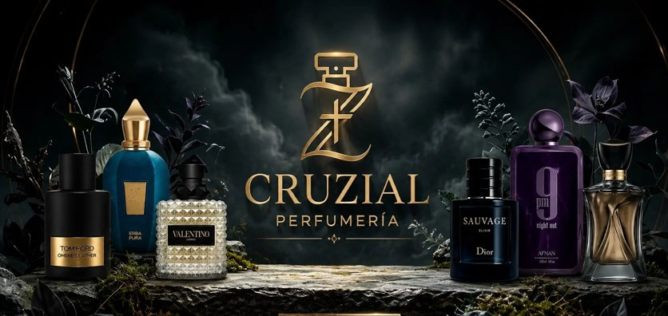

| Zona | Rectángulo (imagen original) | Veredicto |
|---|---|---|
| Humo superior | y 0 → 88 | **Muerto** (oscuro, sin detalle; el logotipo empieza en y = 130) |
| Follaje izquierdo | x 0 → 95 | **Muerto** (hojas; el primer frasco empieza en x = 110) |
| Borde derecho | x > 1670 | **No se toca**: el frasco de cristal de Guerlain llega a x = 1670 |
| Repisa inferior | y 764 → 792 | **Muerto** (28 px de piedra bajo los frascos, que acaban en y = 735) |
| Wordmark, 6 frascos | ver sección 1 | **Intactos** |

### 4.2 Los dos assets (originales sin tocar; archivos nuevos)

| Asset | Archivo | Píxeles | Proporción | Cómo se obtiene |
|---|---|---|---|---|
| Desktop y tablet apaisada | `public/parfums/hero/hero-d-wide.webp` | 1577 × 676 (109 KB) | **21:9** exacta | **Recorte puro** del original: x 95 → 1672, y 88 → 764. Ni un píxel inventado. |
| Móvil y tableta vertical | `public/parfums/hero/hero-d-portrait.webp` | 1100 × 1375 (102 KB) | **4:5** exacta | **Recomposición** con los píxeles del original: bloque del wordmark arriba y los dos grupos de frascos lado a lado debajo, con fundidos en las uniones. **El humo de fondo que une las piezas está sintetizado** (degradado con ruido derivado de los bordes del propio humo): es edición de arte, no un recorte. |

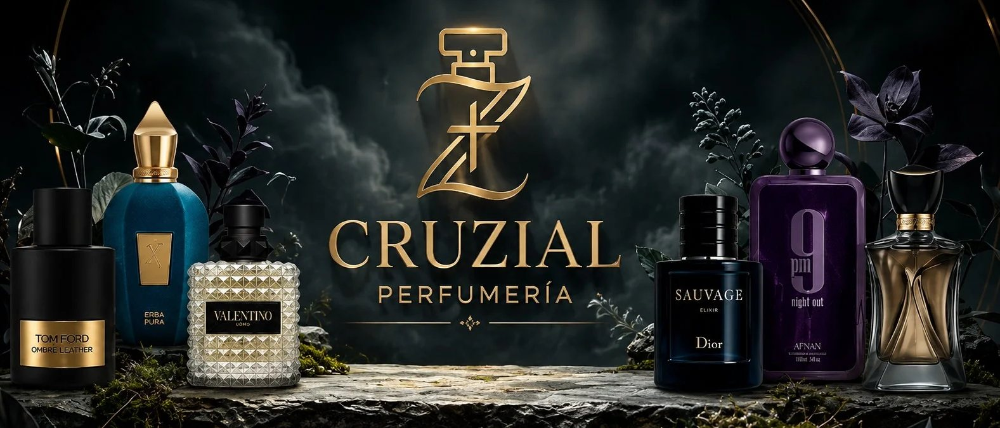
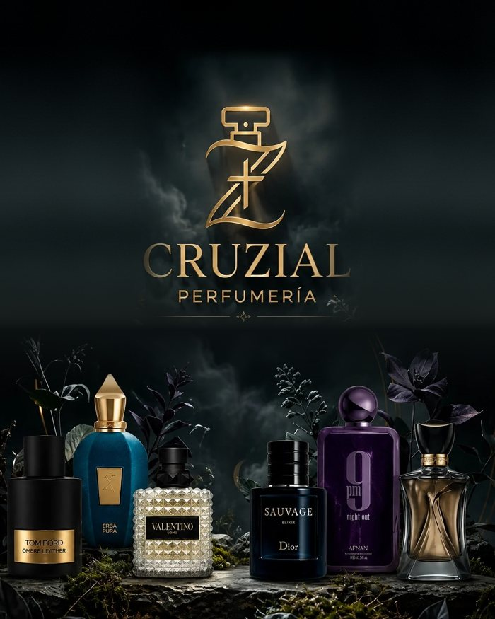

Un recorte 4:5 del original no puede contener los dos grupos de frascos (mueven 1 560 px de ancho en 792 de alto), por eso en
móvil hace falta recomponer. `hero-d-portrait.webp` es la pieza que necesita visto bueno de quien lleve la marca.

### 4.3 Implementación (sólo en `claude/hero-variants`)

- `HeroArtworkD` en `hero-carousel.tsx`: `<picture>` con `getImageProps` de `next/image` (arte dirigido); el `<source>` vertical
  se usa con `(max-width: 767px), (max-width: 1100px) and (orientation: portrait)`; `fetchPriority="high"`, `quality` 60. Mismo `h1`
  y mismos enlaces que el héroe actual.
- CSS: el héroe pasa a altura automática = arte + franja. Sin velo sobre el arte. Un fundido de 16 % funde la repisa en la
  tinta. En pantallas bajas el arte vertical pierde como máximo el humo superior (17 % del cuadro) con `object-position: 50% 100%`;
  nunca un frasco.
- Peso servido (optimizador de Next, `q=60`): desktop 83 KB a 1577 px (el héroe actual: 87 KB); **móvil 29 KB a 640 px / 41 KB
  a 828 px** (el héroe actual en móvil descarga la imagen a 250 % del ancho: 44–87 KB).

### 4.4 Medidas (misma metodología que la sección 2, 5 anchos)

| | Actual | A | B | C | **D** |
|---|---|---|---|---|---|
| Escala de la imagen 1440 / 390 / 1024 | 0.86 / 0.58 / 0.71 | 1.09 / 0.58 / 0.92 | 1.09 / 0.58 / 0.92 | 0.92 / 0.72 / 0.76 | **0.91 / 0.36 / 0.65** |
| Anchura del wordmark en px (1440 / 390) | 396 / 268 | 502 / 268 | 502 / 268 | 423 / 333 | **420 / 163** |
| Arte en el viewport 1440 / 1024 / 390 | 74 / 73 / 55 % | 96 / 95 / 55 % | 96 / 95 / 55 % | 81 / 79 / 68 % | **69 / 57 / 58 %** |
| Frascos izq. / der. visibles, **1440** | 100 / 100 | 86 / 68 | 86 / 68 | 100 / 100 | **100 / 100** |
| Frascos izq. / der. visibles, **1024** | 99 / 79 | 63 / 49 | 63 / 49 | 88 / 70 | **100 / 100** |
| Frascos izq. / der. visibles, **820 (vertical)** | 17 / 10 | 4 / 0 | 4 / 0 | 14 / 8 | **100 / 100** |
| Frascos izq. / der. visibles, **390** | 15 / 8 | 15 / 8 | 15 / 8 | 1 / 0 | **100 / 100** |
| Wordmark visible (todos los anchos) | 100 % | 100 % | 100 % | 100 % | **100 %** |
| Texto sobre zona sagrada (peor ancho) | 3 % | 9 % | 0 % | 0 % | **0 %** |
| Contraste del `h1` (peor ancho) | 14.2 | 7.2 | 16.7 | 9.1 | **16.8** |
| Alto de los CTA | 48 px | 48 | 48 | 48 | **48** |
| `h1` presente y primer encabezado | sí | sí | sí | sí | **sí** |
| axe (WCAG 2.2 A/AA) sobre el héroe, 3 anchos | — | — | — | — | **0 violaciones** |

Capturas: `docs/hero-variants/hero-d-reencuadre-1440.jpg`, `…-1024.jpg`, `…-390.jpg`.

### 4.5 Lectura honesta

**Lo que gana D**
- Es la única variante con **los seis frascos y el wordmark completos en todos los anchos**, incluidos 1024 (88/70 en C), la
  tableta vertical (17/10 en el actual) y el móvil (15/8 en el actual, 1/0 en C). Hoy, en móvil, el visitante ve el logotipo y
  casi nada del producto.
- 0 % de texto sobre arte, contraste 16.8:1, sin velo sobre la foto (A) ni degradado que oscurezca la base de los frascos.
- Mismo tamaño de frasco que C en 1440 (0.91 frente a 0.92) y +6 % respecto al actual, sin la máscara ni el desplazamiento.
- Más ligera en móvil (29–41 KB frente a 44–87 KB).

**Lo que cuesta D**
- **Menos superficie de arte en pantalla en escritorio**: 69 % del primer viewport a 1440 (74 % el actual, 81 % C, 96 % A/B) y
  57 % a 1024. Se debe a que recortar el humo muerto acorta el cuadro: a un ancho dado, un 21:9 es más bajo que un 2.1:1. **No
  recupera el "impacto" medido en píxeles de A/B**; sólo iguala el tamaño del producto de C.
- **El wordmark se hace pequeño en móvil**: 163 px de ancho frente a 268 px actuales (−39 %): es el precio de mostrar todos los
  frascos. En 390 px el nombre sigue legible pero ya no domina.
- El asset vertical es una **recomposición con fondo sintetizado**: hay que aprobarla y, si se adopta, que diseño la rehaga con
  el archivo original en alta resolución (el actual es 1672 px).
- A diferencia de A/B, el héroe ya no ocupa el 100 % de la pantalla (813 px a 1440 × 900; 757 px a 390 × 844): asoma una franja de unos 45–55 px de la
  sección siguiente, algo que puede verse como pista de scroll o como pérdida de inmersión.

## 5. Comparación A · B · C · D

| Criterio | A · Velo | B · Zonas libres | C · Recorte sagrado | D · Reencuadre |
|---|---|---|---|---|
| Cambia | CSS | CSS | CSS | **asset** + CSS |
| Frascos cortados en 1440 | sí (32 % der.) | sí (32 % der.) | **no** | **no** |
| Frascos cortados en móvil | sí | sí | sí (casi todos) | **no** |
| Tamaño del producto en 1440 | 1.09 | 1.09 | 0.92 | 0.91 |
| Superficie de arte en 1440 | **96 %** | **96 %** | 81 % | 69 % |
| Texto sobre zona sagrada | hasta 9 % | **0 %** | **0 %** | **0 %** |
| Titular | sobre degradado | en el humo, lejos de los CTA | en una franja fina | **en franja natural propia** |
| Riesgo | oscurece la foto | titular pequeño y separado | pierde impacto | **asset recompuesto; héroe más bajo; wordmark pequeño en móvil** |
| Esfuerzo si se elige | bajo | bajo | bajo | **medio (diseño del asset 4:5)** |

## 6. Recomendación final

**D, condicionada a aprobar el asset vertical.** Es la única que resuelve las dos objeciones al mismo tiempo (nada de producto
cortado y titular en una franja que respeta el arte) y la única que arregla el móvil, donde hoy casi no se ve producto. Lo que no
hace es "recuperar el impacto" en el sentido de superficie de arte en escritorio: eso sólo lo da **B** (96 %), a costa de cortar el
frasco de cristal derecho (32 %).

Regla para decidir:
- **Prima no cortar producto y que el móvil enseñe el catálogo → D** (con el asset 4:5 rehecho por diseño a partir del original).
- **Prima la máxima presencia de la foto en escritorio y se acepta el recorte → B.**
- **No se quiere tocar el arte → C** (tamaño idéntico a D en escritorio, sin cambios de asset, pero en móvil no se ve producto).

No se ha mergeado nada; `claude/hero-variants` queda como rama de evidencia.

## 7. Variante E · "Sin síntesis": sólo píxeles que ya existen

**Restricción:** una marca de lujo no inventa arte. D sintetiza humo en el asset móvil y queda descartada por esa regla. E usa
**únicamente recortes de originales**; si no hay original, se renuncia a mostrar el frasco antes que fabricarlo.

### 7.1 Búsqueda de un original 4:5 con wordmark + frascos completos

| Dónde se buscó | Qué se revisó | Resultado |
|---|---|---|
| Árbol del repo | 288 imágenes versionadas, hoja de contactos de las 46 con pinta de héroe/banner (1672×941, 2172×724, 1122×1402…) | Sólo `hero-crop.webp/.jpg` (1672×792) combina wordmark horneado y la línea de frascos; es apaisada (2.11:1). Los 1122×1402 (4:5) son un único frasco Cruzial sobre negro (`PERFUME NEGRO`, `PERFUME DORADO`, `parfums-authenticity`…): llevan el logotipo en la etiqueta, no la composición. |
| Manifiesto de Cloudinary | `supabase/staging/client-media-cloudinary.json`: 190 URLs | Todas son fotos de producto; ninguna de héroe/marca. |
| Historial de git (`--all`) | `img/hero/*`, `hero.png` (raíz), versiones previas de `hero-crop` | **`hero2.png` (1376×768, commit `0c3752b`, 30-ago-2026)**: otro héroe, ya retirado del árbol en `14e9323`. Una ventana 4:5 de 614×768 contiene **wordmark + 4 frascos completos**. También `hero.png` (1024×572, `d3cc623`) y un `hero-crop` anterior (1024×417): apaisados y de menor resolución. |
| Perfil del usuario (Escritorio / OneDrive) | proyectos hermanos (Fragance Obsession, JNAFRAGANCE…) | Sólo fotos de producto; ningún héroe de Cruzial. |

**Conclusión:** sí existe un original utilizable, pero **no es el de escritorio**: es el héroe anterior. Se recupera con
`git show 0c3752b:img/hero/hero2.png`.

### 7.2 Los assets de E (todos recortes puros, ninguno sintetizado)

| Formato | Archivo | Origen | Píxeles |
|---|---|---|---|
| Escritorio y tableta apaisada | `hero-d-wide.webp` (el de D) | `hero-crop.webp`, x 95–1672, y 88–764 | 1577 × 676 (21:9) |
| **Móvil y tableta vertical (E)** | `hero-e-hero2-4x5.webp` | `hero2.png`, x 706–1320, y 0–768 | 614 × 768 (4:5), 38 KB servidos |
| Móvil, plan B sin original 4:5 (EC) | `hero-e-center.webp` | `hero-crop.webp`, x 575–1125, y 70–660 (la columna del wordmark, entre los dos grupos de frascos) | 550 × 590, 15 KB servidos |

Variantes en el sitio (`/parfums?hero=…`):
- **`e`**: escritorio D + móvil con el recorte de `hero2` (el que cumple el punto 2 del encargo).
- **`ec`** (plan B del punto 4, ya construido y medido): escritorio D + móvil con la columna del wordmark al 78 % del ancho,
  bordes difuminados, suelo del héroe del color del humo. **Ningún frasco se ve y ninguno se corta**; el wordmark queda más pequeño
  que en C (254 px frente a 333 px) y el héroe mide 596 px de alto en 390 × 844 (el actual, 810).
- **`eb`** (alternativa pura extra): la banda 21:9 completa también en móvil. Todos los frascos, wordmark de 114 px.

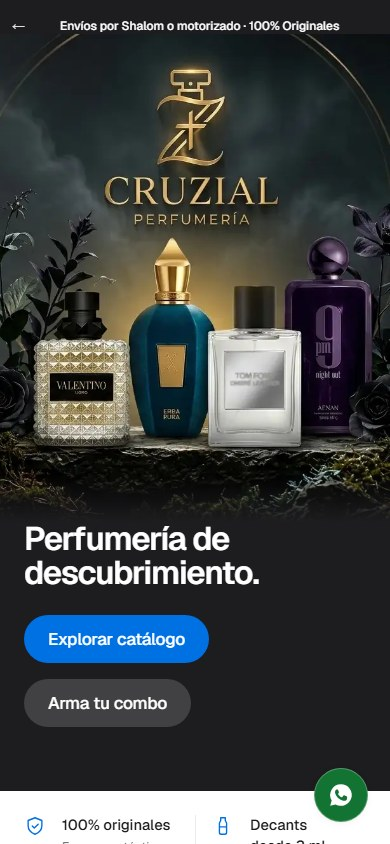
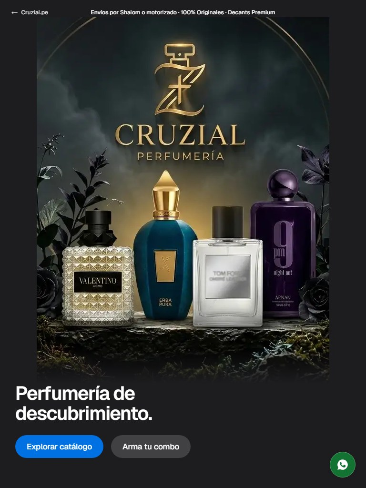

Capturas de E a 1440, 1024, 768, 390 y 375 px: `docs/hero-variants/hero-e-sin-sintesis-<ancho>.jpg`. Del plan B:
`hero-ec-columna-movil-{768,390,375}.jpg`; de la banda: `hero-eb-banda-movil-{390,375}.jpg`.

### 7.3 Implementación

`HeroArtworkD` (comparte estructura con D): `<picture>` con `getImageProps`, origen vertical bajo
`(max-width: 767px), (max-width: 1100px) and (orientation: portrait)`. Para `e` el arte **nunca se recorta con CSS**: en pantallas
bajas (iPhone SE, 375 × 667) se reduce su anchura (`min(100%, (100svh − 256px) × 0.8)`), no se corta el monograma.

### 7.4 Medidas (misma metodología; 5 anchos)

| | 1440 | 1024 | 768 (vertical) | 390 | 375 |
|---|---|---|---|---|---|
| **E** · escala de la imagen | 0.91 | 0.65 | 1.00 | 0.64 | 0.54 |
| **E** · wordmark (px de ancho) | 420 | 299 | 275 | 175 | 147 |
| **E** · frascos visibles izq. / der. | 100 / 100 | 100 / 100 | 100 / 100 | 100 / 100 | 100 / 100 |
| **E** · wordmark visible | 100 % | 100 % | 100 % | 100 % | 100 % |
| **E** · arte en el viewport | 69 % | 57 % | 60 % | 58 % | 54 % |
| **E** · texto sobre zona sagrada | 0 % | 0 % | 0 % | 0 % | 0 % |
| **E** · contraste del `h1` | 16.8 | 16.8 | 16.8 | 16.8 | 16.8 |
| **E** · CTA | 48 px | 48 | 48 | 48 | 48 |
| EC · frascos visibles / wordmark px | 100 / 420 | 100 / 299 | 0 (ninguno) / 401 | 0 (ninguno) / 254 | 0 (ninguno) / 245 |
| EB · frascos visibles / wordmark px | 100 / 420 | 100 / 299 | 100 / 224 | 100 / 114 | 100 / 109 |

axe (WCAG 2.2 A/AA) sobre el héroe: **0 violaciones** en E, EC y EB a 1440, 768, 390 y 375 px. (En EC la métrica «texto sobre zona
sagrada» da 1–8 % porque el rectángulo del frasco izquierdo, que **no se dibuja**, se extiende bajo el titular: es un artefacto del
cálculo, no texto sobre arte.)

### 7.5 Por qué no hay una opción mejor sin síntesis

1. La composición actual mide 1 560 px de producto en 1 672 de ancho y 792 de alto. **Cualquier ventana 4:5 de esa imagen contiene
   o el wordmark o un grupo de frascos, nunca todo**: para tener todo hay que recomponer (D), es decir, inventar la unión.
2. No existe en el repo, en Cloudinary ni en el historial otra fotografía vertical con esa composición. El único original vertical
   utilizable es el héroe antiguo (`hero2`), que es **otra composición**.
3. Lo que se puede hacer sin síntesis se reduce a tres opciones, todas medidas: mostrar el original antiguo (E), mostrar sólo el
   wordmark sin frascos (EC/C) o mostrar la banda completa pequeña (EB/D-banda).

### 7.6 Riesgos de E (a decidir por la marca)

- **No es el mismo arte que en escritorio:** `hero2` tiene 4 frascos (Valentino, Erba Pura, Tom Ford, 9 PM) y el de escritorio 6.
  Además el Tom Ford de `hero2` es un frasco transparente con etiqueta, distinto del negro del héroe actual, y se ve menos
  convincente. Móvil y escritorio mostrarían composiciones diferentes.
- **Baja resolución:** 614 × 768 nativos. A 390 px de ancho con densidad 2 hace falta 780 px (×1.27 de ampliación); con densidad 3,
  ×1.9. Se verá algo blando. Con el archivo de alta resolución de `hero2` (si existe en manos del diseñador) el problema desaparece.
- `hero2.png` está fuera del árbol desde `14e9323`: hay que confirmar con el dueño que sigue siendo un activo aprobado.

## 8. Comparación final A · B · C · D · E

| Criterio | A · Velo | B · Zonas libres | C · Recorte sagrado | D · Reencuadre | **E · Sin síntesis** |
|---|---|---|---|---|---|
| Arte nuevo / inventado | no | no | no | **sí (humo sintetizado)** | **no** |
| Cambia | CSS | CSS | CSS | asset + CSS | asset (recortes) + CSS |
| Frascos cortados en 1440 | sí (32 % der.) | sí (32 % der.) | no | no | **no** |
| Frascos visibles en móvil 390 | 15 / 8 % | 15 / 8 % | 1 / 0 % | 100 / 100 % | **100 / 100 % (4 frascos de otro set)** |
| Frascos visibles en 1024 | 63 / 49 % | 63 / 49 % | 88 / 70 % | 100 / 100 % | **100 / 100 %** |
| Tamaño del producto en 1440 | 1.09 | 1.09 | 0.92 | 0.91 | **0.91** |
| Wordmark en móvil (390 / 375) | 268 / 258 px | 268 / 258 | 333 / 320 | 163 / 157 | **175 / 168** |
| Superficie de arte en 1440 | 96 % | 96 % | 81 % | 69 % | **69 %** |
| Texto sobre zona sagrada | hasta 9 % | 0 % | 0 % | 0 % | **0 %** |
| Contraste del `h1` | ≥ 7.2 | ≥ 16.7 | ≥ 9.1 | 16.8 | **16.8** |
| Descarga móvil del héroe | 44–87 KB | 44–87 KB | 44–87 KB | 29–41 KB | **38 KB** (EC: 15 KB) |
| Riesgo principal | oscurece la foto | titular pequeño y separado | pierde impacto, sin producto en móvil | **inventa píxeles** | **arte distinto en móvil y baja resolución** |

(A y B no se midieron a 768 y 375 en esta ronda; sus columnas de 1440, 1024 y 390 vienen de las secciones 2 y 4.)

## 9. Recomendación final (anterior a F; sustituida por la sección 12)

1. **D queda descartada** por la regla «no se inventan píxeles».
2. **Recomiendo E**, condicionada a que el dueño apruebe usar `hero2` en móvil. Es la única variante que cumple a la vez: ningún
   píxel inventado, ningún frasco cortado en ningún ancho (los 4 de `hero2` completos en móvil, los 6 completos en escritorio),
   0 % de texto sobre el arte, contraste 16.8:1 y producto visible en el teléfono. Pide dos cosas: **el archivo de `hero2` en alta
   resolución** (614 px es justo) y **aceptar que móvil y escritorio muestran composiciones distintas**.
3. **Si no se acepta el arte antiguo, EC** (`?hero=ec`): sin síntesis, mismo arte en todos los dispositivos, wordmark de 254 px,
   nada de producto en el teléfono (queda ninguno visible y ninguno cortado). Es C con menos wordmark.
4. **B** sólo si se prioriza la superficie de foto en escritorio (96 %) y se acepta cortar el frasco de cristal derecho (32 %).

No se ha mergeado nada; `claude/hero-variants` queda como rama de evidencia (basada en el historial anterior a la
reescritura; habrá que rebasarla sobre `claude/apple-design-system` cuando se elija).

## 10. Variante F · "Tipográfica" — ADOPTADA con tres ajustes

**Decisión:** se adopta **F** para el móvil (E, EB y D quedan descartadas: E y EB cambian de producto entre breakpoints y D sintetiza
píxeles). La versión inicial de F tenía tres defectos y se corrige antes del merge:

| # | Ajuste obligatorio | Antes | Ahora |
|---|---|---|---|
| 1 | Asset | `hero-f-wordmark.webp`, derivado del logotipo por **llave de luminancia** | **`logo.jpeg` original**, byte a byte (`logo-official.jpeg`, SHA-256 `2c457b1e…` idéntico), sin transparencia, sin llave, sin edición, servido sin recodificar |
| 2 | Altura del héroe en móvil | 60 % | **45 %** (**48 %** en pantallas ≤ 700 px de alto) |
| 3 | Ancho máximo del wordmark | 337 px (letras «CRUZIAL» de 322 px) | **280 px** (letras de **268 px**) |

> **Actualización (§13):** la altura pasa a 42 % en pantallas ≤ 700 px de alto y la franja de garantías vuelve a una rejilla 2 × 2 con
> texto corto; la placa recibe un aro. Las cifras de §10.3 son anteriores a ese ajuste; las vigentes están en §13.3.

### 10.1 Razón por la que se descarta el keying de luminancia

1. **Es una edición del activo de marca.** Convertir el negro en transparencia produce un archivo nuevo (`alfa = f(luminancia)`), no el
   logotipo oficial; nadie de la marca lo ha aprobado. Un logotipo se coloca, no se retoca.
2. **Cambia el color del propio logotipo.** Para que los bordes no queden grises se divide el color por el alfa: eso aclara el
   degradado dorado en los bordes y funde en transparencia los extremos de bronce oscuro (los de menor luminancia), de modo que la
   forma percibida de las letras ya no es la del original.
3. **Amplifica el ruido de la compresión JPEG.** El original es un JPEG: el halo de bloques cerca del negro pasa a ser alfa visible.
4. **Crea una segunda fuente de verdad.** El derivado diverge del original en cuanto la marca actualice `logo.jpeg`.
5. **Coherencia con el criterio del dueño** para el resto del héroe: no se inventan ni se alteran píxeles.

**Coste asumido:** el JPEG lleva su propio fondo casi negro (`1,1,1`), así que sobre el navy `#0B1F3D` se lee como una **placa
negra** con el wordmark dorado (contraste placa/navy 1.27:1, es decir, sutil). Se le da `--ds-radius-sm` y **ni borde ni sombra**.
Es el precio de no tocar el archivo; desaparece cuando exista el wordmark en SVG (T20).

### 10.2 Implementación (`/parfums?hero=f`, sólo móvil y tableta vertical)

- Héroe con fondo **`var(--ds-color-navy)`** (exactamente `#0B1F3D`), sin imagen de producto, `min-height: 45svh`
  (`48svh` con `max-height: 700px`).
- Placa de **280 px de ancho** (nunca más que `100vw − 40px`) que muestra la ventana «CRUZIAL / PERFUMERÍA» de 440 × 130 px del
  archivo de 499 × 494 con CSS (`overflow: hidden`, imagen posicionada); el archivo no se recorta ni se modifica.
- Debajo, el `h1` «Perfumería de descubrimiento.» (≈ 21 px, `--ds-on-navy`) y dos CTA de 48 px en una sola fila.
- **Ampliación del bitmap** (píxeles de pantalla por píxel de archivo): densidad 2: **×1.27** (antes ×1.53); densidad 3: **×1.91**
  (antes ×2.3).
- Escritorio y tableta apaisada: el recorte puro 21:9 de D/E, sin cambios.

**Cambios de apoyo para que el carrusel asome** (bajo `data-hero="f"` y ≤ 480 px; sólo en esta variante): con un héroe de 45 %,
la franja de garantías (228 px) y el encabezado de la sección empujaban las tarjetas fuera de pantalla. La franja pasa a **una sola
línea con desplazamiento horizontal** que muestra los títulos (la segunda línea de cada garantía sigue en el DOM y en el árbol de
accesibilidad, sólo se oculta a la vista) y la sección «Fragancias para descubrir» arranca 24 px más arriba con un título algo
menor. Es un cambio de contenido visible en móvil que la marca debe aprobar.

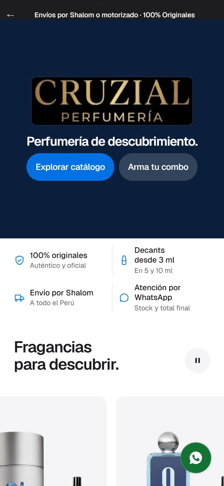
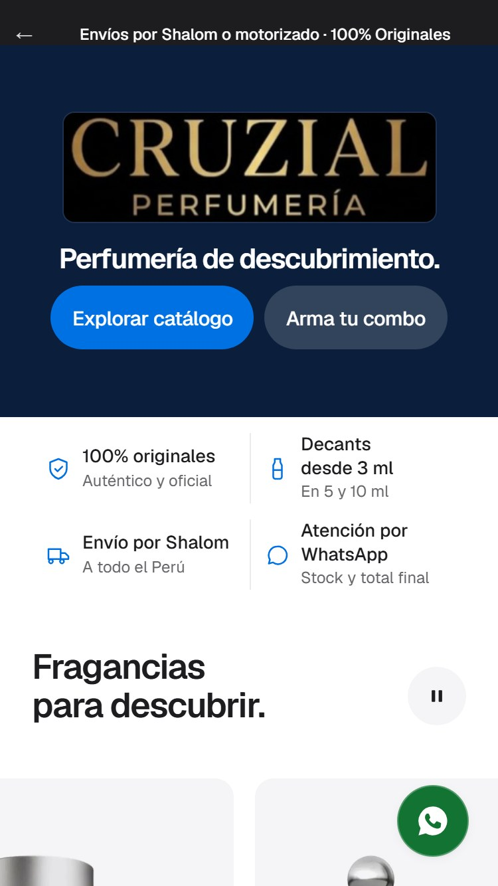
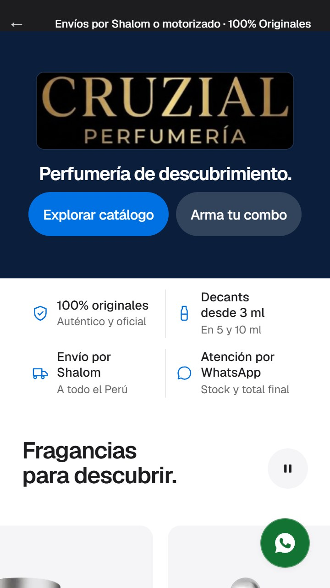
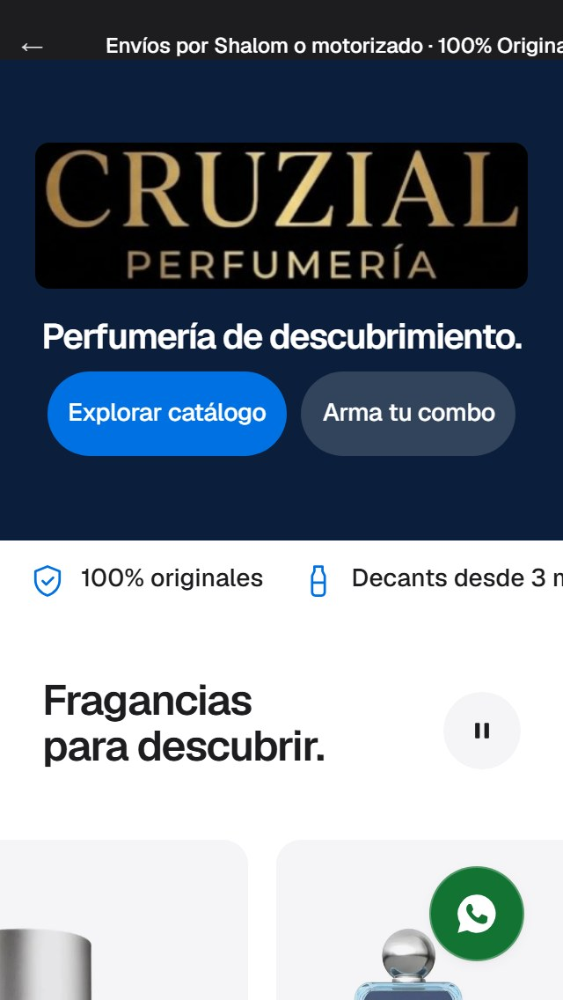

Capturas: `docs/hero-variants/hero-f-tipografica-{390x844,375x667,360x640,320x568,768x1024}.jpg`.

### 10.3 Verificación

| | 390 × 844 | 375 × 667 | 360 × 640 | 320 × 568 |
|---|---|---|---|---|
| Altura del héroe | 380 px (**45 %**) | 320 px (**48 %**) | 307 px (**48 %**) | 273 px (**48 %**) |
| Placa / letras «CRUZIAL» / altura de letra | 280 / 268 / 44 px | 280 / 268 / 44 px | 280 / 268 / 44 px | 280 / 268 / 44 px |
| **Asoma la sección del carrusel** (px visibles) | 384 | 267 | 253 | 215 |
| **Asoma su título** | 352 | 235 | 221 | 183 |
| **Asoma la primera tarjeta** (≥ 40 px exigidos) | **252** | **137** | **125** | **91** |
| Contraste del `h1` (blanco sobre `#0B1F3D`) | 16.4 | 16.4 | 16.4 | 16.4 |
| CTA | 48 px | 48 px | 48 px | 48 px |
| Scroll horizontal de la página | no | no | no | no |
| axe (WCAG 2.2 A/AA, héroe) | 0 violaciones | 0 | 0 | 0 |

(axe también limpio a 1440 y 768 px.) Con la primera versión de este ajuste (sin compactar la franja de garantías) la tarjeta sólo
asomaba 133 / 16 / 2 px y a 320 px no asomaba: por eso hace falta el cambio de apoyo.

**Contraste del wordmark (≥ 4.5:1 exigido) — resultado honesto: se cumple en mediana, no en todo el glifo.** Sobre el fondo en el
que realmente se asienta (la placa negra del JPEG): **mediana 7.6:1, 89 % de los píxeles del glifo ≥ 4.5:1** y p5 = 3.3:1; sobre
el navy directamente: mediana 6.0:1, 72 % ≥ 4.5:1, p5 = 2.6:1. Lo que queda por debajo es el 11 % más oscuro del degradado (bronce).
Sin editar el activo no puede garantizarse 4.5:1 en todo el glifo; un logotipo está exento de WCAG 1.4.3, y el texto que se debe leer
(`h1`, CTA) tiene 16.4:1.

### 10.4 Límites que se mantienen

- **Resolución:** el wordmark mide 421 px en el original. A 280 px y densidad 3 aún se amplía ×1.9: algo blando. La solución es el SVG.
- **Placa negra visible** sobre el navy (1.27:1): sutil pero presente.
- La tableta vertical (768 × 1024) muestra la misma placa de 280 px en un héroe de 461 px: austero.

## 11. Comparación F · EC · B (móvil)

| Criterio | **B · Zonas libres** | **EC · Columna sin síntesis** | **F · Tipográfica (ajustada)** |
|---|---|---|---|
| Qué se ve en móvil | arte recortado: wordmark + 15 / 8 % de frascos | wordmark del arte, sin frascos | logotipo oficial sobre navy, sin imagen de producto |
| Producto cortado | **sí** | no (ninguno visible) | no (ninguno visible) |
| Píxeles alterados | no | no | **no** (archivo oficial intacto) |
| Coherencia con escritorio | mismo arte, recortado distinto | mismo arte, otra ventana | mismo wordmark; sin producto en móvil |
| Letras «CRUZIAL» a 390 / 375 / 360 / 320 | 268 / 258 / 248 / 220 px | 254 / 245 / 235 / 209 px | **268 / 268 / 268 / 268 px** |
| Altura del héroe a 390 × 844 | 810 px (96 %) | 596 px (70 %) | **380 px (45 %)** |
| Primera tarjeta del carrusel a 375 × 667 | no asoma | no asoma | **137 px** |
| Contraste del `h1` (peor ancho) | 12.4 | 19.4 | 16.4 |
| Descarga del héroe en móvil | 44–87 KB | 15 KB | **29 KB** (el JPEG original) |
| Usa tokens del sistema | no | suelo mezclado | **`--ds-color-navy`, `--ds-on-navy`** |
| Riesgo | recorta producto | sin producto; arte ampliado | placa negra sobre navy; bitmap de 421 px |

## 12. Decisión y deuda

**F adoptada con los tres ajustes.** No se ha mergeado nada; `claude/hero-variants` queda como rama de evidencia (basada en el
historial anterior a la reescritura: habrá que rebasarla sobre `claude/apple-design-system` al integrarla, y la integración debe
incluir los cambios de apoyo de `page.module.css` y `page.tsx`, o decidir otra forma de que el carrusel asome).

**Deuda técnica**

| # | Ticket | Prioridad | Por qué |
|---|---|---|---|
| **T20** | **Conseguir el wordmark oficial en SVG antes del próximo rediseño** | Alta | El único original es un JPEG de 499 px con fondo negro: obliga a la placa negra, limita la nitidez (×1.9 en pantallas 3×) y hace imposible garantizar 4.5:1 en todo el glifo. Un SVG permite fondo transparente sobre `--ds-color-navy`, nitidez a cualquier escala y el monograma opcional. |

(El «T20» provisional de `docs/design-audit-2026-10-11.md`, «decidir el héroe», queda resuelto por esta decisión; esa auditoría
vive en el PR de evidencia y conviene renumerarla allí.)

## 13. Ajustes tras aprobar F: placa intencional y franja de garantías sin comprimir

F queda aprobada con dos cambios sobre §10 (que se corrigen aquí): la placa negra sobre navy (contraste 1.27:1) se leía como un
accidente, y la franja de garantías en una línea con desplazamiento horizontal escondía contenido que existe para dar confianza.

### 13.1 La placa se lee como panel

- Se añade un **aro de 1 px** con un navy algo más claro y una **elevación mínima**:
  `box-shadow: 0 0 0 1px color-mix(in srgb, var(--ds-color-navy) 92%, var(--ds-white)), 0 1px 2px rgba(0,0,0,.15)`.
- El aro resuelve a `#1F314D` (HSL 217° / 43 % / **21 %**, frente a 216° / 69 % / **14 %** del navy: **+7 puntos de luminosidad**,
  ≈ 1.4:1 contra el navy). Se hizo con `color-mix` sobre el token, sin hex nuevo, y como **anillo de desplazamiento 0** (no como borde
  opaco: `DESIGN.md` §5 prohíbe los bordes opacos de 1 px; un anillo de `box-shadow` es lo que el sistema permite).
- El archivo sigue sin tocarse; el aro y la sombra son CSS del contenedor.

### 13.2 Franja de garantías: tres alternativas medidas (todas con la segunda línea visible)

Medido en Chromium con el héroe al 45 % (48 % en pantallas ≤ 700 px de alto, la regla anterior). «Tarjeta» = píxeles visibles de la
primera tarjeta del carrusel (mínimo exigido: 40); negativo = no asoma.

| Variante | Qué cambia | Franja 390 × 844 / 375 × 667 / 360 × 640 / 320 × 568 | Tarjeta visible (mismos tamaños) |
|---|---|---|---|
| Sin tocar | — | 228 / 228 / 266 / 304 px | 70 / −65 / −115 / −188 |
| **A** | menos relleno vertical (12 px) | 192 / 192 / 230 / 268 px | 106 / −29 / −79 / −152 |
| **B** | **2 × 2, icono de 20 px y texto corto (≤ 4 palabras)** | **142 / 142 / 142 / 157 px** | **156 / 41 / 30 / −41** |
| **C** | iconos de 18 px y tipografía menor, misma estructura y texto | 151 / 153 / 153 / 183 px | 147 / 30 / 18 / −66 |

Con el héroe al **42 %** en pantallas cortas: B pasa a **182 / 81 / 68 / 13** px y C a 172 / 70 / 57 / −32. A no se repitió con 42 %:
restando los 40 / 38 / 34 px que libera el héroe (extrapolación aritmética) quedaría en 11 / −41 / −118 en las tres pantallas
cortas, sin llegar nunca a 40 en 360 × 640 y 320 × 568.

**Elegida: B.** Es la única que, con el héroe al 42 %, deja asomar la tarjeta en 375 × 667 y 360 × 640 y la única que se acerca en
320 × 568 (13 px). A recorta sólo 36 px porque el cuello de botella no es el relleno sino el **salto de línea** del texto largo en
dos columnas estrechas; C no lo evita. B ataca la causa (menos palabras) sin esconder nada.

Para 320 × 568 B necesita además una compactación ≤ 340 px (relleno de 8 px, iconos de 18 px, títulos de 12.8 px; el texto
secundario se mantiene en **12 px**, el mínimo del sistema: una primera pasada con 11.2 px se descartó por incumplir `DESIGN.md` §10).
La medición de la tabla anterior (45 px de tarjeta a 320 px) es la de esa primera versión del copy; los números vigentes son los de §13.3.

**Copy de B — versión final.** La primera versión acortada («Casas oficiales», «Total final contigo») quitaba atributos
diferenciadores. Criterio de la reescritura: **quitar conectores, no atributos** (autenticidad, oficialidad, stock, tallas). Cada
segunda línea debe caber **en una sola línea a 12 px** en la columna más estrecha (a 320 px el texto dispone de ≈ 95–120 px; los anchos
de abajo están medidos con Geist 12 px / 400).

| Garantía (título, no cambia) | Original | Opción A | Opción B | **Recomendada** |
|---|---|---|---|---|
| **100% originales** | Frascos auténticos de casas oficiales | **Auténtico y oficial** (98 px) | De casas oficiales (99 px) | **A**: conserva *auténtico* y *oficial*, los dos atributos; B pierde *auténtico* |
| **Decants desde 3 ml** | También en 5 y 10 ml | **En 5 y 10 ml** (66 px) | También 5 y 10 ml (≈ 104 px) | **A**: conserva las dos tallas (el atributo); «también» es un conector |
| **Envío por Shalom** | A todo el Perú | **A todo el Perú** (77 px, sin cambio) | Todo el Perú (≈ 66 px) | **A**: ya es corta y completa |
| **Atención por WhatsApp** | Stock y total final contigo | **Stock y total final** (97 px) | Stock confirmado (97 px) | **A**: conserva *stock* y *total final*; B pierde el total. «Contigo» es un conector: el título ya dice que la atención es por WhatsApp |

Sólo en ≤ 480 px y sólo en `?hero=f`; el texto original sigue en el DOM y es el que se ve desde 481 px. En ≤ 480 px el otro texto queda en
`display: none`, así que los lectores de pantalla leen sólo el visible. No se añade ningún claim nuevo: todo atributo corto aparece en el
texto original.

**Ajuste de maquetación para que quepan a 320 px:** en ≤ 340 px la franja usa el ancho casi completo (`calc(100% − 16px)` en vez de
`− 48px`) y 4 px de relleno lateral por ítem. Con eso el texto dispone de ≈ 98–122 px y **las cuatro segundas líneas caben en una
línea a 12 px** (medido, abajo).

### 13.3 Verificación final (hero 45 % / 42 %, B, aro)

| | 390 × 844 | 375 × 667 | 360 × 640 | 320 × 568 |
|---|---|---|---|---|
| Altura del héroe | 380 px (**45 %**) | 280 px (**42 %**) | 269 px (**42 %**) | 239 px (**42 %**) |
| Franja de garantías (sin scroll horizontal) | 142 px | 142 px | 142 px | **109 px** |
| **Primera tarjeta del carrusel visible** (≥ 40 px) | **156 px** | **81 px** | **68 px** | **62 px** |
| Título de la sección visible | 256 px | 179 px | 163 px | 155 px |
| Segunda línea de cada garantía: visible y **en una sola línea** (12 px) | sí | sí | sí | sí |
| Texto más pequeño de la franja | 12.0 px | 12.0 px | 12.0 px | 12.0 px |
| Scroll horizontal de la página | no | no | no | no |
| Contraste del `h1` sobre navy | 16.4 | 16.4 | 16.4 | 16.4 |
| CTA | 48 px | 48 px | 48 px | 48 px |
| axe (WCAG 2.2 A/AA) | 0 violaciones | 0 | 0 | 0 |

axe también limpio a 1440 y 768 px. Capturas: `docs/hero-variants/hero-f-tipografica-{390x844,375x667,360x640,320x568,768x1024}.jpg`.

### 13.4 Qué cambia respecto a §10

- Altura en pantallas ≤ 700 px de alto: **42 %** (antes 48 %). En el resto sigue en 45 %.
- La franja de garantías **deja de ser una tira con scroll horizontal**: vuelve a ser una rejilla 2 × 2 con las dos líneas visibles.
- Se mantiene el título de la sección del carrusel 24 px más arriba y algo menor en ≤ 480 px (§10.2).
- Límites que persisten: la placa sigue siendo la del JPEG (T20, wordmark en SVG), y la integración debe llevar los cambios de
  `page.tsx` y `page.module.css` (copy corto incluido) además del héroe.

## 14. Variante G · «Composición CSS» — logo arriba, frascos abajo, botón al pie (móvil) — REEMPLAZADA por §15

**Encargo:** el cliente no quiere la placa navy (F) sino «el logo arriba y los perfumes abajo». La imagen compuesta no existe y no se
pueden inventar píxeles; E y EB quedan fuera. **Solución:** no componer ninguna imagen; apilar con CSS archivos que **ya existen y se
muestran tal cual**.

### 14.1 Assets (ninguno editado)

| Zona | Archivo | Origen / uso actual |
|---|---|---|
| Logo | `public/parfums/hero/logo-official.jpeg` | el logo oficial, byte a byte (la prueba e2e lo compara con `logo.jpeg`) |
| Frasco 1 | `public/images/parfums-home/parfums-wholesale.webp` | frasco Cruzial ámbar, recorte transparente 1122×1402 |
| Frasco 2 (protagonista) | `public/images/parfums-home/parfums-authenticity.webp` | frasco Cruzial negro (ya se usa en `/parfums` y en Nosotros) |
| Frasco 3 | `public/images/parfums-home/parfums-decant-5ml.webp` | decant de 5 ml (ya se usa en `/parfums`) |

Los tres son recortes con canal alfa de la línea Cruzial: sobre un fondo claro se leen limpios, sin halo, y no hace falta tocarlos.
El logo trae su propio fondo casi negro (`rgb(1,1,1)`); el héroe usa exactamente ese tono de fondo, así que el cuadrado no deja marco
visible (diferencia de 1/255 medida en píxeles) y **no se hace keying ni mezcla**.

### 14.2 Composición

1. Banda superior: el logo, `height: clamp(76px, 15svh, 140px)`, centrado sobre `#010101`.
2. «Estante» claro (`--ds-gray-50`) con hombros redondeados que sube sobre la banda oscura: tres frascos en rejilla de 3 columnas,
   alineados al suelo, sombra suave (`drop-shadow`), el negro algo más grande.
3. Botón «Explorar catálogo» (dorado `--ds-color-accent`, tinta) centrado en la base del estante.
4. El `h1` queda en el DOM, visualmente oculto (1 px), y el enlace secundario se retira: igual que en escritorio.
5. Alto: `min-height: 45svh`; todo se dimensiona en `svh`, medido 45–46 % en 390×844, 375×667, 360×640 y 320×568.
6. En pantallas de 640 px de alto o menos se muestran **dos** frascos (ámbar y negro) para no apretar el botón.

Escritorio y tableta horizontal no cambian (recorte 21:9). Tableta vertical usa esta composición con margen lateral del 18 %.

### 14.3 Medidas

| Móvil | Alto del héroe | Carrusel visible bajo el héroe | Frascos |
|---|---|---|---|
| 390×844 | 380 px (45 %) | 156 px | 3 |
| 375×667 | 300 px (45 %) | 61 px | 3 |
| 360×640 | 288 px (45 %) | 49 px | 2 |
| 320×568 | 259 px (46 %) | 41 px | 2 |

Peso en un Pixel 7: logo 29 KB + frascos 26.7 + 18.4 + 10.2 KB (WebP optimizado, `sizes` 34vw) = **≈ 84 KB** frente a 29 KB de F. Los
frascos van en `loading="lazy"` y el logo conserva el preload (`media`); en escritorio los frascos están en `display: none` y **no se
descargan** (comprobado: sólo se pide el recorte 21:9). El elemento LCP sigue siendo el logo.

Capturas: `docs/hero-variants/hero-g-composicion-{390,375,360,320}.jpg`.

### 14.4 Límites y alternativas

- Es una **composición de CSS, no un arte compuesto**: los frascos no comparten luz ni sombra con el logo (la luz es la de cada
  recorte). Lo resuelve la banda oscura / estante claro, que los separa en lugar de fingir una sola escena.
- El logo queda a 140–150 px de ancho en 390 px (en F, 280 px): se lee, pero menos que en F. Si el cliente quiere el wordmark más
  grande, la alternativa es reducir el estante a un solo frasco.
- Los frascos son del catálogo de marca, no de las fragancias a la venta: si se prefiere mostrar productos reales, basta cambiar
  `PHONE_BOTTLES` en `hero-carousel.tsx` (cualquier recorte con alfa 4:5).
- **T25** (asset compuesto 4:5) deja de bloquear: esta variante lo sustituye hasta que el cliente apruebe o aporte el asset.

## 15. Variante H · «Recorte puro» — la imagen de escritorio, adaptada a móvil (sustituye a §14)

**Encargo:** el cliente quiere *esa misma imagen* del héroe de escritorio en el móvil, no una composición nueva. §14 (logo + frascos con
CSS) queda **reemplazada**; se conserva arriba sólo como historial y para la comparación.

### 15.1 Fuente y por qué un 4:5 no puede llevar lo pedido

La única imagen con el wordmark y los seis frascos es `public/parfums/hero/hero-crop.webp` (**1672 × 792**, 160 KB); el héroe de escritorio
(`hero-wide-21x9.webp`, 1577 × 676) es un recorte suyo. Se revisó el repo y el historial de git: no hay una versión mayor ni sin
comprimir (`hero2.png` es otra composición, de otro set de frascos, y los demás héroes del repo no llevan el wordmark). Las otras
imágenes de 1672 × 941 (`parfums-hero.webp`, `PERFUMES.png`) son escenas distintas, sin logo.

Posiciones medidas sobre esos 1672 × 792 (x en píxeles de la fuente):

| Elemento | x |
|---|---|
| Tom Ford | 110 – 278 |
| Erba Pura | 258 – 425 |
| Valentino | 390 – 570 |
| **Monograma + wordmark** | **612 – 1073** (y 128 – 600) |
| Sauvage | 1125 – 1300 |
| 9 PM | 1275 – 1460 |
| Guerlain | 1455 – 1620 |

El wordmark está **entre** los dos grupos de frascos. Una ventana 4:5 a altura completa mide 634 px de ancho: centrada en el logo
(525 – 1159) sólo deja ver rodajas de Valentino y Sauvage. Para incluir lo que pide el brief (logo completo + Tom Ford + Erba Pura +
un frasco de la derecha) hacen falta **1 190 px**, es decir, una ventana de **3:2**. Con píxeles que ya existen no hay un 4:5 (ni un
3:4) que lleve a la vez el logo y esos frascos: sería hacer la imagen más alta de lo que es, y eso es inventar píxeles.

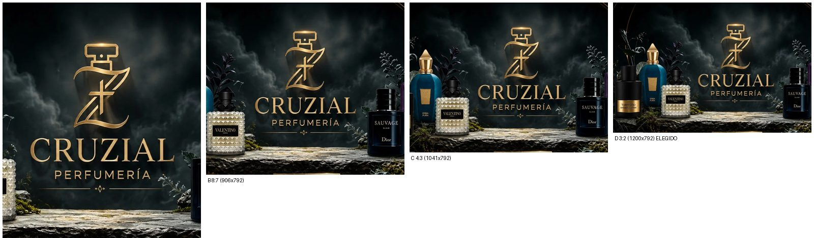

(A: 4:5 sólo logo · B: 8:7 · C: 4:3 · **D: 3:2, la elegida**.)

### 15.2 El recorte

`public/parfums/hero/hero-mobile-3x2.webp` = `hero-crop.webp` recortado a **x 100 – 1300, y 0 – 792** (1200 × 792, altura completa), WebP
calidad 90 (133 KB), sin tocar el original. Contiene el monograma y el wordmark completos, **Tom Ford, Erba Pura, Valentino y
Sauvage** enteros, y el humo alrededor. Fidelidad medida contra la misma región de la fuente: **PSNR 44 dB**, diferencia media 0.95 de
255 (la única diferencia es la recompresión WebP; ningún píxel nuevo). Con 1200 px de ancho cubre 390 px a ×3 de densidad.

### 15.3 Implementación

- `<picture>` con **un `<source media="(min-width: 768px)">`** → `hero-wide-21x9.webp`, y el `` por defecto → `hero-mobile-3x2.webp`
  (`getImageProps`, `loading="eager"`, `fetchpriority="high"`). Dos `<link rel="preload">` con `media` complementarios
  (`(max-width: 767px)` / `(min-width: 768px)`): cada pantalla descarga sólo su imagen.
- Sólo imagen y botón: sin composición CSS, sin `box-shadow`, sin `background-blend`. El `h1` sigue en el DOM, oculto visualmente. El
  botón «Explorar catálogo» (dorado) queda centrado en una franja de tinta bajo la imagen; el degradado de máscara existente funde la
  base de la imagen con esa franja (igual que en escritorio).
- El enlace secundario «Arma tu combo» ya no está en el héroe (sigue en el menú).
- Las tabletas verticales (768 px o más) pasan a usar el recorte 21:9, como pide el brief (`min-width: 768px`); antes usaban la
  versión móvil.

### 15.4 Medidas

| Móvil | Alto del héroe | Carrusel visible bajo el héroe | Se ve |
|---|---|---|---|
| 390 × 844 | 319 px (38 %) | 217 px | los 3:2 completos |
| 375 × 667 | 282 px (42 %) | 79 px | recorte de 33svh: humo arriba y suelo abajo |
| 360 × 640 | 273 px (43 %) | 64 px | ídem |
| 320 × 568 | 249 px (44 %) | 51 px | ídem |

En pantallas cortas el arte se limita a `33svh` y `object-fit: cover` recorta humo arriba y suelo abajo (el wordmark y los frascos
ocupan el 78 % central de la imagen, no se tocan). Peso: 133 KB servidos (WebP optimizado por Next según `sizes`); en escritorio no se descarga el recorte móvil.

Capturas: `docs/hero-variants/hero-h-recorte-{390,375,360,320}.jpg`. Comparación con la versión CSS anterior:
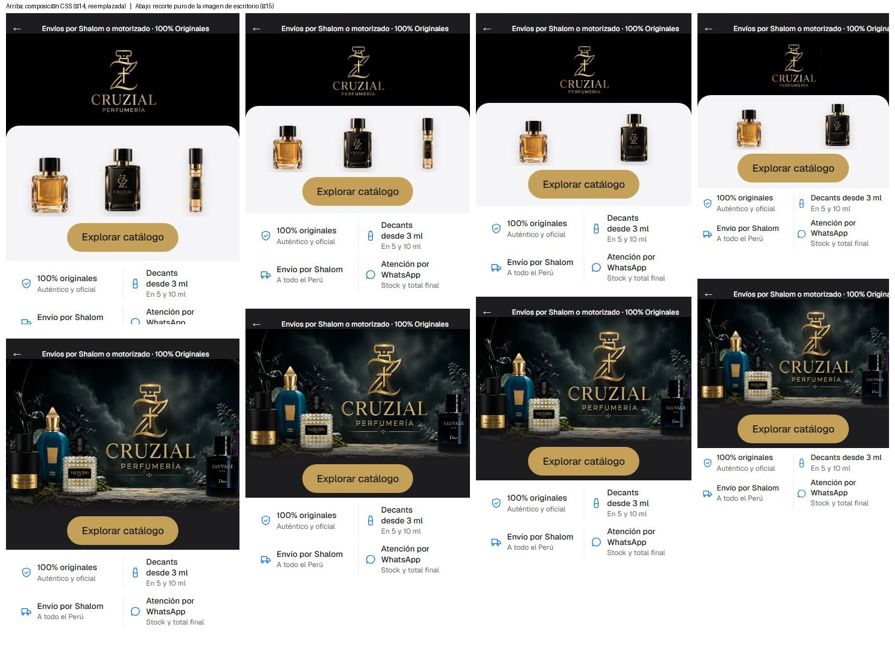

### 15.5 Lo que NO se cumple del brief y por qué

1. **Recorte 4:5 / 3:4** → es **3:2**: un 4:5 no contiene el logo y esos frascos (§15.1).
2. **Alto del héroe de 55 – 60 % del viewport** → mide **38 – 44 %**. Una imagen 3:2 a todo el ancho de un teléfono mide ~ 40 % de una
   pantalla de 844 px; llegar a 55 – 60 % exigiría una imagen más alta (mismo problema que el 4:5) o rellenar con una franja vacía. Además
   en 375 × 667, 360 × 640 y 320 × 568 un héroe de 55 – 60 % **no deja asomar el carrusel** (el requisito de ≥ 40 px, que sí se cumple).
3. El logo queda a ~150 px de ancho en 390 px (el del §14 y el de F eran de 143 y 280 px): se lee, sin el protagonismo de un 4:5.

### 15.6 Para conseguir el 4:5 que quiere el cliente

Hace falta **un original vertical con esa composición** (logo arriba, frascos abajo): el mismo estudio/IA que generó el héroe de
escritorio puede pedirlo en 4:5 con la misma escena. Hasta que exista, T25 sigue abierto como «asset 4:5»; el recorte 3:2 es lo máximo
que da la imagen actual sin sintetizar.
