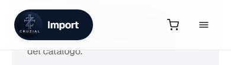
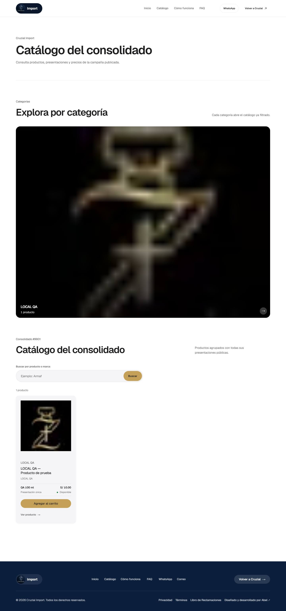
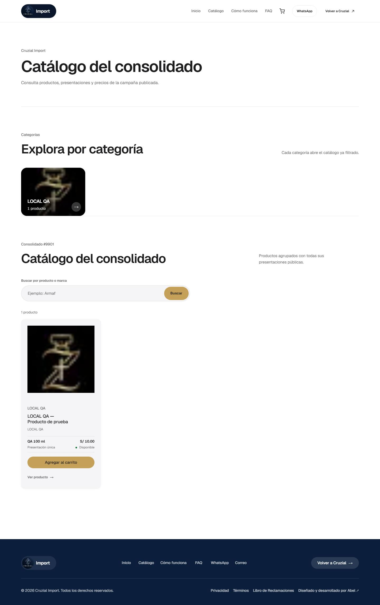
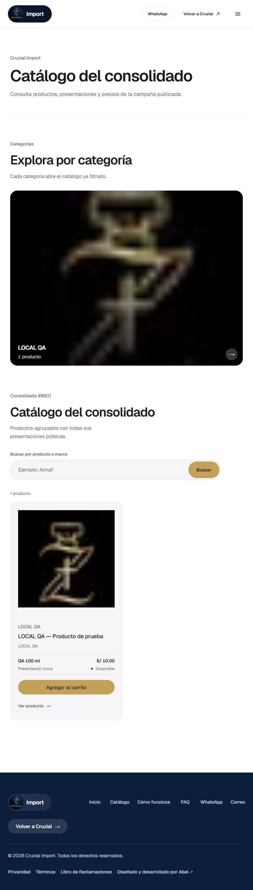
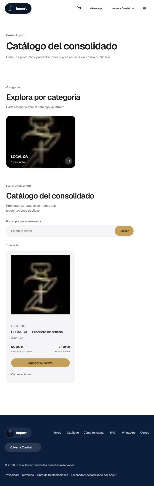
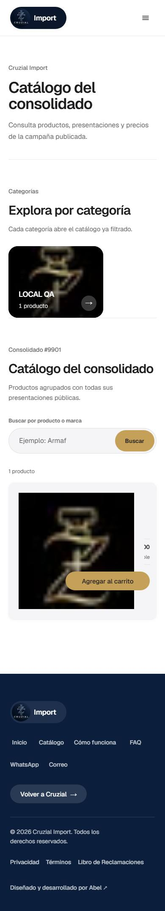
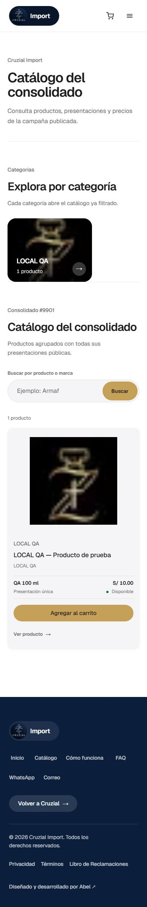

# Import: carrito, héroe y catálogo en móvil

## 1. Icono del carrito (`import-cart-badge.module.css`)

**Causa.** El icono usaba `--ds-on-photo-muted` (blanco translúcido, pensado para ir sobre la foto del héroe). Desde que Import pasó al
sistema claro (`DESIGN.md` §11), el header que aparece al salir del héroe es **blanco**: el icono quedaba blanco sobre blanco, y en el
catálogo, el carrito y el checkout (header claro desde el principio) no se veía en ningún momento. El contador también era blanco con
texto tinta sobre blanco.

**Arreglo.** Icono en tinta `#1D1D1F` (16.8:1 sobre blanco; `--ds-ink-muted` al pasar el puntero) y contador con el acento de marca
(dorado con tinta, 6.85:1). El brief proponía tinta «o un color de alto contraste sobre el fondo navy»: el header de Import no es navy
(el navy sólo está en el héroe, donde el header va oculto, y en el pie), por eso la tinta es el color correcto.

## 2. Héroe de Import (`import-hero.tsx`, `import-home.module.css`)

Queda **título, una línea y los dos botones**:

- Título: nombre del consolidado (`Octavo Consolidado` o el que corresponda), `clamp(2rem, 1.2rem + 3.4vw, 3.5rem)`.
- Una línea: el mensaje público del consolidado; si no hay, «Cierra el …»; en vista previa, «Vista previa · apertura estimada: …».
  El CSS la limita a una línea con puntos suspensivos, así un mensaje largo del admin no crece el héroe.
- Botones sin cambios de lógica: «Ver catálogo» (o «Explorar vista previa» cuando está por abrir) y «Consultar por WhatsApp».
- Se eliminan la píldora de estado («Consolidado #… abierto»), la rejilla de datos (Cierre / Precios / Atención) y la lista de garantías de
  los estados cerrados, junto con sus reglas CSS.

La fecha de cierre ya no aparece como dato aparte; si el consolidado tiene mensaje público, éste manda sobre «Cierra el …».

## 3. Catálogo (`/import/catalogo`)

- **Rejilla:** ya era 1 columna (≤ 767 px), 2 (≤ 1023), 3 y 4 (≥ 1200); se mantiene. La tarjeta ya hablaba el lenguaje de Parfums
  (gris `--ds-gray-50`, sin borde, sombra, elevación de 4 px y zoom de imagen al pasar el puntero).
- **El defecto real estaba en móvil:** la regla de teléfono ponía la tarjeta como `grid` de dos columnas (34 % / resto) pero una regla
  posterior de proporción 1:1 la anulaba, y a 390 px la columna de datos quedaba aplastada (precio y disponibilidad cortados, botón
  encima de la foto). Ahora la tarjeta del teléfono es **una columna apilada** (foto 5:4, datos debajo), declarada al final de la hoja
  para que gane.
- **Categorías:** `auto-fit` → `auto-fill`: con una sola categoría la tarjeta ya no se estira a todo el ancho (en 768 px ocupaba la
  pantalla entera).

## Antes / después

| | Antes | Después |
|---|---|---|
| Héroe 1440 |  |  |
| Héroe 768 |  |  |
| Héroe 390 |  |  |
| Header y carrito 1440 |  |  |
| Header y carrito 390 |  |  |
| Catálogo 1440 |  |  |
| Catálogo 768 |  |  |
| Catálogo 390 |  |  |

(Datos locales de prueba: un solo consolidado y un solo producto, por eso la rejilla se ve con una tarjeta; el comportamiento con
más productos lo fijan las columnas descritas arriba.)

## Límites

- Sólo se probó con un producto local; la rejilla de 3–4 columnas no se vio con datos reales.
- Las imágenes de producto de Import van con `object-fit: contain` y `mix-blend-mode: multiply` (misma regla que Parfums); si las
  fotos reales tienen fondo oscuro, quedarán como en las capturas locales.

## Hero con estado y fechas (2026-10-14)

El cliente quiere ver el estado y las fechas en el hero de Import **sin volver al hero saturado** de antes (píldora de estado + rejilla de
datos + lista de garantías, retirados el 2026-10-12). Se añade solo lo mínimo, con jerarquía limpia:

1. **Insignia discreta arriba** (píldora de 28 px): **Abierto** (dorado con tinta, 6.85:1), **Próximamente** (gris con borde, etiqueta blanca sobre
   el velo oscuro) o **Cerrado** (gris apagado, sin borde ni acento).
2. **Una línea de fecha** pequeña bajo la insignia: `Cierre: 20 nov 2026` (abierto) o `Apertura estimada: 15 nov 2026` (próximamente). Fecha corta en
   hora de Lima, sin punto tras el mes.
3. **Título y una línea de subtítulo** (el mensaje público del consolidado si existe; si no, una frase fija). La fecha salió del subtítulo.
4. **Botones:** «Ver catálogo» o «Explorar vista previa» + «Consultar por WhatsApp» (ahora **secundario** también en «Próximamente»: antes eran dos
   botones dorados juntos).
5. **No están en el hero:** «8 a 15 días hábiles» y «Pedidos desde 1 unidad». Van en **Cómo funciona** (paso «Se entrega») y **Condiciones**
   (filas «Entrega» y «Pedido»), y en la pregunta frecuente «¿Cómo llega mi pedido?». Los valores viven juntos en `domains/import/import-terms.ts` hasta
   que existan los bloques de contenido editables.

**Desviaciones y límites (a revisar):**
- La línea dice **«Apertura estimada»**, no «Apertura» como en el encargo: es la fecha estimada que el dueño puede editar y el catálogo de vista previa ya
  la llama así; una fecha pasada o ausente dice «por confirmar» en vez de prometer una (`importHeroStatus`, con pruebas).
- Un consolidado abierto con fecha de cierre ya pasada **no muestra** línea de fecha (confundiría). Si el estado no se pudo leer (`unavailable`), el hero
  no muestra insignia: nunca afirma un estado que no puede respaldar.
- «8 a 15 días hábiles» y «Pedidos desde 1 unidad» los dio el cliente en el encargo; **no los verifiqué** con otra fuente. La fila de condiciones añade
  «El mínimo de las compras mayoristas es aparte» (verdadero según la regla mayorista vigente).
- «Delivery privado» **no se tocó** (su reemplazo por «Shalom todo el Perú» depende de la decisión del cliente, `docs/content-editor-architecture.md` premisa 5).

**Pruebas:** `domains/import/hero-status.test.ts` (fechas en Lima, estados, fechas pasadas) y `e2e/import-hero-status.spec.ts` (insignia y línea de fecha por estado, orden
insignia → título → subtítulo → acciones, insignia ≤ 32 px, subtítulo de una línea, términos fuera del hero y presentes en las dos secciones; chromium, mobile y tablet).
Suite pública completa sobre el build de producción: 373 pasan, 0 fallan (58 omitidas).

**Capturas** (`docs/screenshots/import-hero-status/`, 1440 / 768 / 390, antes = `master` f30e4a5; datos locales de QA, el título «LOCAL QA activo» es de prueba):

| Estado | 1440 | 768 | 390 |
|---|---|---|---|
| Abierto | [antes](screenshots/import-hero-status/hero-open-1440-before.jpg) · [después](screenshots/import-hero-status/hero-open-1440-after.jpg) | [antes](screenshots/import-hero-status/hero-open-768-before.jpg) · [después](screenshots/import-hero-status/hero-open-768-after.jpg) | [antes](screenshots/import-hero-status/hero-open-390-before.jpg) · [después](screenshots/import-hero-status/hero-open-390-after.jpg) |
| Próximamente | [antes](screenshots/import-hero-status/hero-upcoming-1440-before.jpg) · [después](screenshots/import-hero-status/hero-upcoming-1440-after.jpg) | [antes](screenshots/import-hero-status/hero-upcoming-768-before.jpg) · [después](screenshots/import-hero-status/hero-upcoming-768-after.jpg) | [antes](screenshots/import-hero-status/hero-upcoming-390-before.jpg) · [después](screenshots/import-hero-status/hero-upcoming-390-after.jpg) |
| Cerrado | [antes](screenshots/import-hero-status/hero-closed-1440-before.jpg) · [después](screenshots/import-hero-status/hero-closed-1440-after.jpg) | [antes](screenshots/import-hero-status/hero-closed-768-before.jpg) · [después](screenshots/import-hero-status/hero-closed-768-after.jpg) | [antes](screenshots/import-hero-status/hero-closed-390-before.jpg) · [después](screenshots/import-hero-status/hero-closed-390-after.jpg) |
| Cómo funciona | [antes](screenshots/import-hero-status/como-funciona-1440-before.jpg) · [después](screenshots/import-hero-status/como-funciona-1440-after.jpg) | — | [antes](screenshots/import-hero-status/como-funciona-390-before.jpg) · [después](screenshots/import-hero-status/como-funciona-390-after.jpg) |
| Condiciones | [antes](screenshots/import-hero-status/condiciones-1440-before.jpg) · [después](screenshots/import-hero-status/condiciones-1440-after.jpg) | — | [antes](screenshots/import-hero-status/condiciones-390-before.jpg) · [después](screenshots/import-hero-status/condiciones-390-after.jpg) |

Hoja de revisión con los tres estados: `screenshots/import-hero-status/review-hero-estados.jpg`.

